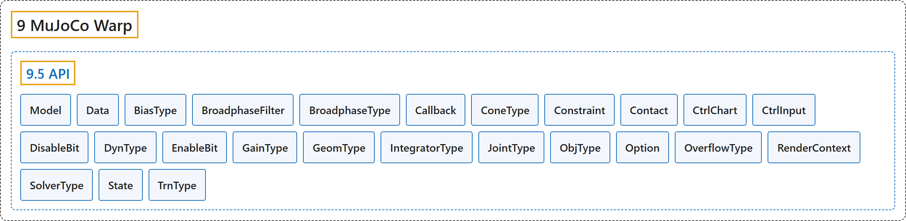

# 9.5 API

## Classification

## Glossary

| Term | Definition | 中文翻译 | Source |
|---|---|---|---|
| **9.5 API** API | (No definition) | （无定义） | [Google DeepMind, n.d., "MuJoCo Warp API"](https://mujoco.readthedocs.io/en/stable/mjwarp/api.html#module-mujoco_warp) |
| **Model** Model 模型 | "**Model definition and parameters**." | **模型的定义和参数**。 | [Google DeepMind, n.d., "MuJoCo Warp API", para. 1](https://mujoco.readthedocs.io/en/stable/mjwarp/api.html#mujoco_warp.Model) |
| **Data** Data 数据 | "**Dynamic state that updates each step**." | **每一步都会更新的动态状态**。 | [Google DeepMind, n.d., "MuJoCo Warp API", para. 1](https://mujoco.readthedocs.io/en/stable/mjwarp/api.html#mujoco_warp.Data) |
| **BiasType** BiasType 偏置类型 | "**Type of actuator bias**." | **执行器偏置的类型**。 | [Google DeepMind, n.d., "MuJoCo Warp API", para. 1](https://mujoco.readthedocs.io/en/stable/mjwarp/api.html#mujoco_warp.BiasType) |
| **BroadphaseFilter** BroadphaseFilter 粗测过滤 | "**Bitmask specifying which collision functions to run during broadphase**." | **指定粗测阶段要运行哪些碰撞函数的位掩码**。 | [Google DeepMind, n.d., "MuJoCo Warp API", para. 1](https://mujoco.readthedocs.io/en/stable/mjwarp/api.html#mujoco_warp.BroadphaseFilter) |
| **BroadphaseType** BroadphaseType 粗测类型 | "**Type of broadphase algorithm**." | **粗测算法的类型**。 | [Google DeepMind, n.d., "MuJoCo Warp API", para. 1](https://mujoco.readthedocs.io/en/stable/mjwarp/api.html#mujoco_warp.BroadphaseType) |
| **Callback** Callback 回调 | "**Callbacks for custom physics behavior**." | **用于自定义物理行为的回调**。 | [Google DeepMind, n.d., "MuJoCo Warp API", para. 1](https://mujoco.readthedocs.io/en/stable/mjwarp/api.html#mujoco_warp.Callback) |
| **ConeType** ConeType 摩擦锥类型 | "**Type of friction cone**." | **摩擦锥的类型**。 | [Google DeepMind, n.d., "MuJoCo Warp API", para. 1](https://mujoco.readthedocs.io/en/stable/mjwarp/api.html#mujoco_warp.ConeType) |
| **Constraint** Constraint 约束 | "**Constraint data**." | **约束数据**。 | [Google DeepMind, n.d., "MuJoCo Warp API", para. 1](https://mujoco.readthedocs.io/en/stable/mjwarp/api.html#mujoco_warp.Constraint) |
| **Contact** Contact 接触 | "**Contact data**." | **接触数据**。 | [Google DeepMind, n.d., "MuJoCo Warp API", para. 1](https://mujoco.readthedocs.io/en/stable/mjwarp/api.html#mujoco_warp.Contact) |
| **CtrlChart** CtrlChart 控制坐标卡 | "**Orientation chart type for SO(3) actuators**." | **SO(3) 执行器的朝向坐标卡类型**。 | [Google DeepMind, n.d., "MuJoCo Warp API", para. 1](https://mujoco.readthedocs.io/en/stable/mjwarp/api.html#mujoco_warp.CtrlChart) |
| **CtrlInput** CtrlInput 控制输入 | "**Control input signature bitflags for actuators**." | **执行器的控制输入签名位标志**。 | [Google DeepMind, n.d., "MuJoCo Warp API", para. 1](https://mujoco.readthedocs.io/en/stable/mjwarp/api.html#mujoco_warp.CtrlInput) |
| **DisableBit** DisableBit 禁用位 | "**Disable default feature bitflags**." | **禁用默认功能的位标志**。 | [Google DeepMind, n.d., "MuJoCo Warp API", para. 1](https://mujoco.readthedocs.io/en/stable/mjwarp/api.html#mujoco_warp.DisableBit) |
| **DynType** DynType 动力学类型 | "**Type of actuator dynamics**." | **执行器动力学的类型**。 | [Google DeepMind, n.d., "MuJoCo Warp API", para. 1](https://mujoco.readthedocs.io/en/stable/mjwarp/api.html#mujoco_warp.DynType) |
| **EnableBit** EnableBit 启用位 | "**Enable optional feature bitflags**." | **启用可选功能的位标志**。 | [Google DeepMind, n.d., "MuJoCo Warp API", para. 1](https://mujoco.readthedocs.io/en/stable/mjwarp/api.html#mujoco_warp.EnableBit) |
| **GainType** GainType 增益类型 | "**Type of actuator gain**." | **执行器增益的类型**。 | [Google DeepMind, n.d., "MuJoCo Warp API", para. 1](https://mujoco.readthedocs.io/en/stable/mjwarp/api.html#mujoco_warp.GainType) |
| **GeomType** GeomType 几何类型 | "**Type of geometry**." | **几何体的类型**。 | [Google DeepMind, n.d., "MuJoCo Warp API", para. 1](https://mujoco.readthedocs.io/en/stable/mjwarp/api.html#mujoco_warp.GeomType) |
| **IntegratorType** IntegratorType 积分器类型 | "**Integrator mode**." | **积分器模式**。 | [Google DeepMind, n.d., "MuJoCo Warp API", para. 1](https://mujoco.readthedocs.io/en/stable/mjwarp/api.html#mujoco_warp.IntegratorType) |
| **JointType** JointType 关节类型 | "**Type of degree of freedom**." | **自由度的类型**。 | [Google DeepMind, n.d., "MuJoCo Warp API", para. 1](https://mujoco.readthedocs.io/en/stable/mjwarp/api.html#mujoco_warp.JointType) |
| **ObjType** ObjType 对象类型 | "**Type of object**." | **对象的类型**。 | [Google DeepMind, n.d., "MuJoCo Warp API", para. 1](https://mujoco.readthedocs.io/en/stable/mjwarp/api.html#mujoco_warp.ObjType) |
| **Option** Option 选项 | "**Physics options**." | **物理选项**。 | [Google DeepMind, n.d., "MuJoCo Warp API", para. 1](https://mujoco.readthedocs.io/en/stable/mjwarp/api.html#mujoco_warp.Option) |
| **OverflowType** OverflowType 溢出类型 | "**Bitmask for physics and collision overflows**." | **物理与碰撞溢出的位掩码**。 | [Google DeepMind, n.d., "MuJoCo Warp API", para. 1](https://mujoco.readthedocs.io/en/stable/mjwarp/api.html#mujoco_warp.OverflowType) |
| **RenderContext** RenderContext 渲染上下文 | "**Context for rendering**." | **用于渲染的上下文**。 | [Google DeepMind, n.d., "MuJoCo Warp API", para. 1](https://mujoco.readthedocs.io/en/stable/mjwarp/api.html#mujoco_warp.RenderContext) |
| **SolverType** SolverType 求解器类型 | "**Constraint solver algorithm**." | **约束求解器算法**。 | [Google DeepMind, n.d., "MuJoCo Warp API", para. 1](https://mujoco.readthedocs.io/en/stable/mjwarp/api.html#mujoco_warp.SolverType) |
| **State** State 状态 | "**State component elements as integer bitflags**." | **以整数位标志表示的状态分量元素**。 | [Google DeepMind, n.d., "MuJoCo Warp API", para. 1](https://mujoco.readthedocs.io/en/stable/mjwarp/api.html#mujoco_warp.State) |
| **TrnType** TrnType 传动类型 | "**Type of actuator transmission**." | **执行器传动的类型**。 | [Google DeepMind, n.d., "MuJoCo Warp API", para. 1](https://mujoco.readthedocs.io/en/stable/mjwarp/api.html#mujoco_warp.TrnType) |

## References

Google DeepMind. (n.d.). *MuJoCo Warp API*. MuJoCo Documentation (Version 3.17.0). Retrieved October 31, 2026, from <https://mujoco.readthedocs.io/en/stable/mjwarp/api.html>
