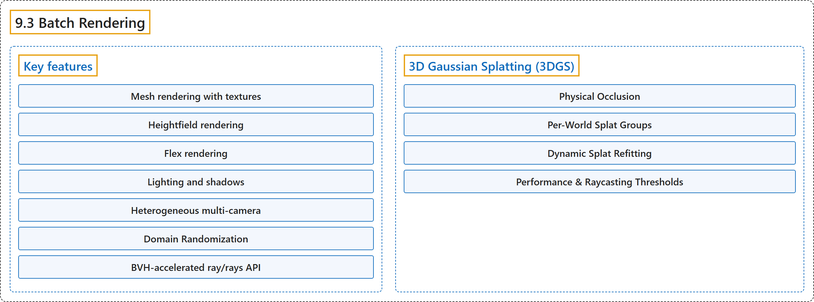

# 9.3 Batch Rendering

## Classification

## Glossary

| Term | Definition | 中文翻译 | Source |
|---|---|---|---|
| **9.3 Batch Rendering** 批量渲染 | "MJWarp provides **a batch renderer for high-throughput ray tracing** built on Warp’s accelerated BVHs for rendering worlds with multiple cameras in parallel." | MJWarp 提供**一个用于高吞吐光线追踪的批量渲染器**，它基于 Warp 加速的 BVH，可用多个相机并行渲染多个世界。 | [Google DeepMind, n.d., "Batch Rendering", para. 1](https://mujoco.readthedocs.io/en/stable/mjwarp/index.html#batch-rendering) |
| **Key features** 主要特性 | (No definition) | （无定义） | [Google DeepMind, n.d., "Batch Rendering"](https://mujoco.readthedocs.io/en/stable/mjwarp/index.html#batch-rendering) |
| **Mesh rendering with textures** 带纹理的网格渲染 | "Mesh rendering with textures: **BVH-accelerated mesh rendering with full texture support**." | 带纹理的网格渲染：**BVH 加速的网格渲染，完整支持纹理**。 | [Google DeepMind, n.d., "Batch Rendering", item 1](https://mujoco.readthedocs.io/en/stable/mjwarp/index.html#batch-rendering) |
| **Heightfield rendering** 高度场渲染 | "Heightfield rendering: **Optimized rendering for heightfields**." | 高度场渲染：**针对高度场优化的渲染**。 | [Google DeepMind, n.d., "Batch Rendering", item 2](https://mujoco.readthedocs.io/en/stable/mjwarp/index.html#batch-rendering) |
| **Flex rendering** 柔性体渲染 | "Flex rendering: **Render flex objects**." | 柔性体渲染：**渲染柔性体对象**。 | [Google DeepMind, n.d., "Batch Rendering", item 3](https://mujoco.readthedocs.io/en/stable/mjwarp/index.html#batch-rendering) |
| **Lighting and shadows** 光照与阴影 | "Lighting and shadows: **Dynamic lighting with configurable shadows**; domain randomizable: light_active, light_type, light_castshadow, light_xpos, light_xdir." | 光照与阴影：**可配置阴影的动态光照**；可做域随机化：light_active、light_type、light_castshadow、light_xpos、light_xdir。 | [Google DeepMind, n.d., "Batch Rendering", item 5](https://mujoco.readthedocs.io/en/stable/mjwarp/index.html#batch-rendering) |
| **Heterogeneous multi-camera** 异构多相机 | "Heterogeneous multi-camera: **Multiple cameras per world and each camera can have a different resolution (cam_resolution), field of view (cam_fovy, cam_sensorsize, cam_intrinsic), and output mode (cam_output)**." | 异构多相机：**每个世界有多个相机，每个相机可以有不同的分辨率（cam_resolution）、视场（cam_fovy、cam_sensorsize、cam_intrinsic）和输出模式（cam_output）**。 | [Google DeepMind, n.d., "Batch Rendering", item 6](https://mujoco.readthedocs.io/en/stable/mjwarp/index.html#batch-rendering) |
| **Domain Randomization** 域随机化 | "Domain Randomization: **Per-world mjw.Model fields** (see Batched Model Fields above): geom_matid, geom_size, geom_rgba, mat_texid, mat_texrepeat, mat_rgba." | 域随机化：**按世界区分的 mjw.Model 字段**（见上文的批量模型字段）：geom_matid、geom_size、geom_rgba、mat_texid、mat_texrepeat、mat_rgba。 | [Google DeepMind, n.d., "Batch Rendering", item 7](https://mujoco.readthedocs.io/en/stable/mjwarp/index.html#batch-rendering) |
| **BVH-accelerated ray/rays API** BVH 加速的 ray/rays API | "BVH-accelerated ray/rays API: Ray casting: **Accelerated mjw.ray, mjw.rays, and rangefinder sensors via Warp’s BVHs**." | BVH 加速的 ray/rays API：光线投射：**借助 Warp 的 BVH 加速 mjw.ray、mjw.rays 和测距传感器**。 | [Google DeepMind, n.d., "Batch Rendering", item 8](https://mujoco.readthedocs.io/en/stable/mjwarp/index.html#batch-rendering) |
| **3D Gaussian Splatting (3DGS)** 三维高斯泼溅（3DGS） | "MJWarp supports rendering **3D Gaussian Splatting (3DGS) scenes composited with simulated physical MuJoCo objects**." | MJWarp 支持渲染**与仿真的 MuJoCo 物理对象合成在一起的三维高斯泼溅（3DGS）场景**。 | [Google DeepMind, n.d., "3D Gaussian Splatting (3DGS)", para. 1](https://mujoco.readthedocs.io/en/stable/mjwarp/index.html#d-gaussian-splatting-3dgs) |
| **Physical Occlusion** 物理遮挡 | "If a camera ray hits a physical body (such as a mesh, primitive, or flex), **splats located behind the hit distance (dist) are occluded by the physical object**, while splats in front of the hit distance are blended over the physical object’s surface color." | 如果相机光线击中一个物理刚体（如网格、基本几何体或柔性体），**位于击中距离（dist）之后的泼溅点会被该物理对象遮挡**，而位于击中距离之前的泼溅点会混合到该物理对象的表面颜色之上。 | [Google DeepMind, n.d., "Physical Occlusion", para. 1](https://mujoco.readthedocs.io/en/stable/mjwarp/index.html#physical-occlusion) |
| **Per-World Splat Groups** 按世界区分的泼溅组 | "Similar to per-world meshes, **MJWarp supports heterogeneous per-world 3DGS scenes**." | 与按世界区分的网格类似，**MJWarp 支持异构的、按世界区分的 3DGS 场景**。 | [Google DeepMind, n.d., "Per-World Splat Groups", para. 1](https://mujoco.readthedocs.io/en/stable/mjwarp/index.html#per-world-splat-groups) |
| **Dynamic Splat Refitting** 动态泼溅重拟合 | (context) "If splat positions, rotations, or scales change dynamically during simulation (e.g., splats attached to moving rigid bodies), **call mjw.refit_splat_bvh before rendering**:" | （语境）如果泼溅点的位置、旋转或尺度在仿真中动态变化（例如附着在运动刚体上的泼溅点），**应在渲染前调用 mjw.refit_splat_bvh**： | [Google DeepMind, n.d., "Dynamic Splat Refitting", para. 1](https://mujoco.readthedocs.io/en/stable/mjwarp/index.html#dynamic-splat-refitting) |
| **Performance & Raycasting Thresholds** 性能与光线投射阈值 | (No definition) | （无定义） | [Google DeepMind, n.d., "Performance & Raycasting Thresholds"](https://mujoco.readthedocs.io/en/stable/mjwarp/index.html#performance-raycasting-thresholds) |
| **BVH Response Cutoff** BVH 响应截断 | "BVH Response Cutoff: **Splat bounding boxes are sized to contain density responses down to SPLAT_MIN_RESPONSE = 0.01**." | BVH 响应截断：**泼溅点包围盒的大小足以包含低至 SPLAT_MIN_RESPONSE = 0.01 的密度响应**。 | [Google DeepMind, n.d., "Performance & Raycasting Thresholds", item 1](https://mujoco.readthedocs.io/en/stable/mjwarp/index.html#performance-raycasting-thresholds) |
| **Bounded Compositing** 有界合成 | "Bounded Compositing: **Raycasting accumulates up to the first _MAX_SPLAT_HITS = 32 BVH intersections per ray ordered by depth**." | 有界合成：**光线投射对每条光线最多累积按深度排序的前 _MAX_SPLAT_HITS = 32 个 BVH 交点**。 | [Google DeepMind, n.d., "Performance & Raycasting Thresholds", item 2](https://mujoco.readthedocs.io/en/stable/mjwarp/index.html#performance-raycasting-thresholds) |
| **Early Termination** 提前终止 | "Early Termination: **Compositing stops early once remaining ray transmittance drops below 0.005 or individual splat alpha is below 8-bit quantization (1 / 255)**." | 提前终止：**一旦剩余的光线透射率降到 0.005 以下，或单个泼溅点的 alpha 低于 8 位量化精度（1 / 255），合成就提前停止**。 | [Google DeepMind, n.d., "Performance & Raycasting Thresholds", item 3](https://mujoco.readthedocs.io/en/stable/mjwarp/index.html#performance-raycasting-thresholds) |

## References

Google DeepMind. (n.d.). *MuJoCo Warp (MJWarp)*. MuJoCo Documentation (Version 3.17.0). Retrieved October 31, 2026, from <https://mujoco.readthedocs.io/en/stable/mjwarp/index.html>
