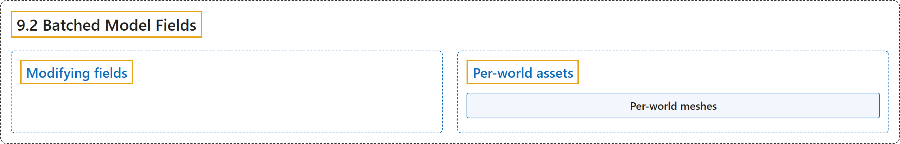

# 9.2 Batched Model Fields

## Classification

## Glossary

| Term | Definition | 中文翻译 | Source |
|---|---|---|---|
| **9.2 Batched Model Fields** 批量模型字段 | (context) "To enable batched simulation with different model parameter values, **many mjw.Model fields have a leading batch dimension**." | （语境）为了支持用不同模型参数值进行批量仿真，**许多 mjw.Model 字段带有一个前置的批量维度**。 | [Google DeepMind, n.d., "Batched Model Fields", para. 1](https://mujoco.readthedocs.io/en/stable/mjwarp/index.html#batched-model-fields) |
| **Modifying fields** 修改字段 | "The recommended workflow for modifying an mjModel field is to **first modify the corresponding mjSpec and then compile to create a new mjModel with the updated field**." | 修改 mjModel 字段的推荐流程是**先修改对应的 mjSpec，再编译生成带有更新字段的新 mjModel**。 | [Google DeepMind, n.d., "Modifying fields", para. 1](https://mujoco.readthedocs.io/en/stable/mjwarp/index.html#modifying-fields) |
| **Per-world assets** 按世界区分的资源 | "Per-world assets **enable heterogeneous worlds where different worlds simulate different assets including meshes, height fields, materials, and textures**." | 按世界区分的资源**支持异构世界，即不同世界仿真不同的资源，包括网格、高度场、材质和纹理**。 | [Google DeepMind, n.d., "Per-world assets", para. 1](https://mujoco.readthedocs.io/en/stable/mjwarp/index.html#per-world-assets) |
| **Per-world meshes** 按世界区分的网格 | (No definition) | （无定义） | [Google DeepMind, n.d., "Per-world assets"](https://mujoco.readthedocs.io/en/stable/mjwarp/index.html#per-world-assets) |
| **Batched fields** 批量字段 | "Batched fields — **fields that must be overridden for per-world meshes**:" | 批量字段：**为按世界区分的网格而必须覆盖的字段**： | [Google DeepMind, n.d., "Per-world assets", para. 6](https://mujoco.readthedocs.io/en/stable/mjwarp/index.html#per-world-assets) |

## References

Google DeepMind. (n.d.). *MuJoCo Warp (MJWarp)*. MuJoCo Documentation (Version 3.17.0). Retrieved October 31, 2026, from <https://mujoco.readthedocs.io/en/stable/mjwarp/index.html>
