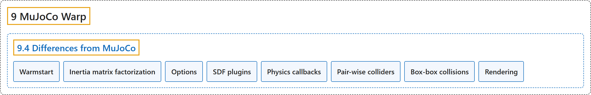

# 9.4 Differences from MuJoCo

## Classification

## Glossary

| Term | Definition | 中文翻译 | Source |
|---|---|---|---|
| **9.4 Differences from MuJoCo** 与 MuJoCo 的差异 | (No definition) | （无定义） | [Google DeepMind, n.d., "Differences from MuJoCo"](https://mujoco.readthedocs.io/en/stable/mjwarp/index.html#differences-from-mujoco) |
| **Warmstart** 热启动 | (context) "If warmstarts are not disabled, **the MJWarp solver warmstart always initializes the acceleration with qacc_warmstart**." | （语境）如果没有禁用热启动，**MJWarp 求解器的热启动总是用 qacc_warmstart 初始化加速度**。 | [Google DeepMind, n.d., "Warmstart", para. 1](https://mujoco.readthedocs.io/en/stable/mjwarp/index.html#warmstart) |
| **Inertia matrix factorization** 惯性矩阵分解 | "MJWarp performs **a per-tree factorization of the inertia matrix that is stored in qLD** where the size of the tree determines if Warp’s U'U Cholesky factorization wp.tile_cholesky, MuJoCo’s sparse reverse-mode L'DL routine, or a simple diagonal inverse routine is employed." | MJWarp 对惯性矩阵进行**按树的分解，结果存放在 qLD 中**，由树的大小决定采用 Warp 的 U'U Cholesky 分解 wp.tile_cholesky、MuJoCo 的稀疏反向 L'DL 例程，还是简单的对角求逆例程。 | [Google DeepMind, n.d., "Inertia matrix factorization", para. 1](https://mujoco.readthedocs.io/en/stable/mjwarp/index.html#inertia-matrix-factorization) |
| **Options** 选项 | (context) "mjw.Option fields **correspond to their mjOption counterparts** with the following exceptions:" | （语境）mjw.Option 的字段**与 mjOption 中的对应字段一一对应**，但有以下例外： | [Google DeepMind, n.d., "Options", para. 1](https://mujoco.readthedocs.io/en/stable/mjwarp/index.html#options) |
| **SDF plugins** SDF 插件 | (context) "**SDF collisions support plugins**." | （语境）**SDF 碰撞支持插件**。 | [Google DeepMind, n.d., "SDF plugins", para. 1](https://mujoco.readthedocs.io/en/stable/mjwarp/index.html#sdf-plugins) |
| **Physics callbacks** 物理回调 | (context) "MJWarp supports a similar mechanism, but **callbacks are Python functions set per-model on the mjw.Model instance via Model.callback** rather than as global function pointers." | （语境）MJWarp 支持类似的机制，但**回调是通过 Model.callback 按模型设置在 mjw.Model 实例上的 Python 函数**，而不是全局函数指针。 | [Google DeepMind, n.d., "Physics callbacks", para. 1](https://mujoco.readthedocs.io/en/stable/mjwarp/index.html#physics-callbacks) |
| **Pair-wise colliders** 成对碰撞器 | (context) "The table below provides **information about the colliders and maximum number of contacts generated for different geom pairs in MJWarp**." | （语境）下表给出了 **MJWarp 中不同 geom 对所用的碰撞器以及生成的最大接触数**。 | [Google DeepMind, n.d., "Pair-wise colliders", para. 1](https://mujoco.readthedocs.io/en/stable/mjwarp/index.html#pair-wise-colliders) |
| **Box-box collisions** 盒盒碰撞 | (context) "By default, **box-box collisions use the general-purpose convex collision pipeline (GJK/EPA)**." | （语境）默认情况下，**盒与盒的碰撞使用通用的凸碰撞流水线（GJK/EPA）**。 | [Google DeepMind, n.d., "Box-box collisions", para. 1](https://mujoco.readthedocs.io/en/stable/mjwarp/index.html#box-box-collisions) |
| **Rendering** 渲染 | (context) "The MJWarp batch renderer is **a single hit raycaster optimized for high throughput and low fidelity**." | （语境）MJWarp 批量渲染器是**一个针对高吞吐、低保真优化的单次命中光线投射器**。 | [Google DeepMind, n.d., "Rendering", para. 1](https://mujoco.readthedocs.io/en/stable/mjwarp/index.html#rendering) |

## References

Google DeepMind. (n.d.). *MuJoCo Warp (MJWarp)*. MuJoCo Documentation (Version 3.17.0). Retrieved October 31, 2026, from <https://mujoco.readthedocs.io/en/stable/mjwarp/index.html>
