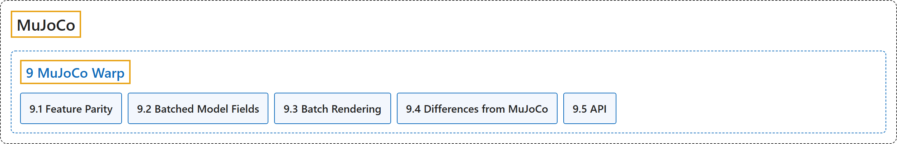

# 9. MuJoCo Warp

## Classification

## Glossary

| Term | Definition | 中文翻译 | Source |
|---|---|---|---|
| **9 MuJoCo Warp** MuJoCo Warp | "MuJoCo Warp (MJWarp) is **an implementation of MuJoCo written in Warp and optimized for NVIDIA hardware and parallel simulation**." | MuJoCo Warp（MJWarp）是**用 Warp 编写、针对 NVIDIA 硬件和并行仿真优化的 MuJoCo 实现**。 | [Google DeepMind, n.d.-a, "MuJoCo Warp (MJWarp)", para. 1](https://mujoco.readthedocs.io/en/stable/mjwarp/index.html#mujoco-warp-mjwarp) |
| **[9.1 Feature Parity](feature-parity.md)** 功能对等 | (context) "MJWarp supports **most of the main simulation features of MuJoCo, with a few exceptions**." | （语境）MJWarp 支持 **MuJoCo 的大部分主要仿真功能，只有少数例外**。 | [Google DeepMind, n.d.-a, "Feature Parity", para. 1](https://mujoco.readthedocs.io/en/stable/mjwarp/index.html#feature-parity) |
| **[9.2 Batched Model Fields](batched-model-fields.md)** 批量模型字段 | (context) "To enable batched simulation with different model parameter values, **many mjw.Model fields have a leading batch dimension**." | （语境）为了支持用不同模型参数值进行批量仿真，**许多 mjw.Model 字段带有一个前置的批量维度**。 | [Google DeepMind, n.d.-a, "Batched Model Fields", para. 1](https://mujoco.readthedocs.io/en/stable/mjwarp/index.html#batched-model-fields) |
| **[9.3 Batch Rendering](batch-rendering.md)** 批量渲染 | "MJWarp provides **a batch renderer for high-throughput ray tracing** built on Warp’s accelerated BVHs for rendering worlds with multiple cameras in parallel." | MJWarp 提供**一个用于高吞吐光线追踪的批量渲染器**，它基于 Warp 加速的 BVH，可用多个相机并行渲染多个世界。 | [Google DeepMind, n.d.-a, "Batch Rendering", para. 1](https://mujoco.readthedocs.io/en/stable/mjwarp/index.html#batch-rendering) |
| **[9.4 Differences from MuJoCo](differences-from-mujoco.md)** 与 MuJoCo 的差异 | (No definition) | （无定义） | [Google DeepMind, n.d.-a, "Differences from MuJoCo"](https://mujoco.readthedocs.io/en/stable/mjwarp/index.html#differences-from-mujoco) |
| **[9.5 API](api.md)** API | (No definition) | （无定义） | [Google DeepMind, n.d.-b, "MuJoCo Warp API"](https://mujoco.readthedocs.io/en/stable/mjwarp/api.html#module-mujoco_warp) |

## References

Google DeepMind. (n.d.-a). *MuJoCo Warp (MJWarp)*. MuJoCo Documentation (Version 3.17.0). Retrieved October 31, 2026, from <https://mujoco.readthedocs.io/en/stable/mjwarp/index.html>

Google DeepMind. (n.d.-b). *MuJoCo Warp API*. MuJoCo Documentation (Version 3.17.0). Retrieved October 31, 2026, from <https://mujoco.readthedocs.io/en/stable/mjwarp/api.html>
