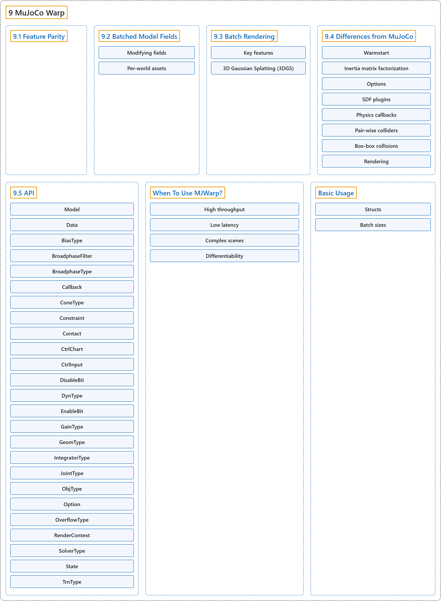

# 9. MuJoCo Warp

## Classification

## Glossary

| Term | Definition | 中文翻译 | Source |
|---|---|---|---|
| **9 MuJoCo Warp** MuJoCo Warp | "MuJoCo Warp (MJWarp) is **an implementation of MuJoCo written in Warp and optimized for NVIDIA hardware and parallel simulation**." | MuJoCo Warp（MJWarp）是**用 Warp 编写、针对 NVIDIA 硬件和并行仿真优化的 MuJoCo 实现**。 | [Google DeepMind, n.d.-a, "MuJoCo Warp (MJWarp)", para. 1](https://mujoco.readthedocs.io/en/stable/mjwarp/index.html#mujoco-warp-mjwarp) |
| **[9.1 Feature Parity](feature-parity.md)** 功能对等 | (context) "MJWarp supports **most of the main simulation features of MuJoCo, with a few exceptions**." | （语境）MJWarp 支持 **MuJoCo 的大部分主要仿真功能，只有少数例外**。 | [Google DeepMind, n.d.-a, "Feature Parity", para. 1](https://mujoco.readthedocs.io/en/stable/mjwarp/index.html#feature-parity) |
| **[9.2 Batched Model Fields](batched-model-fields.md)** 批量模型字段 | (context) "To enable batched simulation with different model parameter values, **many mjw.Model fields have a leading batch dimension**." | （语境）为了支持用不同模型参数值进行批量仿真，**许多 mjw.Model 字段带有一个前置的批量维度**。 | [Google DeepMind, n.d.-a, "Batched Model Fields", para. 1](https://mujoco.readthedocs.io/en/stable/mjwarp/index.html#batched-model-fields) |
| **[9.3 Batch Rendering](batch-rendering.md)** 批量渲染 | "MJWarp provides **a batch renderer for high-throughput ray tracing** built on Warp’s accelerated BVHs for rendering worlds with multiple cameras in parallel." | MJWarp 提供**一个用于高吞吐光线追踪的批量渲染器**，它基于 Warp 加速的 BVH，可用多个相机并行渲染多个世界。 | [Google DeepMind, n.d.-a, "Batch Rendering", para. 1](https://mujoco.readthedocs.io/en/stable/mjwarp/index.html#batch-rendering) |
| **[9.4 Differences from MuJoCo](differences-from-mujoco.md)** 与 MuJoCo 的差异 | (No definition) | （无定义） | [Google DeepMind, n.d.-a, "Differences from MuJoCo"](https://mujoco.readthedocs.io/en/stable/mjwarp/index.html#differences-from-mujoco) |
| **[9.5 API](api.md)** API | (No definition) | （无定义） | [Google DeepMind, n.d.-b, "MuJoCo Warp API"](https://mujoco.readthedocs.io/en/stable/mjwarp/api.html#module-mujoco_warp) |
| **When To Use MJWarp?** 何时使用 MJWarp | (No definition) | （无定义） | [Google DeepMind, n.d.-a, "When To Use MJWarp?"](https://mujoco.readthedocs.io/en/stable/mjwarp/index.html#when-to-use-mjwarp) |
| **High throughput** 高吞吐 | (context) "The MuJoCo ecosystem offers **multiple options for batched simulation**." | （语境）MuJoCo 生态提供了**多种批量仿真的选择**。 | [Google DeepMind, n.d.-a, "High throughput", para. 1](https://mujoco.readthedocs.io/en/stable/mjwarp/index.html#high-throughput) |
| **Low latency** 低延迟 | "MJWarp is optimized for throughput: the total number of simulation steps per unit time whereas **MuJoCo is optimized for latency: time for one simulation step**." | MJWarp 针对吞吐量（单位时间内的仿真步总数）优化，而 **MuJoCo 针对延迟（完成一个仿真步的时间）优化**。 | [Google DeepMind, n.d.-a, "Low latency", para. 1](https://mujoco.readthedocs.io/en/stable/mjwarp/index.html#low-latency) |
| **Complex scenes** 复杂场景 | (context) "**MJWarp scales better than MJX for scenes with many geoms or degrees of freedom**, but not as well as MuJoCo for single large kinematic trees." | （语境）**对于有许多 geom 或自由度的场景，MJWarp 的扩展性优于 MJX**，但对于单个大型运动学树，不如 MuJoCo。 | [Google DeepMind, n.d.-a, "Complex scenes", para. 1](https://mujoco.readthedocs.io/en/stable/mjwarp/index.html#complex-scenes) |
| **Differentiability** 可微性 | (context) "**The dynamics API in MJX is automatically differentiable via JAX**." | （语境）**MJX 中的动力学 API 可通过 JAX 自动求导**。 | [Google DeepMind, n.d.-a, "Differentiability", para. 1](https://mujoco.readthedocs.io/en/stable/mjwarp/index.html#differentiability) |
| **Basic Usage** 基本用法 | (context) "Structs, functions, and enums are **available directly from the top-level mjw module**." | （语境）结构体、函数和枚举**可直接从顶层 mjw 模块获取**。 | [Google DeepMind, n.d.-a, "Basic Usage", para. 1](https://mujoco.readthedocs.io/en/stable/mjwarp/index.html#basic-usage) |
| **Structs** 结构体 | (context) "Before running MJWarp functions on an NVIDIA GPU, **structs must be copied onto the device** via mjw.put_model and mjw.make_data or mjw.put_data functions." | （语境）在 NVIDIA GPU 上运行 MJWarp 函数之前，**必须把结构体复制到设备上**，方法是使用 mjw.put_model 和 mjw.make_data 或 mjw.put_data 函数。 | [Google DeepMind, n.d.-a, "Structs", para. 1](https://mujoco.readthedocs.io/en/stable/mjwarp/index.html#structs) |
| **Batch sizes** 批量大小 | (context) "**A batch of simulations can be specified with three parameters**:" | （语境）**一批仿真可以用三个参数来指定**： | [Google DeepMind, n.d.-a, "Batch sizes", para. 1](https://mujoco.readthedocs.io/en/stable/mjwarp/index.html#batch-sizes) |

## References

Google DeepMind. (n.d.-a). *MuJoCo Warp (MJWarp)*. MuJoCo Documentation (Version 3.17.0). Retrieved October 31, 2026, from <https://mujoco.readthedocs.io/en/stable/mjwarp/index.html>

Google DeepMind. (n.d.-b). *MuJoCo Warp API*. MuJoCo Documentation (Version 3.17.0). Retrieved October 31, 2026, from <https://mujoco.readthedocs.io/en/stable/mjwarp/api.html>
