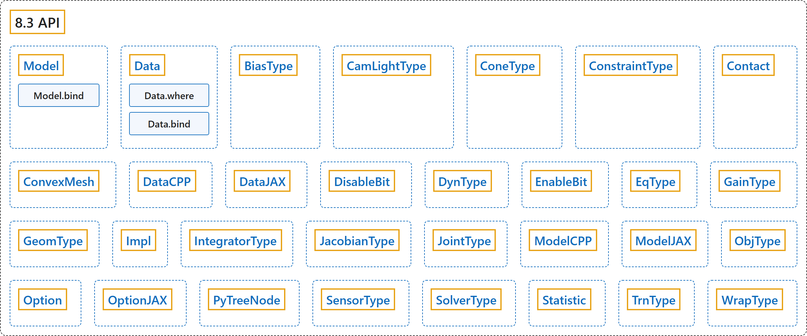

# 8.3 API

## Classification

## Glossary

| Term | Definition | 中文翻译 | Source |
|---|---|---|---|
| **8.3 API** API | (No definition) | （无定义） | [Google DeepMind, n.d., "MJX API"](https://mujoco.readthedocs.io/en/stable/mjx_api.html#module-mujoco.mjx) |
| **Model** Model 模型 | "**Static model of the scene that remains unchanged with each physics step**." | **场景的静态模型，在每个物理步中保持不变**。 | [Google DeepMind, n.d., "MJX API", para. 1](https://mujoco.readthedocs.io/en/stable/mjx_api.html#mujoco.mjx.Model) |
| **Model.bind** bind 方法 | "**Bind a Mujoco spec to an MJX Model**." | **把 MuJoCo spec 绑定到 MJX Model**。 | [Google DeepMind, n.d., "MJX API", para. 1](https://mujoco.readthedocs.io/en/stable/mjx_api.html#mujoco.mjx.Model.bind) |
| **Data** Data 数据 | "**Dynamic state that updates each step**." | **每一步都会更新的动态状态**。 | [Google DeepMind, n.d., "MJX API", para. 1](https://mujoco.readthedocs.io/en/stable/mjx_api.html#mujoco.mjx.Data) |
| **Data.where** where 方法 | "**Selectively merge self and other based on done**." | **根据 done 有选择地合并 self 和 other**。 | [Google DeepMind, n.d., "MJX API", para. 1](https://mujoco.readthedocs.io/en/stable/mjx_api.html#mujoco.mjx.Data.where) |
| **Data.bind** bind 方法 | "**Bind a Mujoco spec to an MJX Data**." | **把 MuJoCo spec 绑定到 MJX Data**。 | [Google DeepMind, n.d., "MJX API", para. 1](https://mujoco.readthedocs.io/en/stable/mjx_api.html#mujoco.mjx.Data.bind) |
| **BiasType** BiasType 偏置类型 | "**Type of actuator bias**." | **执行器偏置的类型**。 | [Google DeepMind, n.d., "MJX API", para. 1](https://mujoco.readthedocs.io/en/stable/mjx_api.html#mujoco.mjx.BiasType) |
| **CamLightType** CamLightType 相机光源类型 | "**Type of camera light**." | **相机光源的类型**。 | [Google DeepMind, n.d., "MJX API", para. 1](https://mujoco.readthedocs.io/en/stable/mjx_api.html#mujoco.mjx.CamLightType) |
| **ConeType** ConeType 摩擦锥类型 | "**Type of friction cone**." | **摩擦锥的类型**。 | [Google DeepMind, n.d., "MJX API", para. 1](https://mujoco.readthedocs.io/en/stable/mjx_api.html#mujoco.mjx.ConeType) |
| **ConstraintType** ConstraintType 约束类型 | "**Type of constraint**." | **约束的类型**。 | [Google DeepMind, n.d., "MJX API", para. 1](https://mujoco.readthedocs.io/en/stable/mjx_api.html#mujoco.mjx.ConstraintType) |
| **Contact** Contact 接触 | "**Result of collision detection functions**." | **碰撞检测函数的结果**。 | [Google DeepMind, n.d., "MJX API", para. 1](https://mujoco.readthedocs.io/en/stable/mjx_api.html#mujoco.mjx.Contact) |
| **ConvexMesh** ConvexMesh 凸网格 | "**Geom properties for convex meshes**." | **凸网格的 geom 属性**。 | [Google DeepMind, n.d., "MJX API", para. 1](https://mujoco.readthedocs.io/en/stable/mjx_api.html#mujoco.mjx.ConvexMesh) |
| **DataCPP** DataCPP C++ 数据 | "**Minimal Data implementation holding only the pointer**." | **只保存指针的最小 Data 实现**。 | [Google DeepMind, n.d., "MJX API", para. 1](https://mujoco.readthedocs.io/en/stable/mjx_api.html#mujoco.mjx.DataCPP) |
| **DataJAX** DataJAX JAX 数据 | "**JAX-specific data**." | **JAX 专用的数据**。 | [Google DeepMind, n.d., "MJX API", para. 1](https://mujoco.readthedocs.io/en/stable/mjx_api.html#mujoco.mjx.DataJAX) |
| **DisableBit** DisableBit 禁用位 | "**Disable default feature bitflags**." | **禁用默认功能的位标志**。 | [Google DeepMind, n.d., "MJX API", para. 1](https://mujoco.readthedocs.io/en/stable/mjx_api.html#mujoco.mjx.DisableBit) |
| **DynType** DynType 动力学类型 | "**Type of actuator dynamics**." | **执行器动力学的类型**。 | [Google DeepMind, n.d., "MJX API", para. 1](https://mujoco.readthedocs.io/en/stable/mjx_api.html#mujoco.mjx.DynType) |
| **EnableBit** EnableBit 启用位 | "**Enable optional feature bitflags**." | **启用可选功能的位标志**。 | [Google DeepMind, n.d., "MJX API", para. 1](https://mujoco.readthedocs.io/en/stable/mjx_api.html#mujoco.mjx.EnableBit) |
| **EqType** EqType 等式类型 | "**Type of equality constraint**." | **等式约束的类型**。 | [Google DeepMind, n.d., "MJX API", para. 1](https://mujoco.readthedocs.io/en/stable/mjx_api.html#mujoco.mjx.EqType) |
| **GainType** GainType 增益类型 | "**Type of actuator gain**." | **执行器增益的类型**。 | [Google DeepMind, n.d., "MJX API", para. 1](https://mujoco.readthedocs.io/en/stable/mjx_api.html#mujoco.mjx.GainType) |
| **GeomType** GeomType 几何类型 | "**Type of geometry**." | **几何体的类型**。 | [Google DeepMind, n.d., "MJX API", para. 1](https://mujoco.readthedocs.io/en/stable/mjx_api.html#mujoco.mjx.GeomType) |
| **Impl** Impl 实现 | "**Implementation to use**." | **要使用的实现**。 | [Google DeepMind, n.d., "MJX API", para. 1](https://mujoco.readthedocs.io/en/stable/mjx_api.html#mujoco.mjx.Impl) |
| **IntegratorType** IntegratorType 积分器类型 | "**Integrator mode**." | **积分器模式**。 | [Google DeepMind, n.d., "MJX API", para. 1](https://mujoco.readthedocs.io/en/stable/mjx_api.html#mujoco.mjx.IntegratorType) |
| **JacobianType** JacobianType 雅可比类型 | "**Type of constraint Jacobian**." | **约束雅可比矩阵的类型**。 | [Google DeepMind, n.d., "MJX API", para. 1](https://mujoco.readthedocs.io/en/stable/mjx_api.html#mujoco.mjx.JacobianType) |
| **JointType** JointType 关节类型 | "**Type of degree of freedom**." | **自由度的类型**。 | [Google DeepMind, n.d., "MJX API", para. 1](https://mujoco.readthedocs.io/en/stable/mjx_api.html#mujoco.mjx.JointType) |
| **ModelCPP** ModelCPP C++ 模型 | "**Minimal Model implementation holding only the pointer**." | **只保存指针的最小 Model 实现**。 | [Google DeepMind, n.d., "MJX API", para. 1](https://mujoco.readthedocs.io/en/stable/mjx_api.html#mujoco.mjx.ModelCPP) |
| **ModelJAX** ModelJAX JAX 模型 | "**JAX-specific model data**." | **JAX 专用的模型数据**。 | [Google DeepMind, n.d., "MJX API", para. 1](https://mujoco.readthedocs.io/en/stable/mjx_api.html#mujoco.mjx.ModelJAX) |
| **ObjType** ObjType 对象类型 | "**Type of object**." | **对象的类型**。 | [Google DeepMind, n.d., "MJX API", para. 1](https://mujoco.readthedocs.io/en/stable/mjx_api.html#mujoco.mjx.ObjType) |
| **Option** Option 选项 | "**Physics options**." | **物理选项**。 | [Google DeepMind, n.d., "MJX API", para. 1](https://mujoco.readthedocs.io/en/stable/mjx_api.html#mujoco.mjx.Option) |
| **OptionJAX** OptionJAX JAX 选项 | "**JAX-specific option**." | **JAX 专用的选项**。 | [Google DeepMind, n.d., "MJX API", para. 1](https://mujoco.readthedocs.io/en/stable/mjx_api.html#mujoco.mjx.OptionJAX) |
| **PyTreeNode** PyTreeNode pytree 节点 | "**Base class for dataclasses that should act like a JAX pytree node**." | **让数据类表现得像 JAX pytree 节点的基类**。 | [Google DeepMind, n.d., "MJX API", para. 1](https://mujoco.readthedocs.io/en/stable/mjx_api.html#mujoco.mjx.PyTreeNode) |
| **SensorType** SensorType 传感器类型 | "**Type of sensor**." | **传感器的类型**。 | [Google DeepMind, n.d., "MJX API", para. 1](https://mujoco.readthedocs.io/en/stable/mjx_api.html#mujoco.mjx.SensorType) |
| **SolverType** SolverType 求解器类型 | "**Constraint solver algorithm**." | **约束求解器算法**。 | [Google DeepMind, n.d., "MJX API", para. 1](https://mujoco.readthedocs.io/en/stable/mjx_api.html#mujoco.mjx.SolverType) |
| **Statistic** Statistic 统计量 | "**Model statistics (in qpos0)**." | **模型统计量（在 qpos0 处）**。 | [Google DeepMind, n.d., "MJX API", para. 1](https://mujoco.readthedocs.io/en/stable/mjx_api.html#mujoco.mjx.Statistic) |
| **TrnType** TrnType 传动类型 | "**Type of actuator transmission**." | **执行器传动的类型**。 | [Google DeepMind, n.d., "MJX API", para. 1](https://mujoco.readthedocs.io/en/stable/mjx_api.html#mujoco.mjx.TrnType) |
| **WrapType** WrapType 缠绕类型 | "**Type of tendon wrap object**." | **肌腱缠绕对象的类型**。 | [Google DeepMind, n.d., "MJX API", para. 1](https://mujoco.readthedocs.io/en/stable/mjx_api.html#mujoco.mjx.WrapType) |

## References

Google DeepMind. (n.d.). *MJX API*. MuJoCo Documentation (Version 3.17.0). Retrieved October 31, 2026, from <https://mujoco.readthedocs.io/en/stable/mjx_api.html>
