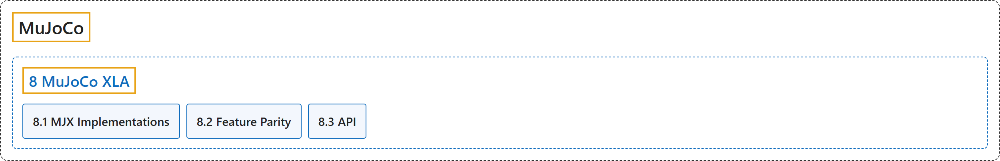

# 8. MuJoCo XLA

## Classification

## Glossary

| Term | Definition | 中文翻译 | Source |
|---|---|---|---|
| **8 MuJoCo XLA** MuJoCo XLA | "MuJoCo XLA (MJX) provides **a JAX API for various implementations of MuJoCo**." | MuJoCo XLA（MJX）提供**一个面向 MuJoCo 多种实现的 JAX API**。 | [Google DeepMind, n.d.-b, "MuJoCo XLA (MJX)", para. 1](https://mujoco.readthedocs.io/en/stable/mjx.html#mujoco-xla-mjx) |
| **[8.1 MJX Implementations](mjx-implementations.md)** MJX 实现 | "MJX currently supports **two implementations of MuJoCo: a pure JAX and a Warp implementation**." | MJX 目前支持 **MuJoCo 的两种实现：纯 JAX 实现和 Warp 实现**。 | [Google DeepMind, n.d.-b, "MJX Implementations", para. 1](https://mujoco.readthedocs.io/en/stable/mjx.html#mjx-implementations) |
| **[8.2 Feature Parity](feature-parity.md)** 功能对等 | (context) "MJX supports **most of the main simulation features of MuJoCo for execution on hardware-accelerated devices**." | （语境）MJX 支持 **MuJoCo 的大部分主要仿真功能，可在硬件加速设备上运行**。 | [Google DeepMind, n.d.-b, "Feature Parity", para. 1](https://mujoco.readthedocs.io/en/stable/mjx.html#feature-parity) |
| **[8.3 API](api.md)** API | (No definition) | （无定义） | [Google DeepMind, n.d.-a, "MJX API"](https://mujoco.readthedocs.io/en/stable/mjx_api.html#module-mujoco.mjx) |

## References

Google DeepMind. (n.d.-a). *MJX API*. MuJoCo Documentation (Version 3.17.0). Retrieved October 31, 2026, from <https://mujoco.readthedocs.io/en/stable/mjx_api.html>

Google DeepMind. (n.d.-b). *MuJoCo XLA (MJX)*. MuJoCo Documentation (Version 3.17.0). Retrieved October 31, 2026, from <https://mujoco.readthedocs.io/en/stable/mjx.html>
