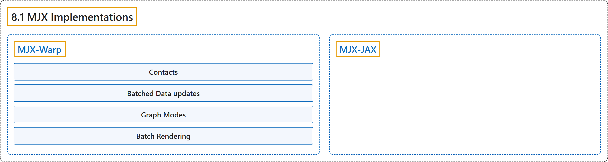

# 8.1 MJX Implementations

## Classification

## Glossary

| Term | Definition | 中文翻译 | Source |
|---|---|---|---|
| **8.1 MJX Implementations** MJX 实现 | "MJX currently supports **two implementations of MuJoCo: a pure JAX and a Warp implementation**." | MJX 目前支持 **MuJoCo 的两种实现：纯 JAX 实现和 Warp 实现**。 | [Google DeepMind, n.d., "MJX Implementations", para. 1](https://mujoco.readthedocs.io/en/stable/mjx.html#mjx-implementations) |
| **MJX-Warp** MJX-Warp | "**A Warp implementation of MuJoCo** (MJX-Warp) optimizes performance specifically for NVIDIA GPUs, resolving several performance bottlenecks exhibited in MJX-JAX." | **MuJoCo 的一个 Warp 实现**（MJX-Warp）专门针对 NVIDIA GPU 优化性能，解决了 MJX-JAX 中出现的若干性能瓶颈。 | [Google DeepMind, n.d., "MuJoCo XLA (MJX)", para. 2](https://mujoco.readthedocs.io/en/stable/mjx.html#mjx-warp) |
| **Contacts** 接触 | (context) "Since JAX and Warp diverge in their implementations of contact buffers, **contacts are located in the private mjx.Data._impl instead of mjx.Data.contact**." | （语境）由于 JAX 和 Warp 在接触缓冲区的实现上不同，**接触位于私有的 mjx.Data._impl 中，而不是 mjx.Data.contact 中**。 | [Google DeepMind, n.d., "Contacts", para. 1](https://mujoco.readthedocs.io/en/stable/mjx.html#contacts) |
| **Batched Data updates** 批量 Data 更新 | (context) "To support batched Data updates for both implementations, **MJX provides a unified where method on Data objects**:" | （语境）为了在两种实现中都支持批量 Data 更新，**MJX 在 Data 对象上提供了统一的 where 方法**： | [Google DeepMind, n.d., "Batched Data updates", para. 2](https://mujoco.readthedocs.io/en/stable/mjx.html#batched-data-updates) |
| **Graph Modes** 图模式 | (context) "The mjx.put_model function accepts a graph_mode argument to **configure the CUDA graph capture behavior**, exposed by the mjx.warp.GraphMode enum." | （语境）mjx.put_model 函数接受一个 graph_mode 参数，用于**配置 CUDA 图捕获行为**，该行为通过 mjx.warp.GraphMode 枚举公开。 | [Google DeepMind, n.d., "Graph Modes", para. 1](https://mujoco.readthedocs.io/en/stable/mjx.html#graph-modes) |
| **mjx.warp.GraphMode** GraphMode 图模式枚举 | (context) "The mjx.put_model function accepts a graph_mode argument to configure the CUDA graph capture behavior, exposed by **the mjx.warp.GraphMode enum**." | （语境）mjx.put_model 函数接受一个 graph_mode 参数，用于配置 CUDA 图捕获行为，该行为通过 **mjx.warp.GraphMode 枚举**公开。 | [Google DeepMind, n.d., "Graph Modes", para. 1](https://mujoco.readthedocs.io/en/stable/mjx.html#graph-modes) |
| **Batch Rendering** 批量渲染 | "MJX-Warp includes **a hardware-accelerated batch renderer for generating pixel observations (such as RGB and depth) across multiple parallel environments**." | MJX-Warp 包含**一个硬件加速的批量渲染器，用于在多个并行环境中生成像素观测（如 RGB 和深度）**。 | [Google DeepMind, n.d., "Batch Rendering", para. 1](https://mujoco.readthedocs.io/en/stable/mjx.html#batch-rendering) |
| **Multi-GPU with pmap** 用 pmap 实现多 GPU | (context) "To render across multiple GPUs, **create a render context per device** by passing devices to create_render_context." | （语境）要在多个 GPU 上渲染，**为每个设备创建一个渲染上下文**，方法是把 devices 传给 create_render_context。 | [Google DeepMind, n.d., "Multi-GPU with pmap", para. 1](https://mujoco.readthedocs.io/en/stable/mjx.html#multi-gpu-with-pmap) |
| **MJX-JAX** MJX-JAX | "MJX-JAX is **a re-implementation of MuJoCo that uses the same algorithms as the MuJoCo implementation**." | MJX-JAX 是 **MuJoCo 的一个重新实现，使用与 MuJoCo 实现相同的算法**。 | [Google DeepMind, n.d., "MJX-JAX", para. 1](https://mujoco.readthedocs.io/en/stable/mjx.html#mjx-jax) |

## References

Google DeepMind. (n.d.). *MuJoCo XLA (MJX)*. MuJoCo Documentation (Version 3.17.0). Retrieved October 31, 2026, from <https://mujoco.readthedocs.io/en/stable/mjx.html>
