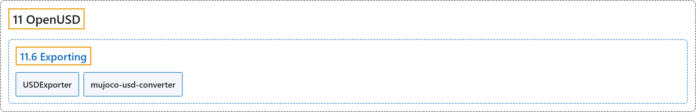

# 11.6 Exporting

## Classification

## Glossary

| Term | Definition | 中文翻译 | Source |
|---|---|---|---|
| **11.6 Exporting** 导出 | (No definition) | （无定义） | [Google DeepMind, n.d., "Exporting"](https://mujoco.readthedocs.io/en/stable/OpenUSD/exporting.html#exporting) |
| **USDExporter** USDExporter 导出器 | (context) "At the moment **the only way to export USD from MuJoCo** is to use the existing USDExporter in Python." | （语境）目前**从 MuJoCo 导出 USD 的唯一方式**是使用 Python 中现有的 USDExporter。 | [Google DeepMind, n.d., "USDExporter", para. 1](https://mujoco.readthedocs.io/en/stable/OpenUSD/exporting.html#usdexporter) |
| **mujoco-usd-converter** mujoco-usd-converter 转换器 | (context) "To convert existing MJCF assets to USD following strong authoring guidelines we recommend the **Newton mujoco-usd-converter**." | （语境）要按照严格的制作规范把现有 MJCF 资源转换为 USD，我们推荐使用 **Newton mujoco-usd-converter**。 | [Google DeepMind, n.d., "mujoco-usd-converter", para. 1](https://mujoco.readthedocs.io/en/stable/OpenUSD/exporting.html#mujoco-usd-converter) |

## References

Google DeepMind. (n.d.). *Exporting*. MuJoCo Documentation (Version 3.17.0). Retrieved October 31, 2026, from <https://mujoco.readthedocs.io/en/stable/OpenUSD/exporting.html>
