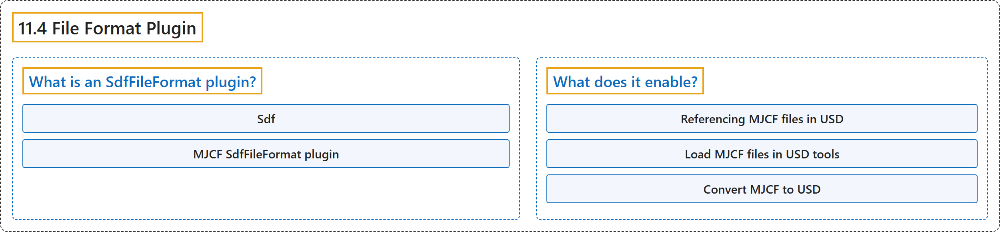

# 11.4 File Format Plugin

## Classification

## Glossary

| Term | Definition | 中文翻译 | Source |
|---|---|---|---|
| **11.4 File Format Plugin** 文件格式插件 | (context) "A SdfFileFormat plugin is **a component that teaches USD how to read and write a specific file format**." | （语境）SdfFileFormat 插件是**一个告诉 USD 如何读写某种特定文件格式的组件**。 | [Google DeepMind, n.d., "File Format Plugin", para. 1](https://mujoco.readthedocs.io/en/stable/OpenUSD/mjcf_file_format_plugin.html#file-format-plugin) |
| **What is an SdfFileFormat plugin?** 什么是 SdfFileFormat 插件 | "A SdfFileFormat plugin is **a component that teaches USD how to read and write a specific file format**." | SdfFileFormat 插件是**一个告诉 USD 如何读写某种特定文件格式的组件**。 | [Google DeepMind, n.d., "What is an SdfFileFormat plugin?", para. 1](https://mujoco.readthedocs.io/en/stable/OpenUSD/mjcf_file_format_plugin.html#what-is-an-sdffileformat-plugin) |
| **Sdf** Sdf（场景描述基础） | "In the OpenUSD framework, Sdf stands for **Scene Description Foundations**. It’s **the underlying layer that handles the serialization and composition of scene data**." | 在 OpenUSD 框架中，Sdf 代表 **Scene Description Foundations（场景描述基础）**。它是**处理场景数据序列化和组合的底层**。 | [Google DeepMind, n.d., "What is an SdfFileFormat plugin?", para. 1](https://mujoco.readthedocs.io/en/stable/OpenUSD/mjcf_file_format_plugin.html#what-is-an-sdffileformat-plugin) |
| **MJCF SdfFileFormat plugin** MJCF SdfFileFormat 插件 | "The MJCF SdfFileFormat plugin allows USD-aware applications to **directly understand and interact with MuJoCo’s native .xml (MJCF) files as if they were native USD files**." | MJCF SdfFileFormat 插件使支持 USD 的应用能够**像对待原生 USD 文件一样，直接理解并操作 MuJoCo 的原生 .xml（MJCF）文件**。 | [Google DeepMind, n.d., "What is an SdfFileFormat plugin?", para. 3](https://mujoco.readthedocs.io/en/stable/OpenUSD/mjcf_file_format_plugin.html#what-is-an-sdffileformat-plugin) |
| **What does it enable?** 它能做什么 | (context) "Essentially, it **makes MJCF a first-class citizen in the USD ecosystem**." | （语境）从本质上说，它**让 MJCF 成为 USD 生态系统中的一等公民**。 | [Google DeepMind, n.d., "What does it enable?", para. 2](https://mujoco.readthedocs.io/en/stable/OpenUSD/mjcf_file_format_plugin.html#what-does-it-enable) |
| **Referencing MJCF files in USD** 在 USD 中引用 MJCF 文件 | "Using standard USD composition arcs (like references, payloads) to **include an MJCF file directly within a larger USD scene**." | 使用标准的 USD 组合弧（如引用、负载）**把 MJCF 文件直接包含在更大的 USD 场景中**。 | [Google DeepMind, n.d., "What does it enable?", item 1](https://mujoco.readthedocs.io/en/stable/OpenUSD/mjcf_file_format_plugin.html#what-does-it-enable) |
| **Load MJCF files in USD tools** 在 USD 工具中加载 MJCF 文件 | "Tools like usdview or other USD-based applications can **open, inspect, and render MJCF files**, translating the MJCF elements into USD prims and attributes on the fly." | usdview 等工具或其他基于 USD 的应用可以**打开、检查和渲染 MJCF 文件**，并即时把 MJCF 元素转换为 USD 的 prim 和属性。 | [Google DeepMind, n.d., "What does it enable?", item 2](https://mujoco.readthedocs.io/en/stable/OpenUSD/mjcf_file_format_plugin.html#what-does-it-enable) |
| **Convert MJCF to USD** 把 MJCF 转换为 USD | "The plugin can be used as **a basis for converting MJCF files to persistent USD files** (e.g., .usda or .usdc)." | 该插件可以用作**把 MJCF 文件转换为持久 USD 文件的基础**（例如 .usda 或 .usdc）。 | [Google DeepMind, n.d., "What does it enable?", item 3](https://mujoco.readthedocs.io/en/stable/OpenUSD/mjcf_file_format_plugin.html#what-does-it-enable) |

## References

Google DeepMind. (n.d.). *File Format Plugin*. MuJoCo Documentation (Version 3.17.0). Retrieved October 31, 2026, from <https://mujoco.readthedocs.io/en/stable/OpenUSD/mjcf_file_format_plugin.html>
