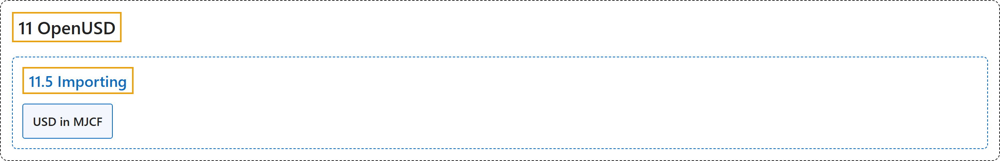

# 11.5 Importing

## Classification

## Glossary

| Term | Definition | 中文翻译 | Source |
|---|---|---|---|
| **11.5 Importing** 导入 | (context) "MuJoCo can **load assets from OpenUSD files** (.usd, .usda, .usdc, .usdz)." | （语境）MuJoCo 可以**从 OpenUSD 文件加载资源**（.usd、.usda、.usdc、.usdz）。 | [Google DeepMind, n.d., "Importing", para. 1](https://mujoco.readthedocs.io/en/stable/OpenUSD/importing.html#importing) |
| **USD in MJCF** MJCF 中的 USD | "If you have built mujoco with USD enabled, you can **reference USD assets from MJCF via the <model tag with content type text/usd**." | 如果构建 mujoco 时启用了 USD，就可以**在 MJCF 中通过内容类型为 text/usd 的 <model 标签引用 USD 资源**。 | [Google DeepMind, n.d., "USD in MJCF", para. 1](https://mujoco.readthedocs.io/en/stable/OpenUSD/importing.html#usd-in-mjcf) |

## References

Google DeepMind. (n.d.). *Importing*. MuJoCo Documentation (Version 3.17.0). Retrieved October 31, 2026, from <https://mujoco.readthedocs.io/en/stable/OpenUSD/importing.html>
