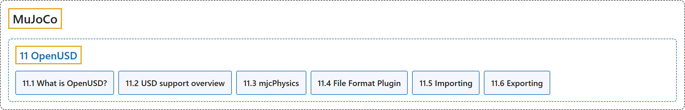

# 11. OpenUSD

## Classification

## Glossary

| Term | Definition | 中文翻译 | Source |
|---|---|---|---|
| **11 OpenUSD** OpenUSD | "This chapter describes **MuJoCo’s support for OpenUSD**." | 本章介绍 **MuJoCo 对 OpenUSD 的支持**。 | [Google DeepMind, n.d.-e, "Introduction", para. 1](https://mujoco.readthedocs.io/en/stable/OpenUSD/index.html#introduction) |
| **[11.1 What is OpenUSD?](what-is-openusd.md)** 什么是 OpenUSD | "USD is **a high-performance, extensible system for describing, composing, simulating, and collaborating on 3D data**." | USD 是**一个高性能、可扩展的系统，用于描述、组合、仿真和协作处理三维数据**。 | [Google DeepMind, n.d.-e, "What is OpenUSD?", para. 1](https://mujoco.readthedocs.io/en/stable/OpenUSD/index.html#what-is-openusd) |
| **[11.2 USD support overview](usd-support-overview.md)** USD 支持概况 | (No definition) | （无定义） | [Google DeepMind, n.d.-e, "USD support overview"](https://mujoco.readthedocs.io/en/stable/OpenUSD/index.html#usd-support-overview) |
| **[11.3 mjcPhysics](mjcphysics.md)** mjcPhysics | "The mjcPhysics schema **allows for detailed specification of a MuJoCo simulation environment directly within a USD file**." | mjcPhysics 模式**允许直接在 USD 文件中详细描述 MuJoCo 仿真环境**。 | [Google DeepMind, n.d.-d, "mjcPhysics", para. 1](https://mujoco.readthedocs.io/en/stable/OpenUSD/mjcPhysics.html#mjcphysics) |
| **[11.4 File Format Plugin](file-format-plugin.md)** 文件格式插件 | (context) "A SdfFileFormat plugin is **a component that teaches USD how to read and write a specific file format**." | （语境）SdfFileFormat 插件是**一个告诉 USD 如何读写某种特定文件格式的组件**。 | [Google DeepMind, n.d.-b, "File Format Plugin", para. 1](https://mujoco.readthedocs.io/en/stable/OpenUSD/mjcf_file_format_plugin.html#file-format-plugin) |
| **[11.5 Importing](importing.md)** 导入 | (context) "MuJoCo can **load assets from OpenUSD files** (.usd, .usda, .usdc, .usdz)." | （语境）MuJoCo 可以**从 OpenUSD 文件加载资源**（.usd、.usda、.usdc、.usdz）。 | [Google DeepMind, n.d.-c, "Importing", para. 1](https://mujoco.readthedocs.io/en/stable/OpenUSD/importing.html#importing) |
| **[11.6 Exporting](exporting.md)** 导出 | (No definition) | （无定义） | [Google DeepMind, n.d.-a, "Exporting"](https://mujoco.readthedocs.io/en/stable/OpenUSD/exporting.html#exporting) |

## References

Google DeepMind. (n.d.-a). *Exporting*. MuJoCo Documentation (Version 3.17.0). Retrieved October 31, 2026, from <https://mujoco.readthedocs.io/en/stable/OpenUSD/exporting.html>

Google DeepMind. (n.d.-b). *File Format Plugin*. MuJoCo Documentation (Version 3.17.0). Retrieved October 31, 2026, from <https://mujoco.readthedocs.io/en/stable/OpenUSD/mjcf_file_format_plugin.html>

Google DeepMind. (n.d.-c). *Importing*. MuJoCo Documentation (Version 3.17.0). Retrieved October 31, 2026, from <https://mujoco.readthedocs.io/en/stable/OpenUSD/importing.html>

Google DeepMind. (n.d.-d). *mjcPhysics*. MuJoCo Documentation (Version 3.17.0). Retrieved October 31, 2026, from <https://mujoco.readthedocs.io/en/stable/OpenUSD/mjcPhysics.html>

Google DeepMind. (n.d.-e). *OpenUSD*. MuJoCo Documentation (Version 3.17.0). Retrieved October 31, 2026, from <https://mujoco.readthedocs.io/en/stable/OpenUSD/index.html>
