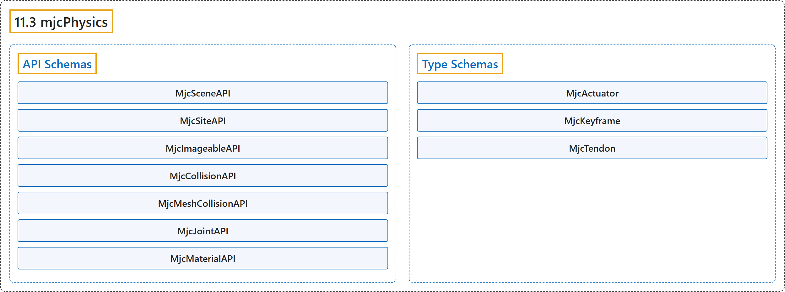

# 11.3 mjcPhysics

## Classification

## Glossary

| Term | Definition | 中文翻译 | Source |
|---|---|---|---|
| **11.3 mjcPhysics** mjcPhysics | "The mjcPhysics schema **allows for detailed specification of a MuJoCo simulation environment directly within a USD file**." | mjcPhysics 模式**允许直接在 USD 文件中详细描述 MuJoCo 仿真环境**。 | [Google DeepMind, n.d., "mjcPhysics", para. 1](https://mujoco.readthedocs.io/en/stable/OpenUSD/mjcPhysics.html#mjcphysics) |
| **API Schemas** API 模式 | (No definition) | （无定义） | [Google DeepMind, n.d., "API Schemas"](https://mujoco.readthedocs.io/en/stable/OpenUSD/mjcPhysics.html#api-schemas) |
| **MjcSceneAPI** MjcSceneAPI 模式 | "This API schema **provides global options for the MuJoCo simulation**." | 这个 API 模式**为 MuJoCo 仿真提供全局选项**。 | [Google DeepMind, n.d., "MjcSceneAPI", para. 1](https://mujoco.readthedocs.io/en/stable/OpenUSD/mjcPhysics.html#mjcsceneapi) |
| **MjcSiteAPI** MjcSiteAPI 模式 | "This API class is used to **define a MuJoCo site**, it can be applied to UsdGeomSphere, UsdGeomCapsule, UsdGeomCylinder, and UsdGeomCube." | 这个 API 类用于**定义一个 MuJoCo site**，可应用于 UsdGeomSphere、UsdGeomCapsule、UsdGeomCylinder 和 UsdGeomCube。 | [Google DeepMind, n.d., "MjcSiteAPI", para. 1](https://mujoco.readthedocs.io/en/stable/OpenUSD/mjcPhysics.html#mjcsiteapi) |
| **MjcImageableAPI** MjcImageableAPI 模式 | "This API class **provides attributes for strictly visual entities in MuJoCo**, in MuJoCo terms we would quantify these has having contype = conaffinity = 0." | 这个 API 类**为 MuJoCo 中纯视觉的实体提供属性**，用 MuJoCo 的术语说，就是 contype = conaffinity = 0 的实体。 | [Google DeepMind, n.d., "MjcImageableAPI", para. 1](https://mujoco.readthedocs.io/en/stable/OpenUSD/mjcPhysics.html#mjcimageableapi) |
| **MjcCollisionAPI** MjcCollisionAPI 模式 | "This API class is **applied to prims that represent collision geometry** and should be applied alongside UsdPhysicsCollisionAPI." | 这个 API 类**应用于表示碰撞几何的 prim**，并应与 UsdPhysicsCollisionAPI 一起应用。 | [Google DeepMind, n.d., "MjcCollisionAPI", para. 1](https://mujoco.readthedocs.io/en/stable/OpenUSD/mjcPhysics.html#mjccollisionapi) |
| **MjcMeshCollisionAPI** MjcMeshCollisionAPI 模式 | "This API class is **applied to prims that represent mesh collision geometry** and should be applied alongside UsdPhysicsMeshCollisionAPI." | 这个 API 类**应用于表示网格碰撞几何的 prim**，并应与 UsdPhysicsMeshCollisionAPI 一起应用。 | [Google DeepMind, n.d., "MjcMeshCollisionAPI", para. 1](https://mujoco.readthedocs.io/en/stable/OpenUSD/mjcPhysics.html#mjcmeshcollisionapi) |
| **MjcJointAPI** MjcJointAPI 模式 | "This API class is applied to UsdPhysicsJoint prims, **adding extra attributes to fully describe MuJoCo joints**." | 这个 API 类应用于 UsdPhysicsJoint prim，**添加额外属性以完整描述 MuJoCo 关节**。 | [Google DeepMind, n.d., "MjcJointAPI", para. 1](https://mujoco.readthedocs.io/en/stable/OpenUSD/mjcPhysics.html#mjcjointapi) |
| **MjcMaterialAPI** MjcMaterialAPI 模式 | "This API class **provides attributes for physical materials** and is an extension of UsdPhysicsMaterialAPI" | 这个 API 类**为物理材质提供属性**，是 UsdPhysicsMaterialAPI 的扩展 | [Google DeepMind, n.d., "MjcMaterialAPI", para. 1](https://mujoco.readthedocs.io/en/stable/OpenUSD/mjcPhysics.html#mjcmaterialapi) |
| **Type Schemas** 类型模式 | (No definition) | （无定义） | [Google DeepMind, n.d., "Type Schemas"](https://mujoco.readthedocs.io/en/stable/OpenUSD/mjcPhysics.html#type-schemas) |
| **MjcActuator** MjcActuator 类型 | "This class **represents a MuJoCo actuator**, which is responsible for applying force to a transmission target joint, body, or site specific via a relationship." | 这个类**表示一个 MuJoCo 执行器**，它负责通过一个关系（relationship）对传动目标关节、刚体或 site 施加力。 | [Google DeepMind, n.d., "MjcActuator", para. 1](https://mujoco.readthedocs.io/en/stable/OpenUSD/mjcPhysics.html#mjcactuator) |
| **MjcKeyframe** MjcKeyframe 类型 | "This type **holds tensor values representing simulator state at specific time values**." | 这个类型**保存表示特定时刻仿真器状态的张量值**。 | [Google DeepMind, n.d., "MjcKeyframe", para. 1](https://mujoco.readthedocs.io/en/stable/OpenUSD/mjcPhysics.html#mjckeyframe) |
| **MjcTendon** MjcTendon 类型 | "This type **represents both fixed and spatial tendons**." | 这个类型**同时表示固定肌腱和空间肌腱**。 | [Google DeepMind, n.d., "MjcTendon", para. 1](https://mujoco.readthedocs.io/en/stable/OpenUSD/mjcPhysics.html#mjctendon) |

## References

Google DeepMind. (n.d.). *mjcPhysics*. MuJoCo Documentation (Version 3.17.0). Retrieved October 31, 2026, from <https://mujoco.readthedocs.io/en/stable/OpenUSD/mjcPhysics.html>
