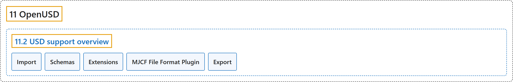

# 11.2 USD support overview

## Classification

## Glossary

| Term | Definition | 中文翻译 | Source |
|---|---|---|---|
| **11.2 USD support overview** USD 支持概况 | (No definition) | （无定义） | [Google DeepMind, n.d., "USD support overview"](https://mujoco.readthedocs.io/en/stable/OpenUSD/index.html#usd-support-overview) |
| **Import** 导入 | "You can **load USD assets** (specifically .usd, .usda, .usdc, .usdz files) into MuJoCo via MJCF or dragging and dropping into simulate.cc." | 可以通过 MJCF 或拖放到 simulate.cc 中，把 **USD 资源加载到** MuJoCo（具体为 .usd、.usda、.usdc、.usdz 文件）。 | [Google DeepMind, n.d., "USD support overview", item 1](https://mujoco.readthedocs.io/en/stable/OpenUSD/index.html#usd-support-overview) |
| **Schemas** 模式 | "MuJoCo primarily uses **the standard UsdPhysics schemas for representing physics properties**." | MuJoCo 主要使用**标准的 UsdPhysics 模式来表示物理属性**。 | [Google DeepMind, n.d., "USD support overview", item 2](https://mujoco.readthedocs.io/en/stable/OpenUSD/index.html#usd-support-overview) |
| **Extensions** 扩展 | "Custom mjcPhysics schemas are **provided to cover MuJoCo-specific features not available in UsdPhysics**." | 自定义的 mjcPhysics 模式**用来覆盖 UsdPhysics 中没有的 MuJoCo 特有功能**。 | [Google DeepMind, n.d., "USD support overview", item 3](https://mujoco.readthedocs.io/en/stable/OpenUSD/index.html#usd-support-overview) |
| **MJCF File Format Plugin** MJCF 文件格式插件 | "A File Format Plugin **allows treating MJCF files as USD layers in any native USD application**." | 文件格式插件**允许在任何原生 USD 应用中把 MJCF 文件当作 USD 图层处理**。 | [Google DeepMind, n.d., "USD support overview", item 4](https://mujoco.readthedocs.io/en/stable/OpenUSD/index.html#usd-support-overview) |
| **Export** 导出 | "MuJoCo scenes can be **exported to USD**." | MuJoCo 场景可以**导出为 USD**。 | [Google DeepMind, n.d., "USD support overview", item 5](https://mujoco.readthedocs.io/en/stable/OpenUSD/index.html#usd-support-overview) |

## References

Google DeepMind. (n.d.). *OpenUSD*. MuJoCo Documentation (Version 3.17.0). Retrieved October 31, 2026, from <https://mujoco.readthedocs.io/en/stable/OpenUSD/index.html>
