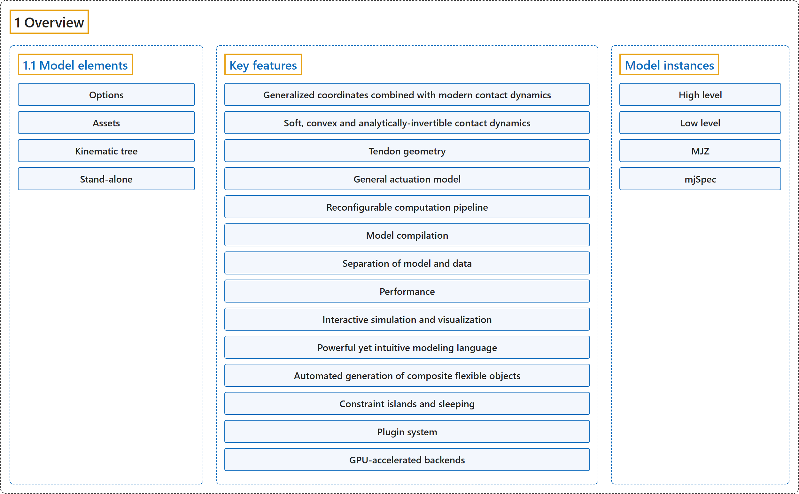

# 1. Overview

## Classification

## Glossary

| Term | Definition | 中文翻译 | Source |
|---|---|---|---|
| **1 Overview** 概述 | (context) "MuJoCo is **a C/C++ library with a C API, intended for researchers and developers**." | （语境）MuJoCo 是**一个提供 C API 的 C/C++ 库，面向研究人员和开发者**。 | [Google DeepMind, n.d., "Introduction", para. 2](https://mujoco.readthedocs.io/en/stable/overview.html#introduction) |
| **[1.1 Model elements](model-elements.md)** 模型元素 | (No definition) | （无定义） | [Google DeepMind, n.d., "Model elements"](https://mujoco.readthedocs.io/en/stable/overview.html#model-elements) |
| **Key features** 主要特性 | (context) "MuJoCo has a long list of features. Here we outline **the most notable ones**." | （语境）MuJoCo 有一长串特性。这里概述**其中最值得注意的几项**。 | [Google DeepMind, n.d., "Key features", para. 1](https://mujoco.readthedocs.io/en/stable/overview.html#key-features) |
| **Generalized coordinates combined with modern contact dynamics** 广义坐标结合现代接触动力学 | "MuJoCo pioneered **the combination of simulation in generalized coordinates with optimization-based contact dynamics**." | MuJoCo 开创了**在广义坐标中仿真与基于优化的接触动力学相结合**的做法。 | [Google DeepMind, n.d., "Key features", item 1](https://mujoco.readthedocs.io/en/stable/overview.html#key-features) |
| **Soft, convex and analytically-invertible contact dynamics** 软的、凸的、可解析求逆的接触动力学 | "MuJoCo is based on **a different formulation of the physics of contact which reduces to a convex optimization problem**, as explained in detail in the Computation chapter." | MuJoCo 基于**一种不同的接触物理表述，它归结为一个凸优化问题**，计算一章对此有详细说明。 | [Google DeepMind, n.d., "Key features", item 2](https://mujoco.readthedocs.io/en/stable/overview.html#key-features) |
| **Tendon geometry** 肌腱几何 | "MuJoCo can model **the 3D geometry of tendons – which are minimum-path-length strings obeying wrapping and via-point constraints**." | MuJoCo 可以建模**肌腱的三维几何：肌腱是服从缠绕约束和途经点约束的最短路径长度的绳索**。 | [Google DeepMind, n.d., "Key features", item 3](https://mujoco.readthedocs.io/en/stable/overview.html#key-features) |
| **General actuation model** 通用驱动模型 | "MuJoCo achieves this goal by adopting **an abstract actuation model that can have different types of transmission, force generation, and internal dynamics** (i.e., state variables which make the overall dynamics 3rd order)." | MuJoCo 通过采用**一个抽象的驱动模型来实现这一目标，它可以有不同类型的传动、力生成和内部动力学**（即使整体动力学成为三阶的状态变量）。 | [Google DeepMind, n.d., "Key features", item 4](https://mujoco.readthedocs.io/en/stable/overview.html#key-features) |
| **Reconfigurable computation pipeline** 可重新配置的计算流水线 | "To this end MuJoCo provides **a large number of flags which can be set in any combination, allowing the user to reconfigure the pipeline as needed**, beyond the selection of algorithms and algorithm parameters via options." | 为此 MuJoCo 提供了**大量可以任意组合设置的标志，让用户按需重新配置流水线**，这超出了通过选项选择算法和算法参数的范围。 | [Google DeepMind, n.d., "Key features", item 5](https://mujoco.readthedocs.io/en/stable/overview.html#key-features) |
| **Model compilation** 模型编译 | "This model is then **compiled by the built-in compiler into the low-level data structure mjModel**, which is cross-indexed and optimized for runtime computation." | 然后这个模型**由内置编译器编译成低层数据结构 mjModel**，它经过交叉索引，并针对运行时计算做了优化。 | [Google DeepMind, n.d., "Key features", item 6](https://mujoco.readthedocs.io/en/stable/overview.html#key-features) |
| **MJCF** MJCF | "As mentioned above, the user defines a MuJoCo model in **an XML file format called MJCF**." | 如上所述，用户用**一种名为 MJCF 的 XML 文件格式**定义 MuJoCo 模型。 | [Google DeepMind, n.d., "Key features", item 6](https://mujoco.readthedocs.io/en/stable/overview.html#key-features) |
| **MJB** MJB | "The compiled model can also be saved in **a binary MJB file**." | 编译后的模型也可以保存为**二进制 MJB 文件**。 | [Google DeepMind, n.d., "Key features", item 6](https://mujoco.readthedocs.io/en/stable/overview.html#key-features) |
| **Separation of model and data** 模型与数据分离 | "MuJoCo separates **simulation parameters into two data structures (C structs) at runtime**:" | MuJoCo 在运行时把**仿真参数分到两个数据结构（C 结构体）中**： | [Google DeepMind, n.d., "Key features", item 7](https://mujoco.readthedocs.io/en/stable/overview.html#key-features) |
| **mjModel** mjModel | "mjModel contains **the model description and is expected to remain constant**." | mjModel 包含**模型描述，预期保持不变**。 | [Google DeepMind, n.d., "Key features", item 7](https://mujoco.readthedocs.io/en/stable/overview.html#key-features) |
| **mjData** mjData | "mjData contains **all dynamic variables and intermediate results**." | mjData 包含**所有动态变量和中间结果**。 | [Google DeepMind, n.d., "Key features", item 7](https://mujoco.readthedocs.io/en/stable/overview.html#key-features) |
| **Performance** 性能 | "MuJoCo’s runtime **performs zero memory allocations after initialization** – all working memory is preallocated in mjData." | MuJoCo 的运行时**在初始化之后不做任何内存分配**：所有工作内存都预先分配在 mjData 中。 | [Google DeepMind, n.d., "Key features", item 8](https://mujoco.readthedocs.io/en/stable/overview.html#key-features) |
| **Interactive simulation and visualization** 交互式仿真与可视化 | "The native 3D visualizer provides **rendering of meshes and geometric primitives, textures, reflections, shadows, fog, transparency, wireframes, skyboxes, stereoscopic visualization** (on video cards supporting quad-buffered OpenGL)." | 原生三维可视化器提供**网格和几何基元、纹理、反射、阴影、雾、透明、线框、天空盒和立体可视化的渲染**（在支持四缓冲 OpenGL 的显卡上）。 | [Google DeepMind, n.d., "Key features", item 9](https://mujoco.readthedocs.io/en/stable/overview.html#key-features) |
| **Powerful yet intuitive modeling language** 强大而直观的建模语言 | "MuJoCo has its own modeling language called MJCF. The goal of MJCF is **to provide access to all of MuJoCo’s compute capabilities, and at the same time enable users to develop new models quickly and experiment with them**." | MuJoCo 有自己的建模语言 MJCF。MJCF 的目标是**提供对 MuJoCo 全部计算能力的访问，同时让用户能快速开发新模型并用它们做实验**。 | [Google DeepMind, n.d., "Key features", item 10](https://mujoco.readthedocs.io/en/stable/overview.html#key-features) |
| **Automated generation of composite flexible objects** 复合柔性物体的自动生成 | "The modeling language has **high-level macros which are automatically expanded by the model compiler into the necessary collections of standard model elements**." | 建模语言有**高层宏，由模型编译器自动展开成所需的标准模型元素集合**。 | [Google DeepMind, n.d., "Key features", item 11](https://mujoco.readthedocs.io/en/stable/overview.html#key-features) |
| **Constraint islands and sleeping** 约束岛与休眠 | "The constraint solver automatically discovers **independent constraint islands – groups of bodies coupled by constraints that can be solved independently**." | 约束求解器会自动发现**独立的约束岛：由约束耦合、可以独立求解的刚体组**。 | [Google DeepMind, n.d., "Key features", item 12](https://mujoco.readthedocs.io/en/stable/overview.html#key-features) |
| **Plugin system** 插件系统 | "Plugins are **dynamically loaded shared libraries that register themselves with the engine and are instantiated per model element**." | 插件是**动态加载的共享库，它们向引擎注册自己，并按模型元素实例化**。 | [Google DeepMind, n.d., "Key features", item 13](https://mujoco.readthedocs.io/en/stable/overview.html#key-features) |
| **GPU-accelerated backends** GPU 加速后端 | "In addition to the C engine, MuJoCo has **GPU-accelerated backends for large-scale parallel simulation**: MJX (JAX) and MuJoCo Warp (NVIDIA Warp)." | 除了 C 引擎，MuJoCo 还有**用于大规模并行仿真的 GPU 加速后端**：MJX（JAX）和 MuJoCo Warp（NVIDIA Warp）。 | [Google DeepMind, n.d., "Key features", item 14](https://mujoco.readthedocs.io/en/stable/overview.html#key-features) |
| **Model instances** 模型实例 | "The user defines the model in an XML file written in MJCF or URDF. The software can then create **multiple instances of the same model in different media (file or memory) and on different levels of description (high or low)**." | 用户在用 MJCF 或 URDF 编写的 XML 文件中定义模型。然后软件可以**在不同介质（文件或内存）中、在不同描述层次（高层或低层）上创建同一模型的多个实例**。 | [Google DeepMind, n.d., "Model instances", para. 1](https://mujoco.readthedocs.io/en/stable/overview.html#model-instances) |
| **High level** 高层 | "The high level exists for user convenience: **its sole purpose is to be compiled into a low level model on which computations can be performed**." | 高层是为了方便用户而存在的：**它的唯一用途是被编译成可在其上进行计算的低层模型**。 | [Google DeepMind, n.d., "Model instances", para. 2](https://mujoco.readthedocs.io/en/stable/overview.html#model-instances) |
| **Low level** 低层 | "The high level exists for user convenience: its sole purpose is to be compiled into **a low level model on which computations can be performed**." | 高层是为了方便用户而存在的：它的唯一用途是被编译成**可在其上进行计算的低层模型**。 | [Google DeepMind, n.d., "Model instances", para. 2](https://mujoco.readthedocs.io/en/stable/overview.html#model-instances) |
| **MJZ** MJZ | (context) "The resulting mjModel can be loaded and saved into a binary file (MJB), however those are version-specific and cannot be decompiled, thus models should always be maintained as XML files or **packaged into MJZ archives**." | （语境）得到的 mjModel 可以加载和保存为二进制文件（MJB），但这些文件与版本相关且无法反编译，因此模型应始终以 XML 文件维护，或**打包成 MJZ 归档**。 | [Google DeepMind, n.d., "Model instances", para. 2](https://mujoco.readthedocs.io/en/stable/overview.html#model-instances) |
| **mjSpec** mjSpec | "The mjSpec C struct is **in one-to-one correspondence with the MJCF file format**." | mjSpec C 结构体**与 MJCF 文件格式一一对应**。 | [Google DeepMind, n.d., "Model instances", para. 3](https://mujoco.readthedocs.io/en/stable/overview.html#model-instances) |

## References

Google DeepMind. (n.d.). *Overview*. MuJoCo Documentation (Version 3.17.0). Retrieved October 31, 2026, from <https://mujoco.readthedocs.io/en/stable/overview.html>
