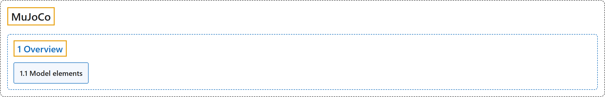

# 1. Overview

## Classification

## Glossary

| Term | Definition | 中文翻译 | Source |
|---|---|---|---|
| **1 Overview** 概述 | (context) "MuJoCo is **a C/C++ library with a C API, intended for researchers and developers**." | （语境）MuJoCo 是**一个提供 C API 的 C/C++ 库，面向研究人员和开发者**。 | [Google DeepMind, n.d., "Introduction", para. 2](https://mujoco.readthedocs.io/en/stable/overview.html#introduction) |
| **[1.1 Model elements](model-elements.md)** 模型元素 | (No definition) | （无定义） | [Google DeepMind, n.d., "Model elements"](https://mujoco.readthedocs.io/en/stable/overview.html#model-elements) |

## References

Google DeepMind. (n.d.). *Overview*. MuJoCo Documentation (Version 3.17.0). Retrieved October 31, 2026, from <https://mujoco.readthedocs.io/en/stable/overview.html>
