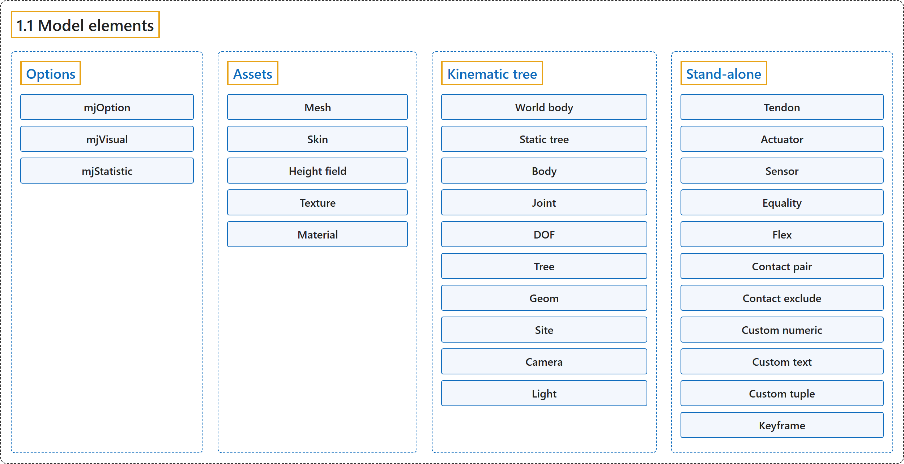

# 1.1 Model elements

## Classification

## Glossary

| Term | Definition | 中文翻译 | Source |
|---|---|---|---|
| **1.1 Model elements** 模型元素 | (No definition) | （无定义） | [Google DeepMind, n.d., "Model elements"](https://mujoco.readthedocs.io/en/stable/overview.html#model-elements) |
| **Options** 选项 | "Each model has **three sets of options** listed below. They are always included." | 每个模型都有下面列出的**三组选项**。它们总是包含在模型中。 | [Google DeepMind, n.d., "Options", para. 1](https://mujoco.readthedocs.io/en/stable/overview.html#options) |
| **mjOption** mjOption | "This structure contains **all options that affect the physics simulation**." | 这个结构体包含**所有影响物理仿真的选项**。 | [Google DeepMind, n.d., "mjOption", para. 1](https://mujoco.readthedocs.io/en/stable/overview.html#mjoption) |
| **mjVisual** mjVisual | "This structure contains **all visualization options**." | 这个结构体包含**所有可视化选项**。 | [Google DeepMind, n.d., "mjVisual", para. 1](https://mujoco.readthedocs.io/en/stable/overview.html#mjvisual) |
| **mjStatistic** mjStatistic | "This structure contains **statistics about the model which are computed by the compiler**: average body mass, spatial extent of the model etc." | 这个结构体包含**由编译器计算的模型统计量**：平均刚体质量、模型的空间范围等。 | [Google DeepMind, n.d., "mjStatistic", para. 1](https://mujoco.readthedocs.io/en/stable/overview.html#mjstatistic) |
| **Assets** 资源 | "Assets are not in themselves model elements. **Model elements can reference them, in which case the asset somehow changes the properties of the referencing element**." | 资源本身不是模型元素。**模型元素可以引用它们，此时资源会以某种方式改变引用它的元素的属性**。 | [Google DeepMind, n.d., "Assets", para. 1](https://mujoco.readthedocs.io/en/stable/overview.html#assets) |
| **Mesh** 网格 | "MuJoCo can load **triangulated meshes** from OBJ files and binary STL." | MuJoCo 可以从 OBJ 文件和二进制 STL 加载**三角网格**。 | [Google DeepMind, n.d., "Mesh", para. 1](https://mujoco.readthedocs.io/en/stable/overview.html#mesh) |
| **Skin** 蒙皮 | "Skinned meshes (or skins) are **meshes whose shape can deform at runtime**." | 蒙皮网格（或蒙皮）是**形状可以在运行时变形的网格**。 | [Google DeepMind, n.d., "Skin", para. 1](https://mujoco.readthedocs.io/en/stable/overview.html#skin) |
| **Height field** 高度场 | "A height field is **a rectangular grid of elevation data**." | 高度场是**一个由高程数据组成的矩形网格**。 | [Google DeepMind, n.d., "Height field", para. 1](https://mujoco.readthedocs.io/en/stable/overview.html#height-field) |
| **Texture** 纹理 | (context) "Textures can be **loaded from PNG or KTX files or synthesized by the compiler based on user-defined procedural parameters**." | （语境）纹理可以**从 PNG 或 KTX 文件加载，或由编译器根据用户定义的程序化参数合成**。 | [Google DeepMind, n.d., "Texture", para. 1](https://mujoco.readthedocs.io/en/stable/overview.html#texture) |
| **Material** 材质 | "Materials are used **to control the appearance of geoms, sites and tendons**." | 材质用于**控制 geom、site 和肌腱的外观**。 | [Google DeepMind, n.d., "Material", para. 1](https://mujoco.readthedocs.io/en/stable/overview.html#material) |
| **Kinematic tree** 运动学树 | "MuJoCo simulates the dynamics of a collection of rigid bodies whose motion is usually constrained. The system state is represented in joint coordinates and **the bodies are explicitly organized into kinematic trees**." | MuJoCo 仿真一组运动通常受约束的刚体的动力学。系统状态用关节坐标表示，**刚体被显式地组织成运动学树**。 | [Google DeepMind, n.d., "Kinematic tree", para. 1](https://mujoco.readthedocs.io/en/stable/overview.html#kinematic-tree) |
| **World body** 世界刚体 | "The top-level “world” body **always exists (with id 0) and is its own parent**, thus body_parentid[0] == 0 and body_parentid[i] < i for all other i." | 顶层的“世界”刚体**总是存在（id 为 0），并且是它自己的父刚体**，因此 body_parentid[0] == 0，且对其他所有 i 有 body_parentid[i] < i。 | [Google DeepMind, n.d., "Kinematic tree", para. 1](https://mujoco.readthedocs.io/en/stable/overview.html#kinematic-tree) |
| **Static tree** 静态树 | "Note that the world body and other static (joint-less) child bodies form **a unique “static tree” with no associated degrees of freedom**." | 注意，世界刚体和其他静态（无关节）子刚体构成**一棵唯一的、没有关联自由度的“静态树”**。 | [Google DeepMind, n.d., "Kinematic tree", para. 1](https://mujoco.readthedocs.io/en/stable/overview.html#kinematic-tree) |
| **Body** 刚体 | "Bodies have **mass and inertial properties but do not have any geometric properties**." | 刚体有**质量和惯性属性，但没有任何几何属性**。 | [Google DeepMind, n.d., "Body", para. 1](https://mujoco.readthedocs.io/en/stable/overview.html#body) |
| **Inertial frame** 惯性坐标系 | "Each body has two coordinate frames: the frame used to define it as well as to position other elements relative to it, and **an inertial frame centered at the body’s center of mass and aligned with its principal axes of inertia**." | 每个刚体有两个坐标系：一个用来定义它并相对于它定位其他元素，另一个是**以刚体质心为中心、与其惯性主轴对齐的惯性坐标系**。 | [Google DeepMind, n.d., "Body", para. 1](https://mujoco.readthedocs.io/en/stable/overview.html#body) |
| **Joint** 关节 | "Joints are defined within bodies. They **create motion degrees of freedom (DOFs) between the body and its parent**." | 关节定义在刚体内部。它们**在刚体与其父刚体之间创建运动自由度（DOF）**。 | [Google DeepMind, n.d., "Joint", para. 1](https://mujoco.readthedocs.io/en/stable/overview.html#joint) |
| **Free joint** 自由关节 | "There are four types of joints: ball, slide, hinge, and a “free joint” **which creates floating bodies**." | 关节有四种类型：球关节、滑动关节、铰链关节，以及一种**创建浮动刚体**的“自由关节”。 | [Google DeepMind, n.d., "Joint", para. 1](https://mujoco.readthedocs.io/en/stable/overview.html#joint) |
| **Joint reference** 关节参考 | "The reference pose is **a vector of joint positions stored in mjModel.qpos0**." | 参考位姿是**存放在 mjModel.qpos0 中的关节位置向量**。 | [Google DeepMind, n.d., "Joint reference", para. 1](https://mujoco.readthedocs.io/en/stable/overview.html#joint-reference) |
| **Spring reference** 弹簧参考 | "This is **the pose in which all joint and tendon springs achieve their resting length**." | 这是**所有关节弹簧和肌腱弹簧都处于静止长度时的位姿**。 | [Google DeepMind, n.d., "Spring reference", para. 1](https://mujoco.readthedocs.io/en/stable/overview.html#spring-reference) |
| **DOF** 自由度 | "Degrees of freedom are **closely related to joints, but are not in one-to-one correspondence** because ball and free joints have multiple DOFs." | 自由度**与关节密切相关，但并非一一对应**，因为球关节和自由关节有多个自由度。 | [Google DeepMind, n.d., "DOF", para. 1](https://mujoco.readthedocs.io/en/stable/overview.html#dof) |
| **Tree** 树 | "A kinematic tree or “tree” is **a movable body and all of its descendants**." | 运动学树或“树”是**一个可动刚体及其所有后代**。 | [Google DeepMind, n.d., "Tree", para. 1](https://mujoco.readthedocs.io/en/stable/overview.html#tree) |
| **Subtree** 子树 | "Note that while trees are indeed subtrees of the global tree (whose root is the world), this should not be confused with the specific term subtree, **which is reserved for per-body partial trees**, thus mjModel.body_subtreemass gives the total mass of the partial tree under each body, for all bodies." | 注意，虽然树确实是全局树（其根是世界）的子树，但这不应与专门术语 subtree 混淆，**它专指以每个刚体为根的部分树**，因此 mjModel.body_subtreemass 给出所有刚体各自下方部分树的总质量。 | [Google DeepMind, n.d., "Tree", para. 2](https://mujoco.readthedocs.io/en/stable/overview.html#tree) |
| **Geom** 几何体 | "Geoms are **3D shapes rigidly attached to the bodies**." | geom 是**刚性附着在刚体上的三维形状**。 | [Google DeepMind, n.d., "Geom", para. 1](https://mujoco.readthedocs.io/en/stable/overview.html#geom) |
| **Site** 站点 | "Sites are essentially **light geoms**. They represent **locations of interest within the body frame**." | site 本质上是**轻量的 geom**。它们表示**刚体坐标系内值得关注的位置**。 | [Google DeepMind, n.d., "Site", para. 1](https://mujoco.readthedocs.io/en/stable/overview.html#site) |
| **Camera** 相机 | (context) "However it is often convenient to define **additional cameras that are either fixed to the world, or are attached to one of the bodies and move with it**." | （语境）不过，定义**另外的相机往往很方便：它们要么固定在世界中，要么附着在某个刚体上并随它移动**。 | [Google DeepMind, n.d., "Camera", para. 1](https://mujoco.readthedocs.io/en/stable/overview.html#camera) |
| **Light** 光源 | (context) "Lights can be **fixed to the world body or attached to moving bodies**." | （语境）光源可以**固定在世界刚体上，或附着在运动的刚体上**。 | [Google DeepMind, n.d., "Light", para. 1](https://mujoco.readthedocs.io/en/stable/overview.html#light) |
| **Stand-alone** 独立元素 | "Here we describe **the model elements which do not belong to an individual body**, and therefore are described outside the kinematic tree." | 这里介绍**不属于单个刚体的模型元素**，因此它们在运动学树之外描述。 | [Google DeepMind, n.d., "Stand-alone", para. 1](https://mujoco.readthedocs.io/en/stable/overview.html#stand-alone) |
| **Tendon** 肌腱 | "Tendons are **scalar length elements** that can be used for actuation, imposing limits and equality constraints, or creating spring-dampers and friction loss." | 肌腱是**标量长度元素**，可用于驱动、施加限位和等式约束，或构造弹簧阻尼器和摩擦损失。 | [Google DeepMind, n.d., "Tendon", para. 1](https://mujoco.readthedocs.io/en/stable/overview.html#tendon) |
| **Fixed tendons** 固定肌腱 | "Fixed tendons are **linear combinations of (scalar) joint positions**." | 固定肌腱是（标量）**关节位置的线性组合**。 | [Google DeepMind, n.d., "Tendon", para. 1](https://mujoco.readthedocs.io/en/stable/overview.html#tendon) |
| **Spatial tendons** 空间肌腱 | "Spatial tendons are defined as **the shortest path that passes through a sequence of specified sites (or via-points) or wraps around specified geoms**." | 空间肌腱定义为**穿过一系列指定 site（即途经点）或缠绕指定 geom 的最短路径**。 | [Google DeepMind, n.d., "Tendon", para. 1](https://mujoco.readthedocs.io/en/stable/overview.html#tendon) |
| **Actuator** 驱动器 | "MuJoCo provides **a flexible actuator model, with three components that can be specified independently**." | MuJoCo 提供**一个灵活的驱动器模型，它有三个可以独立指定的组成部分**。 | [Google DeepMind, n.d., "Actuator", para. 1](https://mujoco.readthedocs.io/en/stable/overview.html#actuator) |
| **Transmission** 传动 | "The transmission **specifies how the actuator is attached to the rest of the system**; available types are joint, tendon, slider-crank, site and body." | 传动**指定驱动器如何连接到系统的其余部分**；可用类型有 joint、tendon、slider-crank、site 和 body。 | [Google DeepMind, n.d., "Actuator", para. 1](https://mujoco.readthedocs.io/en/stable/overview.html#actuator) |
| **Activation dynamics** 激活动力学 | "The activation dynamics can be used **to model internal activation states of pneumatic or hydraulic cylinders as well as biological muscles**; using such actuators makes the overall system dynamics 3rd-order." | 激活动力学可用于**建模气缸、液压缸以及生物肌肉的内部激活状态**；使用这类驱动器会使整个系统动力学成为三阶的。 | [Google DeepMind, n.d., "Actuator", para. 1](https://mujoco.readthedocs.io/en/stable/overview.html#actuator) |
| **Force generation** 力生成 | "The force generation mechanism **determines how the scalar control signal provided as input to the actuator is mapped into a scalar force**, which is in turn mapped into a generalized force by the moment arms inferred from the transmission." | 力生成机制**决定作为驱动器输入的标量控制信号如何映射为标量力**，该力再由从传动推出的力臂映射为广义力。 | [Google DeepMind, n.d., "Actuator", para. 1](https://mujoco.readthedocs.io/en/stable/overview.html#actuator) |
| **Sensor** 传感器 | "MuJoCo can generate **simulated sensor data** which is saved in the global array mjData.sensordata." | MuJoCo 可以生成**仿真的传感器数据**，保存在全局数组 mjData.sensordata 中。 | [Google DeepMind, n.d., "Sensor", para. 1](https://mujoco.readthedocs.io/en/stable/overview.html#sensor) |
| **User sensor type** 用户传感器类型 | "There is also a user sensor type, **allowing user code to insert any other quantity of interest in the sensor data array**." | 还有一种用户传感器类型，**允许用户代码把任何其他感兴趣的量插入传感器数据数组**。 | [Google DeepMind, n.d., "Sensor", para. 1](https://mujoco.readthedocs.io/en/stable/overview.html#sensor) |
| **Equality** 等式约束 | "Equality constraints can **impose additional constraints beyond those already imposed by the kinematic tree structure and the joints/DOFs defined in it**." | 等式约束可以**在运动学树结构及其中定义的关节/自由度已施加的约束之外，再施加额外的约束**。 | [Google DeepMind, n.d., "Equality", para. 1](https://mujoco.readthedocs.io/en/stable/overview.html#equality) |
| **Flex** 柔性体 | "Flexes represent **deformable meshes that can be 1, 2 or 3 dimensional** (thus their elements are capsules, triangles or tetrahedra)." | flex 表示**可以是一维、二维或三维的可变形网格**（因此其单元是胶囊体、三角形或四面体）。 | [Google DeepMind, n.d., "Flex", para. 1](https://mujoco.readthedocs.io/en/stable/overview.html#flex) |
| **Contact pair** 接触对 | "Geom pairs that are checked for contact can come from two sources: automated proximity tests and other filters collectively called “dynamic”, as well as **an explicit list of geom pairs provided in the model**. The latter is **a separate type of model element**." | 要做接触检查的 geom 对有两个来源：自动邻近测试和其他过滤器（统称为“dynamic”），以及**模型中提供的显式 geom 对列表**。后者是**一种单独的模型元素类型**。 | [Google DeepMind, n.d., "Contact pair", para. 1](https://mujoco.readthedocs.io/en/stable/overview.html#contact-pair) |
| **dynamic** 动态机制 | "Geom pairs that are checked for contact can come from two sources: **automated proximity tests and other filters collectively called “dynamic”**, as well as an explicit list of geom pairs provided in the model." | 要做接触检查的 geom 对有两个来源：**自动邻近测试和其他过滤器（统称为“dynamic”）**，以及模型中提供的显式 geom 对列表。 | [Google DeepMind, n.d., "Contact pair", para. 1](https://mujoco.readthedocs.io/en/stable/overview.html#contact-pair) |
| **Contact exclude** 接触排除 | "This is the opposite of contact pairs: it **specifies pairs of bodies (rather than geoms) which should be excluded from the generation of candidate contact pairs**." | 它与接触对相反：它**指定应从候选接触对的生成中排除的刚体对（而不是 geom 对）**。 | [Google DeepMind, n.d., "Contact exclude", para. 1](https://mujoco.readthedocs.io/en/stable/overview.html#contact-exclude) |
| **Custom numeric** 自定义数值 | "There are **three ways to enter custom numbers in a MuJoCo simulation**." | 有**三种方式可以在 MuJoCo 仿真中输入自定义数值**。 | [Google DeepMind, n.d., "Custom numeric", para. 1](https://mujoco.readthedocs.io/en/stable/overview.html#custom-numeric) |
| **Custom text** 自定义文本 | "**Custom text fields can be saved in the model**. They can be used in custom computations – either to specify keyword commands, or to provide some other textual information." | **自定义文本字段可以保存在模型中**。它们可用于自定义计算：指定关键字命令，或提供其他文本信息。 | [Google DeepMind, n.d., "Custom text", para. 1](https://mujoco.readthedocs.io/en/stable/overview.html#custom-text) |
| **Custom tuple** 自定义元组 | "Custom tuples are **lists of MuJoCo model elements, possibly including other tuples**." | 自定义元组是**MuJoCo 模型元素的列表，其中可能包含其他元组**。 | [Google DeepMind, n.d., "Custom tuple", para. 1](https://mujoco.readthedocs.io/en/stable/overview.html#custom-tuple) |
| **Keyframe** 关键帧 | "A keyframe is **a snapshot of the simulation state variables**." | 关键帧是**仿真状态变量的一个快照**。 | [Google DeepMind, n.d., "Keyframe", para. 1](https://mujoco.readthedocs.io/en/stable/overview.html#keyframe) |

## References

Google DeepMind. (n.d.). *Overview*. MuJoCo Documentation (Version 3.17.0). Retrieved October 31, 2026, from <https://mujoco.readthedocs.io/en/stable/overview.html>
