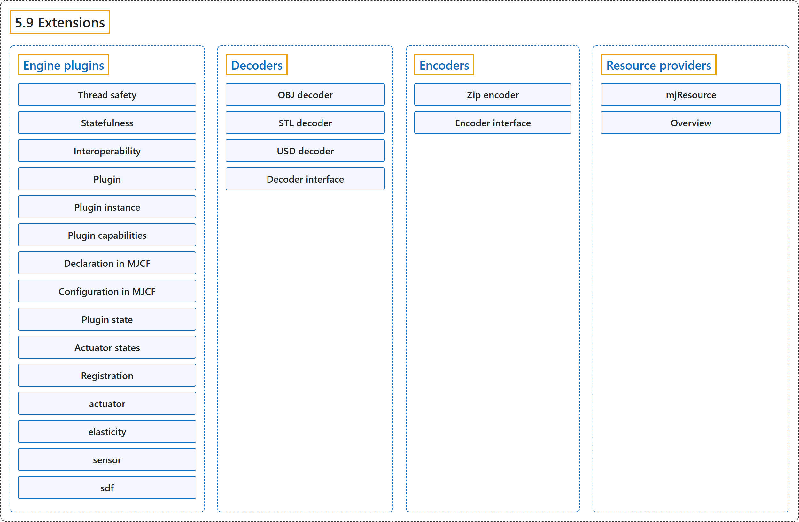

# 5.9 Extensions

## Classification

## Glossary

| Term | Definition | 中文翻译 | Source |
|---|---|---|---|
| **5.9 Extensions** 扩展 | (context) "At present, extensibility is provided by via **engine plugins, decoders, and resource providers**." | （语境）目前，可扩展性由**引擎插件、解码器和资源提供者**提供。 | [Google DeepMind, n.d., "Extensions", para. 1](https://mujoco.readthedocs.io/en/stable/programming/extension.html#extensions) |
| **Engine plugins** 引擎插件 | "Engine plugins **allow user-defined logic to be inserted into various parts of MuJoCo’s computational pipeline**." | 引擎插件**允许把用户定义的逻辑插入 MuJoCo 计算流水线的各个部分**。 | [Google DeepMind, n.d., "Engine plugins", para. 1](https://mujoco.readthedocs.io/en/stable/programming/extension.html#engine-plugins) |
| **Thread safety** 线程安全 | "Plugin instances (see below) are **thread-local, avoiding collisions**." | 插件实例（见下文）是**线程局部的，避免冲突**。 | [Google DeepMind, n.d., "Engine plugins", item 1](https://mujoco.readthedocs.io/en/stable/programming/extension.html#engine-plugins) |
| **Statefulness** 有状态性 | "Plugins can be stateful, and **their state will be (de)serialized correctly**." | 插件可以是有状态的，**它们的状态会被正确地序列化和反序列化**。 | [Google DeepMind, n.d., "Engine plugins", item 2](https://mujoco.readthedocs.io/en/stable/programming/extension.html#engine-plugins) |
| **Interoperability** 互操作性 | "Different plugins **can coexist without interference**." | 不同的插件**可以共存而互不干扰**。 | [Google DeepMind, n.d., "Engine plugins", item 3](https://mujoco.readthedocs.io/en/stable/programming/extension.html#engine-plugins) |
| **Plugin** 插件 | "A plugin is **a collection of functions and static attributes that implement its capabilities, bundled into an mjpPlugin struct**." | 插件是**实现其功能的一组函数和静态属性，打包在一个 mjpPlugin 结构体中**。 | [Google DeepMind, n.d., "Engine plugins", para. 4](https://mujoco.readthedocs.io/en/stable/programming/extension.html#engine-plugins) |
| **stateless** 无状态 | "Plugin functions are stateless: **they depend only on the arguments passed to them**." | 插件函数是无状态的：**它们只依赖传给它们的参数**。 | [Google DeepMind, n.d., "Engine plugins", para. 4](https://mujoco.readthedocs.io/en/stable/programming/extension.html#engine-plugins) |
| **Plugin instance** 插件实例 | "A plugin instance **represents the self-contained runtime state that is operated on by the plugin**: when the plugin logic is executed, the instance state is passed in by the engine." | 插件实例**表示由插件操作的自包含运行时状态**：执行插件逻辑时，引擎把实例状态传进去。 | [Google DeepMind, n.d., "Engine plugins", para. 5](https://mujoco.readthedocs.io/en/stable/programming/extension.html#engine-plugins) |
| **one-to-one** 一对一 | "In this simplest case, **each instance is referenced once in the model**." | 在这种最简单的情况下，**每个实例在模型中只被引用一次**。 | [Google DeepMind, n.d., "Engine plugins", item 1](https://mujoco.readthedocs.io/en/stable/programming/extension.html#engine-plugins) |
| **one-to-many** 一对多 | "Alternatively, **the behavior of multiple elements can be backed by a single plugin instance**." | 或者，**多个元素的行为可以由单个插件实例支撑**。 | [Google DeepMind, n.d., "Engine plugins", item 2](https://mujoco.readthedocs.io/en/stable/programming/extension.html#engine-plugins) |
| **Plugin capabilities** 插件能力 | (context) "The capabilityflags member is **an integer bitfield describing the plugin’s capabilities**, where bit semantics are defined in the enum mjtPluginCapabilityBit." | （语境）capabilityflags 成员是**一个描述插件能力的整数位域**，各位的含义在枚举 mjtPluginCapabilityBit 中定义。 | [Google DeepMind, n.d., "Plugin capabilities", para. 1](https://mujoco.readthedocs.io/en/stable/programming/extension.html#plugin-capabilities) |
| **mjpPlugin** 插件结构体 mjpPlugin | "A plugin is described by **the contents of its associated mjpPlugin struct**." | 插件由**其关联的 mjpPlugin 结构体的内容**描述。 | [Google DeepMind, n.d., "Plugin capabilities", para. 1](https://mujoco.readthedocs.io/en/stable/programming/extension.html#plugin-capabilities) |
| **mjtPluginCapabilityBit** 插件能力位枚举 mjtPluginCapabilityBit | (context) "The capabilityflags member is an integer bitfield describing the plugin’s capabilities, where **bit semantics are defined in the enum mjtPluginCapabilityBit**." | （语境）capabilityflags 成员是一个描述插件能力的整数位域，**各位的含义在枚举 mjtPluginCapabilityBit 中定义**。 | [Google DeepMind, n.d., "Plugin capabilities", para. 1](https://mujoco.readthedocs.io/en/stable/programming/extension.html#plugin-capabilities) |
| **Actuator plugin** 执行器插件 | (No definition) | （无定义） | [Google DeepMind, n.d., "Plugin capabilities"](https://mujoco.readthedocs.io/en/stable/programming/extension.html#plugin-capabilities) |
| **Sensor plugin** 传感器插件 | (No definition) | （无定义） | [Google DeepMind, n.d., "Plugin capabilities"](https://mujoco.readthedocs.io/en/stable/programming/extension.html#plugin-capabilities) |
| **Passive force plugin** 被动力插件 | (No definition) | （无定义） | [Google DeepMind, n.d., "Plugin capabilities"](https://mujoco.readthedocs.io/en/stable/programming/extension.html#plugin-capabilities) |
| **Signed distance field plugin** 有符号距离场插件 | (No definition) | （无定义） | [Google DeepMind, n.d., "Plugin capabilities"](https://mujoco.readthedocs.io/en/stable/programming/extension.html#plugin-capabilities) |
| **Declaration in MJCF** 在 MJCF 中声明 | (context) "First, **a plugin dependency must be declared through <extension><plugin>**." | （语境）首先，**插件依赖必须通过 <extension><plugin> 声明**。 | [Google DeepMind, n.d., "Declaration in MJCF", para. 1](https://mujoco.readthedocs.io/en/stable/programming/extension.html#declaration-in-mjcf) |
| **Configuration in MJCF** 在 MJCF 中配置 | "Plugins can declare **custom attributes that represent specialized configurable parameters**." | 插件可以声明**表示专门可配置参数的自定义属性**。 | [Google DeepMind, n.d., "Configuration in MJCF", para. 1](https://mujoco.readthedocs.io/en/stable/programming/extension.html#configuration-in-mjcf) |
| **Plugin state** 插件状态 | "The term plugin state refers to **the time-dependent state of the plugin instance that consists of floating point values**, while the term plugin data refers to arbitrary data structures consisting of memoized payload that should be considered implementation detail for the plugin’s computation." | 术语“插件状态”指**插件实例中由浮点数值构成的、随时间变化的状态**，而术语“插件数据”指由记忆化负载构成的任意数据结构，应被视为插件计算的实现细节。 | [Google DeepMind, n.d., "Plugin state", para. 1](https://mujoco.readthedocs.io/en/stable/programming/extension.html#plugin-state) |
| **plugin data** 插件数据 | "The term plugin state refers to the time-dependent state of the plugin instance that consists of floating point values, while the term plugin data refers to **arbitrary data structures consisting of memoized payload that should be considered implementation detail for the plugin’s computation**." | 术语“插件状态”指插件实例中由浮点数值构成的、随时间变化的状态，而术语“插件数据”指**由记忆化负载构成的任意数据结构，应被视为插件计算的实现细节**。 | [Google DeepMind, n.d., "Plugin state", para. 1](https://mujoco.readthedocs.io/en/stable/programming/extension.html#plugin-state) |
| **Actuator states** 执行器状态 | (context) "When writing stateful actuator plugins, there are **two choices for where to save the actuator state**." | （语境）编写有状态的执行器插件时，**执行器状态可以保存在两个地方之一**。 | [Google DeepMind, n.d., "Actuator states", para. 1](https://mujoco.readthedocs.io/en/stable/programming/extension.html#actuator-states) |
| **Registration** 注册 | "Plugins must be **registered with MuJoCo before they can be referenced in MJCF models**." | 插件必须**先向 MuJoCo 注册，才能在 MJCF 模型中被引用**。 | [Google DeepMind, n.d., "Registration", para. 1](https://mujoco.readthedocs.io/en/stable/programming/extension.html#registration) |
| **actuator** actuator 插件目录 | "The plugins in the actuator/ directory **implement custom actuators, so far only a PID controller**." | actuator/ 目录中的插件**实现自定义执行器，目前只有一个 PID 控制器**。 | [Google DeepMind, n.d., "actuator", para. 1](https://mujoco.readthedocs.io/en/stable/programming/extension.html#actuator) |
| **elasticity** elasticity 插件目录 | "The plugins in the elasticity/ directory are **passive forces based on continuum mechanics for 1-dimensional and 2-dimensional bodies**." | elasticity/ 目录中的插件是**基于连续介质力学、作用于一维和二维物体的被动力**。 | [Google DeepMind, n.d., "elasticity", para. 1](https://mujoco.readthedocs.io/en/stable/programming/extension.html#elasticity) |
| **sensor** sensor 插件目录 | "The plugins in the sensor/ directory **implement custom sensors**." | sensor/ 目录中的插件**实现自定义传感器**。 | [Google DeepMind, n.d., "sensor", para. 1](https://mujoco.readthedocs.io/en/stable/programming/extension.html#sensor) |
| **sdf** sdf 插件目录 | "The plugins in the sdf/ directory **specify custom shapes in a mesh-free manner, by defining methods computing a signed distance field and its gradient at query points**." | sdf/ 目录中的插件**以无网格的方式指定自定义形状，做法是定义在查询点计算有符号距离场及其梯度的方法**。 | [Google DeepMind, n.d., "sdf", para. 1](https://mujoco.readthedocs.io/en/stable/programming/extension.html#sdf) |
| **sdf_distance** sdf_distance 方法 | "Returns **the signed distance of the query point given in local coordinates**." | 返回**以局部坐标给出的查询点的有符号距离**。 | [Google DeepMind, n.d., "sdf", item 1](https://mujoco.readthedocs.io/en/stable/programming/extension.html#sdf) |
| **sdf_staticdistance** sdf_staticdistance 方法 | "This is **the static version of the previous function, taking config attributes as additional inputs**." | 这是**前一个函数的静态版本，把配置属性作为额外输入**。 | [Google DeepMind, n.d., "sdf", item 2](https://mujoco.readthedocs.io/en/stable/programming/extension.html#sdf) |
| **sdf_gradient** sdf_gradient 方法 | "Computes **the gradient in local coordinates of the SDF at the query point**." | 计算**SDF 在查询点处的局部坐标梯度**。 | [Google DeepMind, n.d., "sdf", item 3](https://mujoco.readthedocs.io/en/stable/programming/extension.html#sdf) |
| **sdf_aabb** sdf_aabb 方法 | "Computes **the axis-aligned bounding box in local coordinates**." | 计算**局部坐标下的轴对齐包围盒**。 | [Google DeepMind, n.d., "sdf", item 4](https://mujoco.readthedocs.io/en/stable/programming/extension.html#sdf) |
| **Decoders** 解码器 | "Decoder plugins **extend asset loading capabilities beyond MJCF and URDF**." | 解码器插件**把资源加载能力扩展到 MJCF 和 URDF 之外**。 | [Google DeepMind, n.d., "Decoders", para. 1](https://mujoco.readthedocs.io/en/stable/programming/extension.html#decoders) |
| **OBJ decoder** OBJ 解码器 | "OBJ decoder (plugin/obj_decoder) – **Wavefront OBJ**." | OBJ 解码器（plugin/obj_decoder），对应 **Wavefront OBJ**。 | [Google DeepMind, n.d., "Decoders", item 1](https://mujoco.readthedocs.io/en/stable/programming/extension.html#decoders) |
| **STL decoder** STL 解码器 | "STL decoder (plugin/stl_decoder) – **STL**" | STL 解码器（plugin/stl_decoder），对应 **STL**。 | [Google DeepMind, n.d., "Decoders", item 2](https://mujoco.readthedocs.io/en/stable/programming/extension.html#decoders) |
| **USD decoder** USD 解码器 | "USD decoder (plugin/usd_decoder) – **Universal Scene Description**." | USD 解码器（plugin/usd_decoder），对应 **Universal Scene Description（通用场景描述）**。 | [Google DeepMind, n.d., "Decoders", item 3](https://mujoco.readthedocs.io/en/stable/programming/extension.html#decoders) |
| **Decoder interface** 解码器接口 | (context) "A decoder is described by **the mjpDecoder struct**, which has the following fields:" | （语境）解码器由 **mjpDecoder 结构体**描述，它有以下字段： | [Google DeepMind, n.d., "Decoder interface", para. 1](https://mujoco.readthedocs.io/en/stable/programming/extension.html#decoder-interface) |
| **mjpDecoder** 解码器结构体 mjpDecoder | "A decoder is **described by the mjpDecoder struct**, which has the following fields:" | 解码器**由 mjpDecoder 结构体描述**，它有以下字段： | [Google DeepMind, n.d., "Decoder interface", para. 1](https://mujoco.readthedocs.io/en/stable/programming/extension.html#decoder-interface) |
| **mjfCanDecode** 可解码回调类型 mjfCanDecode | "A callback of type mjfCanDecode that **determines whether the decoder can handle a given resource**." | 一个 mjfCanDecode 类型的回调，**判断解码器能否处理给定的资源**。 | [Google DeepMind, n.d., "Decoder interface", item 3](https://mujoco.readthedocs.io/en/stable/programming/extension.html#decoder-interface) |
| **mjfDecode** 解码回调类型 mjfDecode | "A callback of type mjfDecode that **performs the actual decoding**." | 一个 mjfDecode 类型的回调，**执行实际的解码**。 | [Google DeepMind, n.d., "Decoder interface", item 4](https://mujoco.readthedocs.io/en/stable/programming/extension.html#decoder-interface) |
| **Encoders** 编码器 | "Encoder plugins **extend asset serialization and model saving capabilities beyond native formats** (XML, MJB, TXT)." | 编码器插件**把资源序列化和模型保存能力扩展到原生格式之外**（XML、MJB、TXT）。 | [Google DeepMind, n.d., "Encoders", para. 1](https://mujoco.readthedocs.io/en/stable/programming/extension.html#encoders) |
| **Zip encoder** Zip 编码器 | "MuJoCo ships with **a built-in Zip encoder for .mjz archives** (src/xml/mjz/mjz_encoder.cc)." | MuJoCo 自带**一个用于 .mjz 归档的内置 Zip 编码器**（src/xml/mjz/mjz_encoder.cc）。 | [Google DeepMind, n.d., "Encoders", para. 2](https://mujoco.readthedocs.io/en/stable/programming/extension.html#encoders) |
| **Encoder interface** 编码器接口 | (context) "An encoder is described by **the mjpEncoder struct**, which has the following fields:" | （语境）编码器由 **mjpEncoder 结构体**描述，它有以下字段： | [Google DeepMind, n.d., "Encoder interface", para. 1](https://mujoco.readthedocs.io/en/stable/programming/extension.html#encoder-interface) |
| **mjpEncoder** 编码器结构体 mjpEncoder | "An encoder is **described by the mjpEncoder struct**, which has the following fields:" | 编码器**由 mjpEncoder 结构体描述**，它有以下字段： | [Google DeepMind, n.d., "Encoder interface", para. 1](https://mujoco.readthedocs.io/en/stable/programming/extension.html#encoder-interface) |
| **mjfEncode** 编码回调类型 mjfEncode | "A callback of type mjfEncode that **performs the actual serialization**." | 一个 mjfEncode 类型的回调，**执行实际的序列化**。 | [Google DeepMind, n.d., "Encoder interface", item 3](https://mujoco.readthedocs.io/en/stable/programming/extension.html#encoder-interface) |
| **Resource providers** 资源提供者 | "Resource providers (mjpResourceProvider) **extend MuJoCo to load assets (XML files, meshes, textures, and etc.) that don’t necessarily come from the OS filesystem or the Virtual File System** (mjVFS)." | 资源提供者（mjpResourceProvider）**扩展 MuJoCo，使其能加载不一定来自操作系统文件系统或虚拟文件系统的资源（XML 文件、网格、纹理等）**（mjVFS）。 | [Google DeepMind, n.d., "Resource providers", para. 1](https://mujoco.readthedocs.io/en/stable/programming/extension.html#resource-providers) |
| **mjResource** 资源结构体 mjResource | (context) "These extensions are **handled abstractly in MuJoCo via the mjResource struct**." | （语境）这些扩展**在 MuJoCo 中通过 mjResource 结构体以抽象方式处理**。 | [Google DeepMind, n.d., "Resource providers", para. 1](https://mujoco.readthedocs.io/en/stable/programming/extension.html#resource-providers) |
| **Overview** 概述 | (context) "Creating a new resource provider works by **registering a mjpResourceProvider struct via mjp_registerProvider in a global table**." | （语境）创建新的资源提供者的方法是**通过 mjp_registerProvider 把一个 mjpResourceProvider 结构体注册到全局表中**。 | [Google DeepMind, n.d., "Overview", para. 1](https://mujoco.readthedocs.io/en/stable/programming/extension.html#overview) |
| **Resource prefix** 资源前缀 | "Resources are **identified by prefixes in their name**." | 资源**通过其名称中的前缀来识别**。 | [Google DeepMind, n.d., "Overview", item 1](https://mujoco.readthedocs.io/en/stable/programming/extension.html#overview) |
| **Callbacks** 回调 | "There are **three callbacks that a resource provider is required to implement**: open, read, and close." | 资源提供者**必须实现三个回调**：open、read 和 close。 | [Google DeepMind, n.d., "Overview", item 2](https://mujoco.readthedocs.io/en/stable/programming/extension.html#overview) |
| **Data Pointer** 数据指针 | "Lastly, there’s **an opaque data pointer for the provider to pass data into the callbacks**." | 最后，还有**一个不透明的数据指针，供提供者把数据传给各个回调**。 | [Google DeepMind, n.d., "Overview", item 3](https://mujoco.readthedocs.io/en/stable/programming/extension.html#overview) |
| **mjfOpenResource** 打开资源回调类型 mjfOpenResource | "The open callback takes a single parameter of type mjResource. The name field of the resource should be used to **verify that the resource exists and populate the resource data field with any extra information needed for the resource**." | open 回调接受一个 mjResource 类型的参数。应当用资源的 name 字段**验证资源存在，并把该资源所需的任何额外信息填入资源的 data 字段**。 | [Google DeepMind, n.d., "Overview", item 4](https://mujoco.readthedocs.io/en/stable/programming/extension.html#overview) |
| **mjfReadResource** 读取资源回调类型 mjfReadResource | "The read callback should **point the buffer pointer to the location of where the bytes of the resource can be read and return the number of bytes pointed to in the buffer**." | read 回调应当**把 buffer 指针指向可以读取资源字节的位置，并返回 buffer 中所指的字节数**。 | [Google DeepMind, n.d., "Overview", item 5](https://mujoco.readthedocs.io/en/stable/programming/extension.html#overview) |
| **mjfCloseResource** 关闭资源回调类型 mjfCloseResource | "This callback takes a single parameter of type mjResource, and should be used to **free any memory allocated in the data field in the supplied resource**." | 这个回调接受一个 mjResource 类型的参数，应当用来**释放所给资源的 data 字段中分配的任何内存**。 | [Google DeepMind, n.d., "Overview", item 6](https://mujoco.readthedocs.io/en/stable/programming/extension.html#overview) |
| **mjfGetResourceDir** 获取资源目录回调类型 mjfGetResourceDir | "This callback is optional and is used to **extract the directory from a resource name**." | 这个回调是可选的，用于**从资源名称中提取目录**。 | [Google DeepMind, n.d., "Overview", item 7](https://mujoco.readthedocs.io/en/stable/programming/extension.html#overview) |
| **mjfResourceModified** 资源已修改回调类型 mjfResourceModified | "This callback is optional and is used to **check if an existing opened resource has been modified from its original source**." | 这个回调是可选的，用于**检查一个已打开的资源相对其原始来源是否已被修改**。 | [Google DeepMind, n.d., "Overview", item 8](https://mujoco.readthedocs.io/en/stable/programming/extension.html#overview) |

## References

Google DeepMind. (n.d.). *Extensions*. MuJoCo Documentation (Version 3.17.0). Retrieved October 31, 2026, from <https://mujoco.readthedocs.io/en/stable/programming/extension.html>
