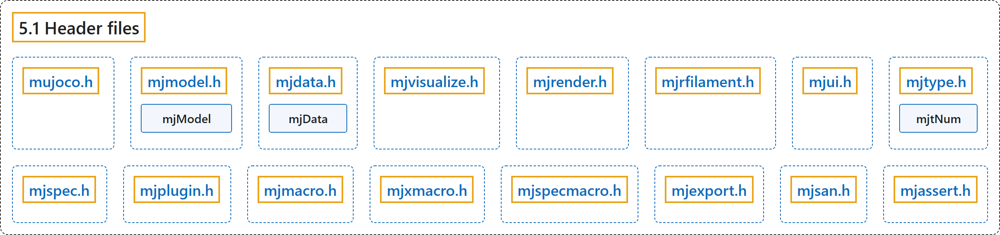

# 5.1 Header files

## Classification

## Glossary

| Term | Definition | 中文翻译 | Source |
|---|---|---|---|
| **5.1 Header files** 头文件 | (context) "The distribution contains **several header files which are identical on all platforms**." | （语境）发行包中包含**若干在所有平台上都相同的头文件**。 | [Google DeepMind, n.d., "Header files", para. 1](https://mujoco.readthedocs.io/en/stable/programming/index.html#header-files) |
| **mujoco.h** 主头文件 mujoco.h | "This is **the main header file and must be included in all programs using MuJoCo**." | 这是**主头文件，所有使用 MuJoCo 的程序都必须包含它**。 | [Google DeepMind, n.d., "Header files", item 1](https://mujoco.readthedocs.io/en/stable/programming/index.html#header-files) |
| **mjmodel.h** mjmodel.h 头文件 | "Defines **the C structure mjModel** which is the runtime representation of the model being simulated." | 定义**C 结构体 mjModel**，它是被仿真模型的运行时表示。 | [Google DeepMind, n.d., "Header files", item 2](https://mujoco.readthedocs.io/en/stable/programming/index.html#header-files) |
| **mjModel** 模型结构体 mjModel | "Defines the C structure mjModel which is **the runtime representation of the model being simulated**." | 定义 C 结构体 mjModel，它是**被仿真模型的运行时表示**。 | [Google DeepMind, n.d., "Header files", item 2](https://mujoco.readthedocs.io/en/stable/programming/index.html#header-files) |
| **mjdata.h** mjdata.h 头文件 | "Defines **the C structure mjData** which is the workspace where all computations read their inputs and write their outputs." | 定义**C 结构体 mjData**，它是所有计算读取输入、写入输出的工作区。 | [Google DeepMind, n.d., "Header files", item 3](https://mujoco.readthedocs.io/en/stable/programming/index.html#header-files) |
| **mjData** 数据结构体 mjData | "Defines the C structure mjData which is **the workspace where all computations read their inputs and write their outputs**." | 定义 C 结构体 mjData，它是**所有计算读取输入、写入输出的工作区**。 | [Google DeepMind, n.d., "Header files", item 3](https://mujoco.readthedocs.io/en/stable/programming/index.html#header-files) |
| **mjvisualize.h** mjvisualize.h 头文件 | "Defines **the primitive types and structures needed by the abstract visualizer**." | 定义**抽象可视化器所需的基本类型和结构体**。 | [Google DeepMind, n.d., "Header files", item 4](https://mujoco.readthedocs.io/en/stable/programming/index.html#header-files) |
| **mjrender.h** mjrender.h 头文件 | "Defines **the primitive types and structures needed by the OpenGL renderer**." | 定义**OpenGL 渲染器所需的基本类型和结构体**。 | [Google DeepMind, n.d., "Header files", item 5](https://mujoco.readthedocs.io/en/stable/programming/index.html#header-files) |
| **mjrfilament.h** mjrfilament.h 头文件 | "Defines **the primitive types and structures needed by the filament renderer**." | 定义**Filament 渲染器所需的基本类型和结构体**。 | [Google DeepMind, n.d., "Header files", item 6](https://mujoco.readthedocs.io/en/stable/programming/index.html#header-files) |
| **mjui.h** mjui.h 头文件 | "Defines **the primitive types and structures needed by the UI framework**." | 定义**UI 框架所需的基本类型和结构体**。 | [Google DeepMind, n.d., "Header files", item 7](https://mujoco.readthedocs.io/en/stable/programming/index.html#header-files) |
| **mjtype.h** mjtype.h 头文件 | "Defines **primitive types and enums**, including the mjtNum floating-point type to be either double or float (see mjtNum)." | 定义**基本类型和枚举**，包括取值为 double 或 float 的浮点类型 mjtNum（见 mjtNum）。 | [Google DeepMind, n.d., "Header files", item 8](https://mujoco.readthedocs.io/en/stable/programming/index.html#header-files) |
| **mjtNum** 浮点类型 mjtNum | "Defines primitive types and enums, including **the mjtNum floating-point type to be either double or float** (see mjtNum)." | 定义基本类型和枚举，包括**取值为 double 或 float 的浮点类型 mjtNum**（见 mjtNum）。 | [Google DeepMind, n.d., "Header files", item 8](https://mujoco.readthedocs.io/en/stable/programming/index.html#header-files) |
| **mjspec.h** mjspec.h 头文件 | "Defines **enums and structs used for procedural model editing**." | 定义**程序化模型编辑所用的枚举和结构体**。 | [Google DeepMind, n.d., "Header files", item 9](https://mujoco.readthedocs.io/en/stable/programming/index.html#header-files) |
| **mjplugin.h** mjplugin.h 头文件 | "Defines **data structures required by engine plugins**." | 定义**引擎插件所需的数据结构**。 | [Google DeepMind, n.d., "Header files", item 10](https://mujoco.readthedocs.io/en/stable/programming/index.html#header-files) |
| **mjmacro.h** mjmacro.h 头文件 | "Defines **C macros that are useful in user code**." | 定义**在用户代码中有用的 C 宏**。 | [Google DeepMind, n.d., "Header files", item 11](https://mujoco.readthedocs.io/en/stable/programming/index.html#header-files) |
| **mjxmacro.h** mjxmacro.h 头文件 | "This file is optional and is not included by mujoco.h. It defines **X Macros that can automate the mapping of mjModel and mjData into scripting languages**, as well as other operations that require accessing all fields of mjModel and mjData." | 此文件是可选的，不被 mujoco.h 包含。它定义了**可将 mjModel 和 mjData 自动映射到脚本语言的 X 宏**，以及其他需要访问 mjModel 和 mjData 全部字段的操作。 | [Google DeepMind, n.d., "Header files", item 12](https://mujoco.readthedocs.io/en/stable/programming/index.html#header-files) |
| **mjspecmacro.h** mjspecmacro.h 头文件 | "This file is optional and is not included by mujoco.h. It defines **X Macros that can automate the mapping of mjSpec and its element structs into scripting languages**, as well as other operations that require accessing all fields of mjSpec during procedural model editing." | 此文件是可选的，不被 mujoco.h 包含。它定义了**可将 mjSpec 及其元素结构体自动映射到脚本语言的 X 宏**，以及程序化模型编辑中其他需要访问 mjSpec 全部字段的操作。 | [Google DeepMind, n.d., "Header files", item 13](https://mujoco.readthedocs.io/en/stable/programming/index.html#header-files) |
| **mjexport.h** mjexport.h 头文件 | "Macros used for **exporting public symbols from the MuJoCo library**." | 用于**从 MuJoCo 库导出公共符号**的宏。 | [Google DeepMind, n.d., "Header files", item 14](https://mujoco.readthedocs.io/en/stable/programming/index.html#header-files) |
| **mjsan.h** mjsan.h 头文件 | "Definitions required when **building with sanitizer instrumentation**." | 使用 sanitizer 插桩构建时所需的定义。 | [Google DeepMind, n.d., "Header files", item 15](https://mujoco.readthedocs.io/en/stable/programming/index.html#header-files) |
| **mjassert.h** mjassert.h 头文件 | "Compile-time size assertions **verifying MuJoCo ABI stability across C and C++ compilers**." | 编译期的大小断言，**用于验证 MuJoCo 的 ABI 在 C 和 C++ 编译器之间的稳定性**。 | [Google DeepMind, n.d., "Header files", item 16](https://mujoco.readthedocs.io/en/stable/programming/index.html#header-files) |

## References

Google DeepMind. (n.d.). *Programming*. MuJoCo Documentation (Version 3.17.0). Retrieved October 31, 2026, from <https://mujoco.readthedocs.io/en/stable/programming/index.html>
