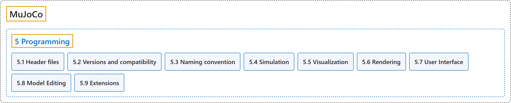

# 5. Programming

## Classification

## Glossary

| Term | Definition | 中文翻译 | Source |
|---|---|---|---|
| **5 Programming** 编程 | "This chapter is **the MuJoCo programming guide**." | 本章是 **MuJoCo 编程指南**。 | [Google DeepMind, n.d.-c, "Introduction", para. 1](https://mujoco.readthedocs.io/en/stable/programming/index.html#introduction) |
| **[5.1 Header files](header-files.md)** 头文件 | (context) "The distribution contains **several header files which are identical on all platforms**." | （语境）发行包中包含**若干在所有平台上都相同的头文件**。 | [Google DeepMind, n.d.-c, "Header files", para. 1](https://mujoco.readthedocs.io/en/stable/programming/index.html#header-files) |
| **[5.2 Versions and compatibility](versions-and-compatibility.md)** 版本与兼容性 | (No definition) | （无定义） | [Google DeepMind, n.d.-c, "Versions and compatibility"](https://mujoco.readthedocs.io/en/stable/programming/index.html#versions-and-compatibility) |
| **[5.3 Naming convention](naming-convention.md)** 命名约定 | (context) "All symbols defined in the API **start with the prefix “mj”**." | （语境）API 中定义的所有符号**都以前缀“mj”开头**。 | [Google DeepMind, n.d.-c, "Naming convention", para. 1](https://mujoco.readthedocs.io/en/stable/programming/index.html#naming-convention) |
| **[5.4 Simulation](simulation.md)** 仿真 | (No definition) | （无定义） | [Google DeepMind, n.d.-e, "Simulation"](https://mujoco.readthedocs.io/en/stable/programming/simulation.html#simulation) |
| **[5.5 Visualization](visualization.md)** 可视化 | (context) "MuJoCo has **a native 3D visualization layer that is independent of any graphics library**." | （语境）MuJoCo 有**一个不依赖任何图形库的原生三维可视化层**。 | [Google DeepMind, n.d.-g, "Visualization", para. 1](https://mujoco.readthedocs.io/en/stable/programming/visualization.html#abstract) |
| **[5.6 Rendering](rendering.md)** 渲染 | (context) "MuJoCo provides **two built-in 3D rendering backends that support both interactive onscreen viewers and headless offscreen rendering**:" | （语境）MuJoCo 提供**两个内置的三维渲染后端，既支持交互式屏幕查看器，也支持无界面的离屏渲染**： | [Google DeepMind, n.d.-d, "Rendering", para. 1](https://mujoco.readthedocs.io/en/stable/programming/rendering.html#rendering) |
| **[5.7 User Interface](user-interface.md)** 用户界面 | (context) "MuJoCo has **a native UI framework**." | （语境）MuJoCo 有**一个原生的 UI 框架**。 | [Google DeepMind, n.d.-f, "User Interface", para. 1](https://mujoco.readthedocs.io/en/stable/programming/ui.html#user-interface) |
| **[5.8 Model Editing](model-editing.md)** 模型编辑 | (context) "It is possible to **create and modify models using the mjSpec struct and related API**." | （语境）可以**用 mjSpec 结构体和相关 API 创建和修改模型**。 | [Google DeepMind, n.d.-b, "Model Editing", para. 1](https://mujoco.readthedocs.io/en/stable/programming/modeledit.html#model-editing) |
| **[5.9 Extensions](extensions.md)** 扩展 | (context) "At present, extensibility is provided by via **engine plugins, decoders, and resource providers**." | （语境）目前，可扩展性由**引擎插件、解码器和资源提供者**提供。 | [Google DeepMind, n.d.-a, "Extensions", para. 1](https://mujoco.readthedocs.io/en/stable/programming/extension.html#extensions) |

## References

Google DeepMind. (n.d.-a). *Extensions*. MuJoCo Documentation (Version 3.17.0). Retrieved October 31, 2026, from <https://mujoco.readthedocs.io/en/stable/programming/extension.html>

Google DeepMind. (n.d.-b). *Model Editing*. MuJoCo Documentation (Version 3.17.0). Retrieved October 31, 2026, from <https://mujoco.readthedocs.io/en/stable/programming/modeledit.html>

Google DeepMind. (n.d.-c). *Programming*. MuJoCo Documentation (Version 3.17.0). Retrieved October 31, 2026, from <https://mujoco.readthedocs.io/en/stable/programming/index.html>

Google DeepMind. (n.d.-d). *Rendering*. MuJoCo Documentation (Version 3.17.0). Retrieved October 31, 2026, from <https://mujoco.readthedocs.io/en/stable/programming/rendering.html>

Google DeepMind. (n.d.-e). *Simulation*. MuJoCo Documentation (Version 3.17.0). Retrieved October 31, 2026, from <https://mujoco.readthedocs.io/en/stable/programming/simulation.html>

Google DeepMind. (n.d.-f). *User Interface*. MuJoCo Documentation (Version 3.17.0). Retrieved October 31, 2026, from <https://mujoco.readthedocs.io/en/stable/programming/ui.html>

Google DeepMind. (n.d.-g). *Visualization*. MuJoCo Documentation (Version 3.17.0). Retrieved October 31, 2026, from <https://mujoco.readthedocs.io/en/stable/programming/visualization.html>
