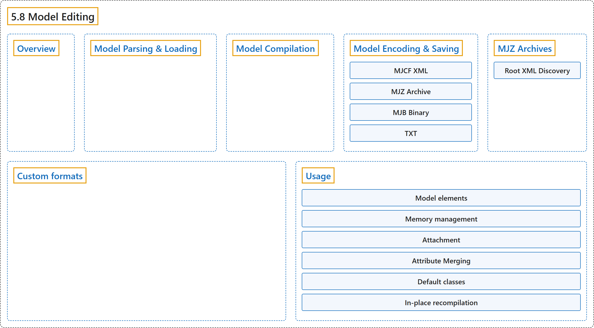

# 5.8 Model Editing

## Classification

## Glossary

| Term | Definition | 中文翻译 | Source |
|---|---|---|---|
| **5.8 Model Editing** 模型编辑 | (context) "It is possible to **create and modify models using the mjSpec struct and related API**." | （语境）可以**用 mjSpec 结构体和相关 API 创建和修改模型**。 | [Google DeepMind, n.d., "Model Editing", para. 1](https://mujoco.readthedocs.io/en/stable/programming/modeledit.html#model-editing) |
| **Overview** 概述 | "The API augments the traditional workflow of creating and editing models using XML files, **breaking up the parse and compile steps**." | 这套 API 扩充了用 XML 文件创建和编辑模型的传统工作流程，**把解析和编译两个步骤拆开**。 | [Google DeepMind, n.d., "Overview", para. 1](https://mujoco.readthedocs.io/en/stable/programming/modeledit.html#overview) |
| **Model Parsing & Loading** 模型解析与加载 | "As summarized in Model instances, model description files (MJCF, MJZ, URDF, USD) are **parsed into an mjSpec using mj_parse** (or mjSpec.from_file() / mjSpec.from_string() in Python)." | 如“模型实例”一节所概述，模型描述文件（MJCF、MJZ、URDF、USD）**用 mj_parse 解析为 mjSpec**（在 Python 中用 mjSpec.from_file() 或 mjSpec.from_string()）。 | [Google DeepMind, n.d., "Model Parsing & Loading", para. 1](https://mujoco.readthedocs.io/en/stable/programming/modeledit.html#model-parsing-loading) |
| **Model Compilation** 模型编译 | "Once a high-level mjSpec is created—by parsing a file, loading an archive, or constructing it programmatically—it is **compiled into an mjModel using mj_compile**." | 高层的 mjSpec 一旦创建（通过解析文件、加载归档或以编程方式构建），就**用 mj_compile 编译成 mjModel**。 | [Google DeepMind, n.d., "Model Compilation", para. 1](https://mujoco.readthedocs.io/en/stable/programming/modeledit.html#model-compilation) |
| **Model Encoding & Saving** 模型编码与保存 | "Model specs and compiled models can be **serialized to files using mj_encode**, or directly saved to XML strings using mj_saveXMLString or mj_saveXML." | 模型 spec 和编译后的模型可以**用 mj_encode 序列化到文件**，或用 mj_saveXMLString 或 mj_saveXML 直接保存为 XML 字符串。 | [Google DeepMind, n.d., "Model Encoding & Saving", para. 1](https://mujoco.readthedocs.io/en/stable/programming/modeledit.html#model-encoding-saving) |
| **MJCF XML** MJCF XML 格式 | "Flattens **the spec into a single MJCF XML file** using mj_saveXML." | 用 mj_saveXML 把**spec 展平为单个 MJCF XML 文件**。 | [Google DeepMind, n.d., "Model Encoding & Saving", item 1](https://mujoco.readthedocs.io/en/stable/programming/modeledit.html#model-encoding-saving) |
| **MJZ Archive** MJZ 归档 | "Bundles **the spec and all associated external assets (meshes, textures, included XMLs) into a self-contained Zip archive** via the built-in mjz_encoder." | 通过内置的 mjz_encoder 把**spec 及所有关联的外部资源（网格、纹理、被包含的 XML）打包成一个自包含的 Zip 归档**。 | [Google DeepMind, n.d., "Model Encoding & Saving", item 2](https://mujoco.readthedocs.io/en/stable/programming/modeledit.html#model-encoding-saving) |
| **MJB Binary** MJB 二进制 | "Serializes **the compiled mjModel in MuJoCo binary format** via mj_saveModel." | 通过 mj_saveModel 把**编译后的 mjModel 序列化为 MuJoCo 二进制格式**。 | [Google DeepMind, n.d., "Model Encoding & Saving", item 3](https://mujoco.readthedocs.io/en/stable/programming/modeledit.html#model-encoding-saving) |
| **TXT** TXT 文本 | "Writes **a human-readable text dump** via mj_printModel." | 通过 mj_printModel 写出**人类可读的文本转储**。 | [Google DeepMind, n.d., "Model Encoding & Saving", item 4](https://mujoco.readthedocs.io/en/stable/programming/modeledit.html#model-encoding-saving) |
| **MJZ Archives** MJZ 归档 | "The MJZ format (extension .mjz or .zip) provides **a convenient way to bundle an entire model and all of its referenced assets into a single Zip archive**." | MJZ 格式（扩展名 .mjz 或 .zip）提供了**一种方便的方式，把整个模型及其引用的所有资源打包成单个 Zip 归档**。 | [Google DeepMind, n.d., "MJZ Archives", para. 1](https://mujoco.readthedocs.io/en/stable/programming/modeledit.html#mjz-archives) |
| **Root XML Discovery** 根 XML 查找 | (context) "When decoding an .mjz archive, MuJoCo **searches for the root model XML file in the following order**:" | （语境）解码 .mjz 归档时，MuJoCo **按以下顺序查找根模型 XML 文件**： | [Google DeepMind, n.d., "Root XML Discovery", para. 1](https://mujoco.readthedocs.io/en/stable/programming/modeledit.html#root-xml-discovery) |
| **Custom formats** 自定义格式 | (context) "Adding support for new file formats can be done with **mjp_registerDecoder and mjp_registerEncoder**." | （语境）可以用 **mjp_registerDecoder 和 mjp_registerEncoder** 添加对新文件格式的支持。 | [Google DeepMind, n.d., "Custom formats", para. 1](https://mujoco.readthedocs.io/en/stable/programming/modeledit.html#custom-formats) |
| **Usage** 用法 | (context) "Here we describe **the C API for procedural model editing**, but it is also exposed in the Python bindings." | （语境）这里介绍**用于程序化模型编辑的 C API**，它也在 Python 绑定中提供。 | [Google DeepMind, n.d., "Usage", para. 1](https://mujoco.readthedocs.io/en/stable/programming/modeledit.html#usage) |
| **Model elements** 模型元素 | "Model elements corresponding to MJCF are **exposed to the user as C structs with the mjs prefix**." | 对应 MJCF 的模型元素**以带 mjs 前缀的 C 结构体提供给用户**。 | [Google DeepMind, n.d., "Model elements", para. 1](https://mujoco.readthedocs.io/en/stable/programming/modeledit.html#model-elements) |
| **Memory management** 内存管理 | "The library **takes ownership of all elements and frees them when the parent mjSpec is deleted** using mj_deleteSpec." | 库**拥有所有元素的所有权，并在用 mj_deleteSpec 删除父 mjSpec 时释放它们**。 | [Google DeepMind, n.d., "Memory management", para. 1](https://mujoco.readthedocs.io/en/stable/programming/modeledit.html#memory-management) |
| **Attachment** 附加 | "Attachment allows the user to **move or copy a subtree from one model into another**, while also copying or moving related referenced assets and referencing elements from outside the kinematic tree (e.g., actuators and sensors)." | 附加允许用户**把一个子树从一个模型移动或复制到另一个模型中**，同时复制或移动相关的被引用资源，以及运动学树之外引用它的元素（例如执行器和传感器）。 | [Google DeepMind, n.d., "Attachment", para. 1](https://mujoco.readthedocs.io/en/stable/programming/modeledit.html#attachment) |
| **shallow copy** 浅复制 | "The default behavior (“shallow copy”) is to **move the child into the parent while attaching**, so subsequent changes to the child will also change the parent." | 默认行为（“浅复制”）是**在附加时把子模型移入父模型**，因此之后对子模型的修改也会改变父模型。 | [Google DeepMind, n.d., "Attachment", para. 1](https://mujoco.readthedocs.io/en/stable/programming/modeledit.html#attachment) |
| **Attribute Merging** 属性合并 | "A conflict occurs when **both the parent and child specify authored values for the same field and those values differ**." | 当**父模型和子模型对同一字段都指定了显式设置的值，且这些值不同**时，就发生冲突。 | [Google DeepMind, n.d., "Attribute Merging", para. 1](https://mujoco.readthedocs.io/en/stable/programming/modeledit.html#attribute-merging) |
| **warning (default)** warning（默认） | "Parent values take precedence. Whenever a conflict is detected, **a warning is emitted but the parent value is not modified**." | 父模型的值优先。每当检测到冲突时，**发出一个警告，但父模型的值不被修改**。 | [Google DeepMind, n.d., "Attribute Merging", item 1](https://mujoco.readthedocs.io/en/stable/programming/modeledit.html#attribute-merging) |
| **merge** merge（合并） | "Attribute values are **merged using a per-field strategy** as described in the table below." | 属性值**按逐字段策略合并**，见下表。 | [Google DeepMind, n.d., "Attribute Merging", item 2](https://mujoco.readthedocs.io/en/stable/programming/modeledit.html#attribute-merging) |
| **error** error（报错） | "Any conflict results in **a compile error**." | 任何冲突都会导致**编译错误**。 | [Google DeepMind, n.d., "Attribute Merging", item 3](https://mujoco.readthedocs.io/en/stable/programming/modeledit.html#attribute-merging) |
| **Default classes** 默认类 | "As explained in the Default settings section, default classes are **first loaded as a tree of dummy elements, which are then used to initialize elements which reference them**." | 如“默认设置”一节所述，默认类**先被加载为一棵由虚元素组成的树，再用来初始化引用它们的元素**。 | [Google DeepMind, n.d., "Default classes", para. 1](https://mujoco.readthedocs.io/en/stable/programming/modeledit.html#default-classes) |
| **In-place recompilation** 就地重新编译 | "In contrast, mj_recompile **updates an existing mjModel and mjData pair in-place, while preserving the simulation state**." | 相比之下，mj_recompile **就地更新已有的一对 mjModel 和 mjData，同时保留仿真状态**。 | [Google DeepMind, n.d., "In-place recompilation", para. 1](https://mujoco.readthedocs.io/en/stable/programming/modeledit.html#in-place-recompilation) |

## References

Google DeepMind. (n.d.). *Model Editing*. MuJoCo Documentation (Version 3.17.0). Retrieved October 31, 2026, from <https://mujoco.readthedocs.io/en/stable/programming/modeledit.html>
