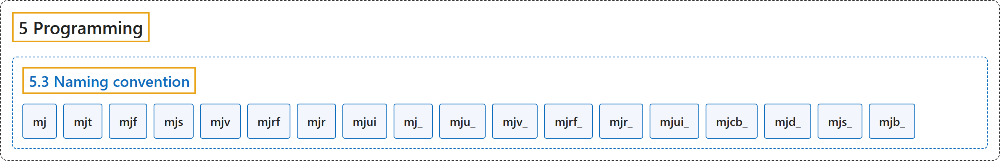

# 5.3 Naming convention

## Classification

## Glossary

| Term | Definition | 中文翻译 | Source |
|---|---|---|---|
| **5.3 Naming convention** 命名约定 | (context) "All symbols defined in the API **start with the prefix “mj”**." | （语境）API 中定义的所有符号**都以前缀“mj”开头**。 | [Google DeepMind, n.d., "Naming convention", para. 1](https://mujoco.readthedocs.io/en/stable/programming/index.html#naming-convention) |
| **mj** mj 前缀 | "Core **simulation data structure (C struct)**, for example mjModel." | 核心**仿真数据结构（C 结构体）**，例如 mjModel。 | [Google DeepMind, n.d., "Naming convention", item 1](https://mujoco.readthedocs.io/en/stable/programming/index.html#naming-convention) |
| **mjt** mjt 前缀 | "Primitive type, for example mjtNum and mjtGeom. **Most types in this family are enums**." | 基本类型，例如 mjtNum 和 mjtGeom。**这一族中的大多数类型是枚举**。 | [Google DeepMind, n.d., "Naming convention", item 2](https://mujoco.readthedocs.io/en/stable/programming/index.html#naming-convention) |
| **mjf** mjf 前缀 | "Callback **function type**, for example mjfGeneric." | 回调**函数类型**，例如 mjfGeneric。 | [Google DeepMind, n.d., "Naming convention", item 3](https://mujoco.readthedocs.io/en/stable/programming/index.html#naming-convention) |
| **mjs** mjs 前缀 | "Data structure **related to procedural model editing**, for example mjsJoint." | 与程序化模型编辑相关的数据结构，例如 mjsJoint。 | [Google DeepMind, n.d., "Naming convention", item 4](https://mujoco.readthedocs.io/en/stable/programming/index.html#naming-convention) |
| **mjv** mjv 前缀 | "Data structure **related to abstract visualization**, for example mjvCamera." | 与抽象可视化相关的数据结构，例如 mjvCamera。 | [Google DeepMind, n.d., "Naming convention", item 5](https://mujoco.readthedocs.io/en/stable/programming/index.html#naming-convention) |
| **mjrf** mjrf 前缀 | "Data structure **related to filament rendering**, for example mjrfContext." | 与 Filament 渲染相关的数据结构，例如 mjrfContext。 | [Google DeepMind, n.d., "Naming convention", item 6](https://mujoco.readthedocs.io/en/stable/programming/index.html#naming-convention) |
| **mjr** mjr 前缀 | "Data structure **related to OpenGL rendering**, for example mjrContext." | 与 OpenGL 渲染相关的数据结构，例如 mjrContext。 | [Google DeepMind, n.d., "Naming convention", item 7](https://mujoco.readthedocs.io/en/stable/programming/index.html#naming-convention) |
| **mjui** mjui 前缀 | "Data structure **related to UI framework**, for example mjuiSection." | 与 UI 框架相关的数据结构，例如 mjuiSection。 | [Google DeepMind, n.d., "Naming convention", item 8](https://mujoco.readthedocs.io/en/stable/programming/index.html#naming-convention) |
| **mj_** mj_ 前缀 | "Core **simulation function**, for example mj_step." | 核心**仿真函数**，例如 mj_step。 | [Google DeepMind, n.d., "Naming convention", item 9](https://mujoco.readthedocs.io/en/stable/programming/index.html#naming-convention) |
| **mju_** mju_ 前缀 | "Utility function, for example mju_mulMatVec. These functions are **self-contained in the sense that they do not have mjModel and mjData pointers as their arguments**." | 工具函数，例如 mju_mulMatVec。这些函数是**自包含的，即它们的参数中没有 mjModel 和 mjData 指针**。 | [Google DeepMind, n.d., "Naming convention", item 10](https://mujoco.readthedocs.io/en/stable/programming/index.html#naming-convention) |
| **mjv_** mjv_ 前缀 | "Function **related to abstract visualization**, for example mjv_updateScene." | 与抽象可视化相关的函数，例如 mjv_updateScene。 | [Google DeepMind, n.d., "Naming convention", item 11](https://mujoco.readthedocs.io/en/stable/programming/index.html#naming-convention) |
| **mjrf_** mjrf_ 前缀 | "Function **related to filament rendering**, for example mjrf_render." | 与 Filament 渲染相关的函数，例如 mjrf_render。 | [Google DeepMind, n.d., "Naming convention", item 12](https://mujoco.readthedocs.io/en/stable/programming/index.html#naming-convention) |
| **mjr_** mjr_ 前缀 | "Function **related to OpenGL rendering**, for example mjr_render." | 与 OpenGL 渲染相关的函数，例如 mjr_render。 | [Google DeepMind, n.d., "Naming convention", item 13](https://mujoco.readthedocs.io/en/stable/programming/index.html#naming-convention) |
| **mjui_** mjui_ 前缀 | "Function **related to UI framework**, for example mjui_update." | 与 UI 框架相关的函数，例如 mjui_update。 | [Google DeepMind, n.d., "Naming convention", item 14](https://mujoco.readthedocs.io/en/stable/programming/index.html#naming-convention) |
| **mjcb_** mjcb_ 前缀 | "Global **callback function pointer**, for example mjcb_control." | 全局**回调函数指针**，例如 mjcb_control。 | [Google DeepMind, n.d., "Naming convention", item 15](https://mujoco.readthedocs.io/en/stable/programming/index.html#naming-convention) |
| **mjd_** mjd_ 前缀 | "Functions for **computing derivatives**, for example mjd_transitionFD." | 用于**计算导数**的函数，例如 mjd_transitionFD。 | [Google DeepMind, n.d., "Naming convention", item 16](https://mujoco.readthedocs.io/en/stable/programming/index.html#naming-convention) |
| **mjs_** mjs_ 前缀 | "Functions for **procedural model editing**, for example mjs_addJoint." | 用于**程序化模型编辑**的函数，例如 mjs_addJoint。 | [Google DeepMind, n.d., "Naming convention", item 17](https://mujoco.readthedocs.io/en/stable/programming/index.html#naming-convention) |
| **mjb_** mjb_ 前缀 | "Functions for **batched simulation**, declared in mujoco/mjbatch.h, for example mjb_step." | 用于**批量仿真**的函数，声明在 mujoco/mjbatch.h 中，例如 mjb_step。 | [Google DeepMind, n.d., "Naming convention", item 18](https://mujoco.readthedocs.io/en/stable/programming/index.html#naming-convention) |

## References

Google DeepMind. (n.d.). *Programming*. MuJoCo Documentation (Version 3.17.0). Retrieved October 31, 2026, from <https://mujoco.readthedocs.io/en/stable/programming/index.html>
