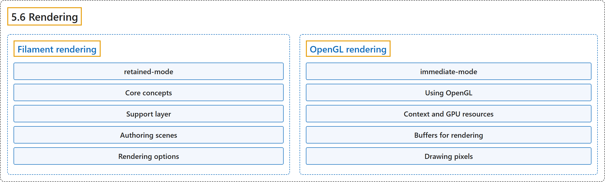

# 5.6 Rendering

## Classification

## Glossary

| Term | Definition | 中文翻译 | Source |
|---|---|---|---|
| **5.6 Rendering** 渲染 | (context) "MuJoCo provides **two built-in 3D rendering backends that support both interactive onscreen viewers and headless offscreen rendering**:" | （语境）MuJoCo 提供**两个内置的三维渲染后端，既支持交互式屏幕查看器，也支持无界面的离屏渲染**： | [Google DeepMind, n.d., "Rendering", para. 1](https://mujoco.readthedocs.io/en/stable/programming/rendering.html#rendering) |
| **Filament rendering** Filament 渲染 | "MuJoCo provides **a renderer based on Filament, Google’s real-time physically based rendering engine**." | MuJoCo 提供**一个基于 Filament（Google 的实时基于物理的渲染引擎）的渲染器**。 | [Google DeepMind, n.d., "Filament rendering", para. 1](https://mujoco.readthedocs.io/en/stable/programming/rendering.html#filament-rendering) |
| **retained-mode** 保留模式 | "It uses a retained-mode, asynchronous architecture in which **meshes, textures, lights, and renderables are created once from mjModel and updated in place from mjData each frame**." | 它采用保留模式的异步架构，其中**网格、纹理、灯光和可渲染对象从 mjModel 创建一次，然后每帧根据 mjData 就地更新**。 | [Google DeepMind, n.d., "Rendering", item 1](https://mujoco.readthedocs.io/en/stable/programming/rendering.html#rendering) |
| **Core concepts** 核心概念 | (context) "The mjrf C API revolves around **seven opaque object types**" | （语境）mjrf C API 围绕**七种不透明对象类型**展开 | [Google DeepMind, n.d., "Core concepts", para. 1](https://mujoco.readthedocs.io/en/stable/programming/rendering.html#core-concepts) |
| **mjrfContext** Filament 上下文 mjrfContext | "mjrfContext is **the entry point to the Filament renderer**." | mjrfContext 是**Filament 渲染器的入口**。 | [Google DeepMind, n.d., "Core concepts", item 1](https://mujoco.readthedocs.io/en/stable/programming/rendering.html#core-concepts) |
| **mjrfScene** Filament 场景 mjrfScene | "A mjrfScene is **a container of lights, renderables, and an optional skybox texture**;" | mjrfScene 是**容纳灯光、可渲染对象和一个可选天空盒纹理的容器**； | [Google DeepMind, n.d., "Core concepts", item 1](https://mujoco.readthedocs.io/en/stable/programming/rendering.html#core-concepts) |
| **mjrfMesh** Filament 网格 mjrfMesh | "mjrfMesh **stores vertex attributes (positions, packed tangent-frame orientations, UVs) and indices** uploaded via mjrf_uploadMesh, along with bounding boxes used for frustum culling." | mjrfMesh **存储顶点属性（位置、打包的切线坐标系朝向、UV）和索引**，它们通过 mjrf_uploadMesh 上传，还存储用于视锥剔除的包围盒。 | [Google DeepMind, n.d., "Core concepts", item 2](https://mujoco.readthedocs.io/en/stable/programming/rendering.html#core-concepts) |
| **mjrfTexture** Filament 纹理 mjrfTexture | "mjrfTexture **stores 2D, cubemap, or KTX-compressed image data** uploaded via mjrf_uploadTexture." | mjrfTexture **存储二维、立方体贴图或 KTX 压缩的图像数据**，它们通过 mjrf_uploadTexture 上传。 | [Google DeepMind, n.d., "Core concepts", item 2](https://mujoco.readthedocs.io/en/stable/programming/rendering.html#core-concepts) |
| **mjrfRenderable** 可渲染对象 mjrfRenderable | "An mjrfRenderable is **a persistent drawable entity in a scene, combining surface geometry, material appearance, and a 3D transform**:" | mjrfRenderable 是**场景中一个持久的可绘制实体，组合了表面几何、材质外观和三维变换**： | [Google DeepMind, n.d., "Core concepts", item 3](https://mujoco.readthedocs.io/en/stable/programming/rendering.html#core-concepts) |
| **Geometry** 几何 | "A renderable can reference either **a custom mjrfMesh (via mjrf_setRenderableMesh) or a built-in geometric primitive** such as a sphere, capsule, cylinder, box, or ellipsoid (via mjrf_setRenderableGeomMesh, which caches and shares underlying mesh buffers across renderables with matching quality parameters)." | 可渲染对象可以引用**一个自定义的 mjrfMesh（通过 mjrf_setRenderableMesh），或一个内置几何图元**，如球、胶囊、圆柱、长方体或椭球（通过 mjrf_setRenderableGeomMesh，它会缓存底层网格缓冲区，并在质量参数相同的可渲染对象之间共享）。 | [Google DeepMind, n.d., "Core concepts", item 3](https://mujoco.readthedocs.io/en/stable/programming/rendering.html#core-concepts) |
| **Material** 材质 | "mjrf_setRenderableMaterial applies an mjrfMaterial struct, which **selects between three shading models**: metallic-roughness PBR, legacy specular-glossiness (Phong), or unlit rendering for UI and decorative overlays (decor, which also places the object on the decor layer and disables shadows)." | mjrf_setRenderableMaterial 应用一个 mjrfMaterial 结构体，它**在三种着色模型之间选择**：金属度-粗糙度 PBR、旧式镜面-光泽度（Phong），或用于 UI 和装饰叠加层的无光照渲染（decor，它还会把对象放到装饰层并关闭阴影）。 | [Google DeepMind, n.d., "Core concepts", item 3](https://mujoco.readthedocs.io/en/stable/programming/rendering.html#core-concepts) |
| **mjrfMaterial** Filament 材质 mjrfMaterial | (context) "Plain structs such as mjrfMaterial and mjrfRenderRequest **describe how these objects are configured and drawn**." | （语境）像 mjrfMaterial 和 mjrfRenderRequest 这样的普通结构体**描述这些对象如何配置和绘制**。 | [Google DeepMind, n.d., "Core concepts", para. 1](https://mujoco.readthedocs.io/en/stable/programming/rendering.html#core-concepts) |
| **Pose and size** 位姿与尺寸 | "On each frame, mjrf_setRenderablePose **updates the renderable’s 3D position and rotation matrix in place**, and mjrf_setRenderableSize updates its scale (handling non-uniform primitive scaling such as keeping capsule end-caps spherical)." | 每一帧，mjrf_setRenderablePose **就地更新可渲染对象的三维位置和旋转矩阵**，mjrf_setRenderableSize 更新它的缩放（处理图元的非均匀缩放，例如保持胶囊端帽为球形）。 | [Google DeepMind, n.d., "Core concepts", item 3](https://mujoco.readthedocs.io/en/stable/programming/rendering.html#core-concepts) |
| **mjrfLight** Filament 灯光 mjrfLight | "mjrfLight **represents directional, spot, point, or image-based (IBL environment cubemap) light sources** added to a scene via mjrf_addSceneLight." | mjrfLight **表示平行光、聚光灯、点光源或基于图像的（IBL 环境立方体贴图）光源**，它们通过 mjrf_addSceneLight 添加到场景中。 | [Google DeepMind, n.d., "Core concepts", item 4](https://mujoco.readthedocs.io/en/stable/programming/rendering.html#core-concepts) |
| **headlight** 头灯 | "Note that the camera-aligned headlight is **specified on mjrfRenderRequest (with intensity in lux) rather than as a scene light**, so rendering the same scene from multiple cameras does not cross-illuminate views." | 注意，与相机对齐的头灯**在 mjrfRenderRequest 上指定（强度单位为勒克斯），而不是作为场景灯光**，因此从多个相机渲染同一场景时各视图不会相互照亮。 | [Google DeepMind, n.d., "Core concepts", item 4](https://mujoco.readthedocs.io/en/stable/programming/rendering.html#core-concepts) |
| **mjrfRenderTarget** 渲染目标 mjrfRenderTarget | (context) "Each mjrfRenderRequest pairs an mjrfScene with a camera (mjrCamera), viewport, **optional offscreen mjrfRenderTarget (or NULL for the native window)**, draw mode (mjrDrawMode: default, no-textures, wireframe, depth, solver islands, or segmentation by ID/color), and per-view flags (shadows, reflections, post-processing, headlight)." | （语境）每个 mjrfRenderRequest 把一个 mjrfScene 与相机（mjrCamera）、视口、**可选的离屏 mjrfRenderTarget（为 NULL 时表示原生窗口）**、绘制模式（mjrDrawMode：默认、无纹理、线框、深度、求解器岛，或按 ID/颜色分割）以及逐视图标志（阴影、反射、后处理、头灯）配成一组。 | [Google DeepMind, n.d., "Core concepts", item 5](https://mujoco.readthedocs.io/en/stable/programming/rendering.html#core-concepts) |
| **mjrfRenderRequest** 渲染请求 mjrfRenderRequest | "Each mjrfRenderRequest **pairs an mjrfScene with a camera (mjrCamera), viewport, optional offscreen mjrfRenderTarget (or NULL for the native window), draw mode** (mjrDrawMode: default, no-textures, wireframe, depth, solver islands, or segmentation by ID/color), and per-view flags (shadows, reflections, post-processing, headlight)." | 每个 mjrfRenderRequest **把一个 mjrfScene 与相机（mjrCamera）、视口、可选的离屏 mjrfRenderTarget（为 NULL 时表示原生窗口）、绘制模式配成一组**（mjrDrawMode：默认、无纹理、线框、深度、求解器岛，或按 ID/颜色分割），并带有逐视图标志（阴影、反射、后处理、头灯）。 | [Google DeepMind, n.d., "Core concepts", item 5](https://mujoco.readthedocs.io/en/stable/programming/rendering.html#core-concepts) |
| **mjrfReadRequest** 读取请求 mjrfReadRequest | "Offscreen pixel readbacks are **requested alongside render requests via mjrfReadRequest**." | 离屏像素回读**通过 mjrfReadRequest 与渲染请求一起提交**。 | [Google DeepMind, n.d., "Core concepts", item 5](https://mujoco.readthedocs.io/en/stable/programming/rendering.html#core-concepts) |
| **mjrfFrameHandle** 帧句柄 mjrfFrameHandle | "mjrf_render dispatches work to a dedicated render thread and returns an mjrfFrameHandle, which **the caller synchronizes on with mjrf_waitForFrame**." | mjrf_render 把工作分派给一个专用渲染线程，并返回一个 mjrfFrameHandle，**调用者用 mjrf_waitForFrame 在它上面同步**。 | [Google DeepMind, n.d., "Core concepts", item 5](https://mujoco.readthedocs.io/en/stable/programming/rendering.html#core-concepts) |
| **Support layer** 支持层 | (context) "most MuJoCo applications use **the support layer** in src/render/filament/support" | （语境）大多数 MuJoCo 应用使用 src/render/filament/support 中的**支持层** | [Google DeepMind, n.d., "Support layer", para. 1](https://mujoco.readthedocs.io/en/stable/programming/rendering.html#support-layer) |
| **ModelResources** 模型资源类 ModelResources | "Creates and owns **all mjrfMesh (meshes, convex hulls, and heightfields) and mjrfTexture resources from an mjModel**, and supports re-uploading modified assets dynamically." | 根据 mjModel 创建并持有**所有 mjrfMesh（网格、凸包和高度场）和 mjrfTexture 资源**，并支持动态重新上传修改过的资源。 | [Google DeepMind, n.d., "Support layer", item 1](https://mujoco.readthedocs.io/en/stable/programming/rendering.html#support-layer) |
| **ModelLights** 模型灯光类 ModelLights | "Populates and updates **the scene’s mjrfLight instances from mjModel and mjData**, and automatically configures fallback environment and directional lighting when a model does not define photometric light intensities." | 根据 mjModel 和 mjData 填充并更新**场景中的 mjrfLight 实例**，并在模型未定义光度学灯光强度时自动配置后备的环境光和平行光照明。 | [Google DeepMind, n.d., "Support layer", item 2](https://mujoco.readthedocs.io/en/stable/programming/rendering.html#support-layer) |
| **ModelRenderables** 模型可渲染对象类 ModelRenderables | "Creates **persistent mjrfRenderable entities for all model geoms, sites, skins, flexes, and spatial tendons**." | 为**所有模型 geom、site、蒙皮、柔性体和空间肌腱创建持久的 mjrfRenderable 实体**。 | [Google DeepMind, n.d., "Support layer", item 3](https://mujoco.readthedocs.io/en/stable/programming/rendering.html#support-layer) |
| **ModelDecorations** 模型装饰类 ModelDecorations | "Bridges **the abstract visualizer for transient decorative geometry**." | 为临时的装饰性几何**桥接抽象可视化器**。 | [Google DeepMind, n.d., "Support layer", item 4](https://mujoco.readthedocs.io/en/stable/programming/rendering.html#support-layer) |
| **Authoring scenes** 场景制作 | (context) "The Filament renderer **supports both models**." | （语境）Filament 渲染器**同时支持这两种模型**。 | [Google DeepMind, n.d., "Authoring scenes", para. 2](https://mujoco.readthedocs.io/en/stable/programming/rendering.html#authoring-scenes) |
| **Phong lighting model** Phong 光照模型 | "The classic renderer implements a traditional Phong lighting model: **surface color is a sum of ambient, diffuse, specular and emissive terms**, and light intensities are dimensionless values tuned by eye." | 经典渲染器实现了传统的 Phong 光照模型：**表面颜色是环境光、漫反射、镜面反射和自发光各项之和**，灯光强度是凭眼睛调节的无量纲值。 | [Google DeepMind, n.d., "Authoring scenes", para. 1](https://mujoco.readthedocs.io/en/stable/programming/rendering.html#authoring-scenes) |
| **physically-based rendering (PBR)** 基于物理的渲染（PBR） | "Modern physically-based rendering (PBR) engines **describe surfaces with empirically measurable properties and lights with photometric units**." | 现代基于物理的渲染（PBR）引擎**用可经验测量的属性描述表面，用光度学单位描述灯光**。 | [Google DeepMind, n.d., "Authoring scenes", para. 1](https://mujoco.readthedocs.io/en/stable/programming/rendering.html#authoring-scenes) |
| **Materials** 材质 | "A material is shaded with the PBR lighting model if it **defines any physical property**: a non-negative metallic or roughness coefficient, or texture layers with PBR roles (metallic, roughness, packed occlusion-roughness-metallic, normal, emissive, occlusion)." | 如果一个材质**定义了任何物理属性**，它就用 PBR 光照模型着色：非负的金属度或粗糙度系数，或具有 PBR 角色的纹理层（金属度、粗糙度、打包的遮蔽-粗糙度-金属度、法线、自发光、遮蔽）。 | [Google DeepMind, n.d., "Materials", para. 1](https://mujoco.readthedocs.io/en/stable/programming/rendering.html#materials) |
| **Lighting** 光照 | "Physical lighting is **enabled by the lights themselves**: if any light in the model has positive intensity, all lights are assumed to be photometric, with intensities measured in candela." | 物理光照**由灯光本身启用**：只要模型中有任何灯光强度为正，所有灯光就都被视为光度学灯光，强度以坎德拉计量。 | [Google DeepMind, n.d., "Lighting", para. 1](https://mujoco.readthedocs.io/en/stable/programming/rendering.html#lighting) |
| **image-based lighting** 基于图像的光照 | "Lights of type image provide image-based lighting: **the referenced texture illuminates the scene as an environment map**." | image 类型的灯光提供基于图像的光照：**被引用的纹理作为环境贴图照亮场景**。 | [Google DeepMind, n.d., "Lighting", para. 1](https://mujoco.readthedocs.io/en/stable/programming/rendering.html#lighting) |
| **Rendering options** 渲染选项 | "The Filament renderer provides **a set of options for controlling how the final image is rendered**." | Filament 渲染器提供**一组用于控制最终图像如何渲染的选项**。 | [Google DeepMind, n.d., "Rendering options", para. 1](https://mujoco.readthedocs.io/en/stable/programming/rendering.html#rendering-options) |
| **Shadows** 阴影 | (No definition) | （无定义） | [Google DeepMind, n.d., "Rendering options"](https://mujoco.readthedocs.io/en/stable/programming/rendering.html#rendering-options) |
| **Screen-space ambient occlusion** 屏幕空间环境光遮蔽 | (No definition) | （无定义） | [Google DeepMind, n.d., "Rendering options"](https://mujoco.readthedocs.io/en/stable/programming/rendering.html#rendering-options) |
| **Bloom** 泛光 | (No definition) | （无定义） | [Google DeepMind, n.d., "Rendering options"](https://mujoco.readthedocs.io/en/stable/programming/rendering.html#rendering-options) |
| **Color grading** 调色 | (No definition) | （无定义） | [Google DeepMind, n.d., "Rendering options"](https://mujoco.readthedocs.io/en/stable/programming/rendering.html#rendering-options) |
| **Exponential height fog** 指数高度雾 | (No definition) | （无定义） | [Google DeepMind, n.d., "Rendering options"](https://mujoco.readthedocs.io/en/stable/programming/rendering.html#rendering-options) |
| **Vignette** 暗角 | (No definition) | （无定义） | [Google DeepMind, n.d., "Rendering options"](https://mujoco.readthedocs.io/en/stable/programming/rendering.html#rendering-options) |
| **Background** 背景 | (No definition) | （无定义） | [Google DeepMind, n.d., "Rendering options"](https://mujoco.readthedocs.io/en/stable/programming/rendering.html#rendering-options) |
| **OpenGL rendering** OpenGL 渲染 | "The classic OpenGL renderer (mjr) **takes the mjvScene data structure populated in the Visualization stage and renders it**." | 经典 OpenGL 渲染器（mjr）**接收在可视化阶段填充好的 mjvScene 数据结构并渲染它**。 | [Google DeepMind, n.d., "OpenGL rendering", para. 1](https://mujoco.readthedocs.io/en/stable/programming/rendering.html#opengl-rendering) |
| **immediate-mode** 立即模式 | "It uses an immediate-mode scene architecture in which **mjv_updateScene populates an mjvScene with all geometric objects and lights on every frame**, and mjr_render draws it." | 它采用立即模式的场景架构，其中 **mjv_updateScene 每帧都用全部几何对象和灯光填充一个 mjvScene**，再由 mjr_render 绘制它。 | [Google DeepMind, n.d., "Rendering", item 2](https://mujoco.readthedocs.io/en/stable/programming/rendering.html#rendering) |
| **Using OpenGL** 使用 OpenGL | (context) "MuJoCo uses **OpenGL 1.5 in the compatibility profile** with the ARB_framebuffer_object and ARB_vertex_buffer_object extensions." | （语境）MuJoCo 使用**兼容性配置下的 OpenGL 1.5**，并使用 ARB_framebuffer_object 和 ARB_vertex_buffer_object 扩展。 | [Google DeepMind, n.d., "Using OpenGL", para. 1](https://mujoco.readthedocs.io/en/stable/programming/rendering.html#using-opengl) |
| **Context and GPU resources** 上下文与 GPU 资源 | (context) "The first step in the rendering process is to **create the model-specific GPU context mjrContext**." | （语境）渲染过程的第一步是**创建特定于模型的 GPU 上下文 mjrContext**。 | [Google DeepMind, n.d., "Context and GPU resources", para. 1](https://mujoco.readthedocs.io/en/stable/programming/rendering.html#context-and-gpu-resources) |
| **OpenGL context** OpenGL 上下文 | "An OpenGL context is **what enables the application to talk to the video driver and send rendering commands**." | OpenGL 上下文是**让应用能够与显卡驱动通信并发送渲染命令的东西**。 | [Google DeepMind, n.d., "Context and GPU resources", para. 2](https://mujoco.readthedocs.io/en/stable/programming/rendering.html#context-and-gpu-resources) |
| **mjrContext** GPU 上下文 mjrContext | "mjrContext is specific to MuJoCo. After creation, it contains **references (called “names” in OpenGL) to all the resources that were uploaded to the GPU by mjr_makeContext**." | mjrContext 是 MuJoCo 特有的。创建之后，它包含**对 mjr_makeContext 上传到 GPU 的所有资源的引用（在 OpenGL 中称为“名字”）**。 | [Google DeepMind, n.d., "Context and GPU resources", para. 3](https://mujoco.readthedocs.io/en/stable/programming/rendering.html#context-and-gpu-resources) |
| **Buffers for rendering** 渲染缓冲区 | "In MuJoCo we provide **systematic support for two framebuffers: the default window framebuffer, and one offscreen framebuffer**." | 在 MuJoCo 中，我们**系统地支持两个帧缓冲区：默认的窗口帧缓冲区和一个离屏帧缓冲区**。 | [Google DeepMind, n.d., "Buffers for rendering", para. 1](https://mujoco.readthedocs.io/en/stable/programming/rendering.html#buffers-for-rendering) |
| **framebuffer objects (FBOs)** 帧缓冲区对象（FBO） | (context) "In addition to the default window framebuffer, OpenGL can support **unlimited framebuffer objects (FBOs) for custom rendering**." | （语境）除了默认的窗口帧缓冲区，OpenGL 还可以支持**任意数量的用于自定义渲染的帧缓冲区对象（FBO）**。 | [Google DeepMind, n.d., "Buffers for rendering", para. 1](https://mujoco.readthedocs.io/en/stable/programming/rendering.html#buffers-for-rendering) |
| **mjtFramebuffer** 帧缓冲区枚举 mjtFramebuffer | (context) "They are referred to by **the constants in the enum type mjtFramebuffer**, namely mjFB_WINDOW and mjFB_OFFSCREEN." | （语境）它们用**枚举类型 mjtFramebuffer 中的常量**来指代，即 mjFB_WINDOW 和 mjFB_OFFSCREEN。 | [Google DeepMind, n.d., "Buffers for rendering", para. 1](https://mujoco.readthedocs.io/en/stable/programming/rendering.html#buffers-for-rendering) |
| **active buffer** 活动缓冲区 | "At any time, one of these two buffers is active for the purposes of MuJoCo rendering, meaning that **all subsequent commands are directed to it**." | 在任何时刻，这两个缓冲区中有一个对 MuJoCo 渲染而言是活动的，意思是**之后的所有命令都发往它**。 | [Google DeepMind, n.d., "Buffers for rendering", para. 1](https://mujoco.readthedocs.io/en/stable/programming/rendering.html#buffers-for-rendering) |
| **window framebuffer** 窗口帧缓冲区 | "The window framebuffer is **created and managed by the operating system and not by OpenGL**." | 窗口帧缓冲区**由操作系统而不是由 OpenGL 创建和管理**。 | [Google DeepMind, n.d., "Buffers for rendering", para. 3](https://mujoco.readthedocs.io/en/stable/programming/rendering.html#buffers-for-rendering) |
| **offscreen framebuffer** 离屏帧缓冲区 | "In contrast, the offscreen framebuffer is **managed entirely by OpenGL**, and so we can create that buffer with whatever properties we want, namely with the resolution and multi-sample properties specified in mjModel.vis." | 相比之下，离屏帧缓冲区**完全由 OpenGL 管理**，因此我们可以按需要的任何属性创建它，即使用 mjModel.vis 中指定的分辨率和多重采样属性。 | [Google DeepMind, n.d., "Buffers for rendering", para. 3](https://mujoco.readthedocs.io/en/stable/programming/rendering.html#buffers-for-rendering) |
| **Drawing pixels** 绘制像素 | (context) "The main rendering function is **mjr_render**." | （语境）主渲染函数是 **mjr_render**。 | [Google DeepMind, n.d., "Drawing pixels", para. 1](https://mujoco.readthedocs.io/en/stable/programming/rendering.html#drawing-pixels) |
| **mjtRndFlag** 渲染标志枚举 mjtRndFlag | (context) "The array mjvScene.flags contains **flags indexed by the enum type mjtRndFlag** and include options for enabling and disabling wireframe mode, shadows, reflections, skyboxes and fog." | （语境）数组 mjvScene.flags 包含**由枚举类型 mjtRndFlag 索引的标志**，包括启用和禁用线框模式、阴影、反射、天空盒和雾的选项。 | [Google DeepMind, n.d., "Drawing pixels", para. 2](https://mujoco.readthedocs.io/en/stable/programming/rendering.html#drawing-pixels) |
| **mjtStereo** 立体模式枚举 mjtStereo | (context) "The possible values are given by **the enum type mjtStereo** and are as follows:" | （语境）可能的取值由**枚举类型 mjtStereo** 给出，如下： | [Google DeepMind, n.d., "Drawing pixels", para. 3](https://mujoco.readthedocs.io/en/stable/programming/rendering.html#drawing-pixels) |

## References

Google DeepMind. (n.d.). *Rendering*. MuJoCo Documentation (Version 3.17.0). Retrieved October 31, 2026, from <https://mujoco.readthedocs.io/en/stable/programming/rendering.html>
