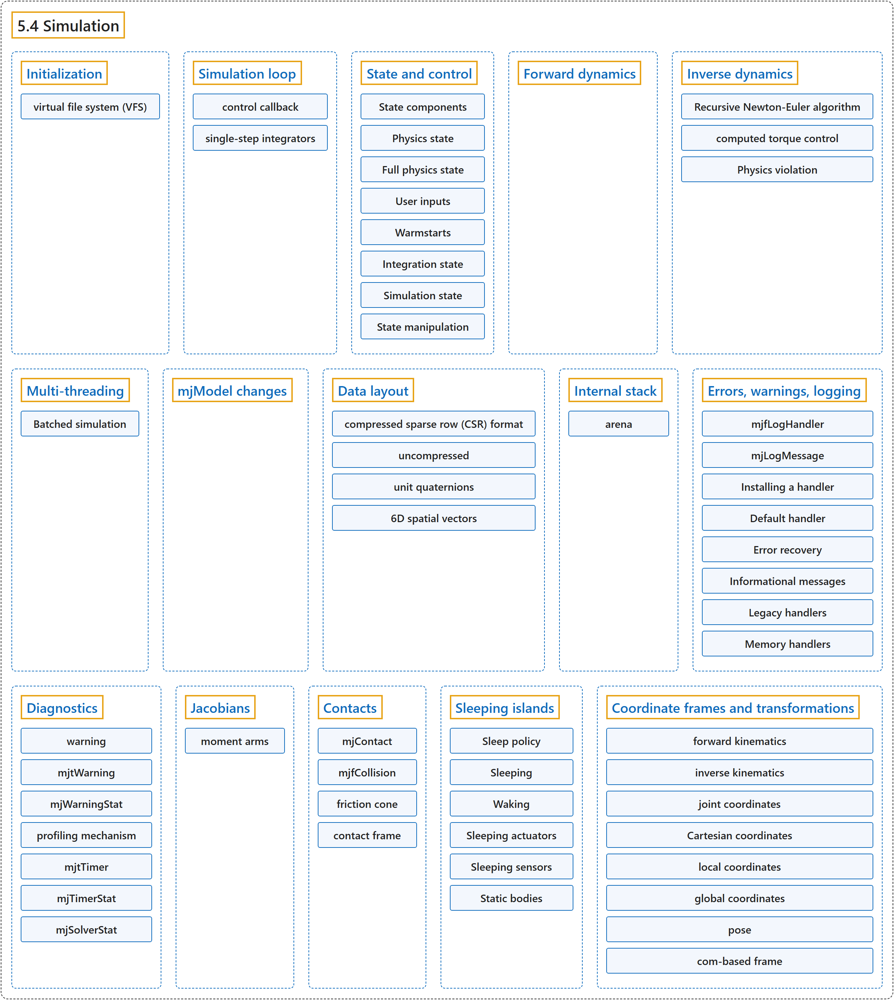

# 5.4 Simulation

## Classification

## Glossary

| Term | Definition | 中文翻译 | Source |
|---|---|---|---|
| **5.4 Simulation** 仿真 | (No definition) | （无定义） | [Google DeepMind, n.d., "Simulation"](https://mujoco.readthedocs.io/en/stable/programming/simulation.html#simulation) |
| **Initialization** 初始化 | (context) "mjModel and mjData should never be allocated directly by the user. Instead they are **allocated and initialized by the corresponding API functions**." | （语境）mjModel 和 mjData 绝不应由用户直接分配，而是**由相应的 API 函数分配和初始化**。 | [Google DeepMind, n.d., "Initialization", para. 1](https://mujoco.readthedocs.io/en/stable/programming/simulation.html#initialization) |
| **virtual file system (VFS)** 虚拟文件系统（VFS） | "The virtual file system (VFS) **allows disk resources to be loaded in memory or created programmatically by the user**, and then MuJoCo’s load functions search for files in the VFS before accessing the disk." | 虚拟文件系统（VFS）**允许把磁盘资源加载到内存中，或由用户以编程方式创建**，然后 MuJoCo 的加载函数会先在 VFS 中查找文件，再访问磁盘。 | [Google DeepMind, n.d., "Initialization", para. 4](https://mujoco.readthedocs.io/en/stable/programming/simulation.html#initialization) |
| **Simulation loop** 仿真循环 | (context) "There are multiple ways to run a simulation loop in MuJoCo. The simplest way is to **call the top-level simulation function mj_step in a loop** such as" | （语境）在 MuJoCo 中运行仿真循环有多种方式。最简单的方式是**在循环中调用顶层仿真函数 mj_step**，例如 | [Google DeepMind, n.d., "Simulation loop", para. 1](https://mujoco.readthedocs.io/en/stable/programming/simulation.html#simulation-loop) |
| **control callback** 控制回调 | (context) "The default way to control the system is to **implement a control callback**, for example" | （语境）控制系统的默认方式是**实现一个控制回调**，例如 | [Google DeepMind, n.d., "Simulation loop", para. 2](https://mujoco.readthedocs.io/en/stable/programming/simulation.html#simulation-loop) |
| **single-step integrators** 单步积分器 | (context) "There is one complication however: this only works with the **single-step integrators (Euler, implicit, implicitfast)**." | （语境）不过有一个复杂之处：这只适用于**单步积分器（Euler、implicit、implicitfast）**。 | [Google DeepMind, n.d., "Simulation loop", para. 8](https://mujoco.readthedocs.io/en/stable/programming/simulation.html#simulation-loop) |
| **State and control** 状态与控制 | "MuJoCo has **a well-defined state that is easy to set, reset and advance through time**." | MuJoCo 有**一个定义明确、易于设置、重置并随时间推进的状态**。 | [Google DeepMind, n.d., "State and control", para. 1](https://mujoco.readthedocs.io/en/stable/programming/simulation.html#state-and-control) |
| **State components** 状态组成部分 | "The state is composed of **distinct components**, described in the mjtState bitfield enum, which enumerates both individual components and combinations of components." | 状态由**不同的组成部分**构成，它们在 mjtState 位域枚举中描述，该枚举既列出单个组成部分，也列出组成部分的组合。 | [Google DeepMind, n.d., "State components", para. 1](https://mujoco.readthedocs.io/en/stable/programming/simulation.html#state-components) |
| **mjtState** 状态枚举 mjtState | "The state is composed of distinct components, described in the mjtState bitfield enum, which **enumerates both individual components and combinations of components**." | 状态由不同的组成部分构成，它们在 mjtState 位域枚举中描述，该枚举**既列出单个组成部分，也列出组成部分的组合**。 | [Google DeepMind, n.d., "State components", para. 1](https://mujoco.readthedocs.io/en/stable/programming/simulation.html#state-components) |
| **Physics state** 物理状态 | "The physics state (mjSTATE_PHYSICS) contains **the main quantities which are time-integrated during stepping**." | 物理状态（mjSTATE_PHYSICS）包含**在步进过程中进行时间积分的主要量**。 | [Google DeepMind, n.d., "Physics state", para. 1](https://mujoco.readthedocs.io/en/stable/programming/simulation.html#physics-state) |
| **Position: qpos** 位置 qpos | "The **configuration in generalized coordinates**" | 广义坐标下的位形 | [Google DeepMind, n.d., "Physics state", item 1](https://mujoco.readthedocs.io/en/stable/programming/simulation.html#physics-state) |
| **Velocity: qvel** 速度 qvel | "The **generalized velocities**" | 广义速度 | [Google DeepMind, n.d., "Physics state", item 2](https://mujoco.readthedocs.io/en/stable/programming/simulation.html#physics-state) |
| **Actuator activation: act** 执行器激活 act | "For a second-order mechanical system, the state contains only position and velocity, but MuJoCo also models stateful actuators (such as biological muscles) that have **their own activation states assembled in mjData.act**" | 对二阶机械系统而言，状态只包含位置和速度，但 MuJoCo 还对有状态的执行器（如生物肌肉）建模，它们有**自己的激活状态，汇集在 mjData.act 中** | [Google DeepMind, n.d., "Physics state", item 3](https://mujoco.readthedocs.io/en/stable/programming/simulation.html#physics-state) |
| **History buffer: history** 历史缓冲区 history | "When actuators or sensors have a positive nsample attribute (actuators, sensors), this buffer **stores timestamped samples of previous control or sensor values**." | 当执行器或传感器的 nsample 属性为正时（执行器、传感器），这个缓冲区**存储以前的控制值或传感器值的带时间戳样本**。 | [Google DeepMind, n.d., "Physics state", item 4](https://mujoco.readthedocs.io/en/stable/programming/simulation.html#physics-state) |
| **Full physics state** 完整物理状态 | "t, x above correspond to the full physics state (mjSTATE_FULLPHYSICS) – **everything which advances in time**." | 上面的 t、x 对应完整物理状态（mjSTATE_FULLPHYSICS），即**一切随时间推进的量**。 | [Google DeepMind, n.d., "Full physics state", para. 1](https://mujoco.readthedocs.io/en/stable/programming/simulation.html#full-physics-state) |
| **Time: time** 时间 time | "The time t (mjData.time) is therefore **a state component with dt/dt == 1**." | 因此时间 t（mjData.time）是**一个满足 dt/dt == 1 的状态组成部分**。 | [Google DeepMind, n.d., "Full physics state", item 1](https://mujoco.readthedocs.io/en/stable/programming/simulation.html#full-physics-state) |
| **Plugin state: plugin_state** 插件状态 plugin_state | "mjData.plugin_state are **states declared by engine plugins**." | mjData.plugin_state 是**由引擎插件声明的状态**。 | [Google DeepMind, n.d., "Full physics state", item 2](https://mujoco.readthedocs.io/en/stable/programming/simulation.html#full-physics-state) |
| **User inputs** 用户输入 | "These input fields (mjSTATE_USER) are **set by the user and affect the physics simulation, but are untouched by the simulator**." | 这些输入字段（mjSTATE_USER）**由用户设置并影响物理仿真，但仿真器不会改动它们**。 | [Google DeepMind, n.d., "User inputs", para. 1](https://mujoco.readthedocs.io/en/stable/programming/simulation.html#user-inputs) |
| **Control: ctrl** 控制 ctrl | "The control vector u mostly corresponds to the array mjData.ctrl, containing **the actuation signal set by the user**." | 控制向量 u 主要对应数组 mjData.ctrl，其中包含**用户设置的驱动信号**。 | [Google DeepMind, n.d., "User inputs", para. 2](https://mujoco.readthedocs.io/en/stable/programming/simulation.html#user-inputs) |
| **Auxiliary Controls: qfrc_applied and xfrc_applied** 辅助控制 qfrc_applied 和 xfrc_applied | "mjData.qfrc_applied are **directly applied generalized forces**.mjData.xfrc_applied are **Cartesian wrenches applied to the CoM of individual bodies**." | mjData.qfrc_applied 是**直接施加的广义力**。mjData.xfrc_applied 是**施加在各个刚体质心上的笛卡尔力旋量**。 | [Google DeepMind, n.d., "User inputs", item 2](https://mujoco.readthedocs.io/en/stable/programming/simulation.html#user-inputs) |
| **MoCap poses: mocap_pos and mocap_quat** 动捕位姿 mocap_pos 和 mocap_quat | "mjData.mocap_pos and mjData.mocap_quat are **special optional kinematic states** described here, which allow the user to set the positions and orientations of static bodies in real-time, for example when streaming 6D poses from a motion-capture device." | mjData.mocap_pos 和 mjData.mocap_quat 是**特殊的可选运动学状态**（见此处说明），允许用户实时设置静态刚体的位置和朝向，例如从动作捕捉设备流式传入 6D 位姿时。 | [Google DeepMind, n.d., "User inputs", item 3](https://mujoco.readthedocs.io/en/stable/programming/simulation.html#user-inputs) |
| **Equality constraint toggle: eq_active** 等式约束开关 eq_active | "mjData.eq_active is **a byte-valued array that allows the user to toggle the state of equality constraints at runtime**." | mjData.eq_active 是**一个字节值数组，允许用户在运行时切换等式约束的状态**。 | [Google DeepMind, n.d., "User inputs", item 4](https://mujoco.readthedocs.io/en/stable/programming/simulation.html#user-inputs) |
| **User data: userdata** 用户数据 userdata | "mjData.userdata acts as **a user-defined memory space untouched by the engine**." | mjData.userdata 充当**引擎不会改动的用户自定义内存空间**。 | [Google DeepMind, n.d., "User inputs", item 5](https://mujoco.readthedocs.io/en/stable/programming/simulation.html#user-inputs) |
| **Warmstarts** 热启动 | (No definition) | （无定义） | [Google DeepMind, n.d., "Warmstarts"](https://mujoco.readthedocs.io/en/stable/programming/simulation.html#warmstarts) |
| **Warmstart accelerations: qacc_warmstart** 热启动加速度 qacc_warmstart | "mjData.qacc_warmstart are **the previous step’s accelerations used to warmstart the constraint solver**." | mjData.qacc_warmstart 是**上一步的加速度，用于热启动约束求解器**。 | [Google DeepMind, n.d., "Warmstarts", item 1](https://mujoco.readthedocs.io/en/stable/programming/simulation.html#warmstarts) |
| **Integration state** 积分状态 | "The integration state (mjSTATE_INTEGRATION) is **the union of all the above mjData fields and constitutes the entire set of inputs to the forward dynamics**." | 积分状态（mjSTATE_INTEGRATION）是**以上所有 mjData 字段的并集，构成正向动力学的全部输入**。 | [Google DeepMind, n.d., "Integration state", para. 1](https://mujoco.readthedocs.io/en/stable/programming/simulation.html#integration-state) |
| **Simulation state** 仿真状态 | "The simulation state is **the entirety of the mjData struct and associated memory buffer**." | 仿真状态是**整个 mjData 结构体及其关联的内存缓冲区**。 | [Google DeepMind, n.d., "Simulation state", para. 1](https://mujoco.readthedocs.io/en/stable/programming/simulation.html#simulation-state) |
| **State manipulation** 状态操作 | (context) "Manipulation of the state is **facilitated by the mjtState bitfield enum**, which enumerates the state components documented above." | （语境）状态操作**借助 mjtState 位域枚举来实现**，该枚举列出了上面介绍的各个状态组成部分。 | [Google DeepMind, n.d., "State manipulation", para. 1](https://mujoco.readthedocs.io/en/stable/programming/simulation.html#state-manipulation) |
| **Forward dynamics** 正向动力学 | "The goal of forward dynamics is to **compute the time-derivative of the state**, namely the acceleration vector mjData.qacc and the activation time-derivative mjData.act_dot." | 正向动力学的目标是**计算状态的时间导数**，即加速度向量 mjData.qacc 和激活量的时间导数 mjData.act_dot。 | [Google DeepMind, n.d., "Forward dynamics", para. 1](https://mujoco.readthedocs.io/en/stable/programming/simulation.html#forward-dynamics) |
| **Inverse dynamics** 逆向动力学 | (context) "The computation of inverse dynamics is **a unique feature of MuJoCo**, and is not found in any other modern engine capable of simulating contacts." | （语境）逆向动力学的计算是 **MuJoCo 的一项独有功能**，在其他任何能模拟接触的现代引擎中都没有。 | [Google DeepMind, n.d., "Inverse dynamics", para. 1](https://mujoco.readthedocs.io/en/stable/programming/simulation.html#inverse-dynamics) |
| **Recursive Newton-Euler algorithm** 递归牛顿-欧拉算法 | (context) "The result mjData.qfrc_inverse is obtained by using the Recursive Newton-Euler algorithm to **compute the net force acting on the system**, and then subtracting from it all internal forces." | （语境）结果 mjData.qfrc_inverse 是这样得到的：用递归牛顿-欧拉算法**计算作用在系统上的合力**，再从中减去所有内力。 | [Google DeepMind, n.d., "Inverse dynamics", para. 5](https://mujoco.readthedocs.io/en/stable/programming/simulation.html#inverse-dynamics) |
| **computed torque control** 计算力矩控制 | "It can also be used **to compute the joint torques needed to drive the system along a given reference trajectory**; this is known as computed torque control." | 它还可以用来**计算沿给定参考轨迹驱动系统所需的关节力矩**，这称为计算力矩控制。 | [Google DeepMind, n.d., "Inverse dynamics", para. 6](https://mujoco.readthedocs.io/en/stable/programming/simulation.html#inverse-dynamics) |
| **Physics violation** 物理违背 | "Physics violation can be quantified as **the norm of any unexplained external force computed by inverse dynamics**." | 物理违背可以量化为**逆向动力学计算出的任何无法解释的外力的范数**。 | [Google DeepMind, n.d., "Inverse dynamics", para. 6](https://mujoco.readthedocs.io/en/stable/programming/simulation.html#inverse-dynamics) |
| **Multi-threading** 多线程 | "MuJoCo has support for **within-step multi-threading**." | MuJoCo 支持**步内多线程**。 | [Google DeepMind, n.d., "Multi-threading", para. 1](https://mujoco.readthedocs.io/en/stable/programming/simulation.html#multi-threading) |
| **Batched simulation** 批量仿真 | "The batch API in mujoco/mjbatch.h **packages this multi-threading scheme**." | mujoco/mjbatch.h 中的批量 API **封装了这种多线程方案**。 | [Google DeepMind, n.d., "Batched simulation", para. 1](https://mujoco.readthedocs.io/en/stable/programming/simulation.html#batched-simulation) |
| **mjBatch** 批量结构体 mjBatch | "An mjBatch **holds nsim simulations of one model and runs them on a thread pool of its own**." | 一个 mjBatch **保存同一模型的 nsim 个仿真，并在自己的线程池上运行它们**。 | [Google DeepMind, n.d., "Batched simulation", para. 1](https://mujoco.readthedocs.io/en/stable/programming/simulation.html#batched-simulation) |
| **State rows** 状态行 | "The batch keeps these states in a table returned by mjb_state, an nsim x nstate array **whose row i is simulation i’s state**, where nstate is mjb_nstate." | 批量对象把这些状态保存在 mjb_state 返回的表中，这是一个 nsim x nstate 数组，**其第 i 行是第 i 个仿真的状态**，其中 nstate 是 mjb_nstate。 | [Google DeepMind, n.d., "Batched simulation", para. 2](https://mujoco.readthedocs.io/en/stable/programming/simulation.html#batched-simulation) |
| **Calls** 调用 | "A call such as mjb_step **runs on the simulations selected by ids, or on all of them**." | 像 mjb_step 这样的调用**在由 ids 选中的仿真上运行，或在全部仿真上运行**。 | [Google DeepMind, n.d., "Batched simulation", para. 3](https://mujoco.readthedocs.io/en/stable/programming/simulation.html#batched-simulation) |
| **Outputs** 输出 | "mjb_output **registers an mjData field as an output**: after every call, the batch copies it out of each simulation’s mjData into an nsim x size array that the batch owns." | mjb_output **把一个 mjData 字段注册为输出**：每次调用之后，批量对象把它从各个仿真的 mjData 中复制到自己拥有的 nsim x size 数组里。 | [Google DeepMind, n.d., "Batched simulation", para. 4](https://mujoco.readthedocs.io/en/stable/programming/simulation.html#batched-simulation) |
| **Shared and persistent mjData** 共享与持久的 mjData | "By default, a batch **keeps one mjData per thread**, which each thread reuses for the simulations it runs, so memory scales with threads rather than simulations." | 默认情况下，批量对象**为每个线程保留一个 mjData**，每个线程在它运行的各个仿真之间复用它，因此内存随线程数而不是仿真数增长。 | [Google DeepMind, n.d., "Batched simulation", para. 5](https://mujoco.readthedocs.io/en/stable/programming/simulation.html#batched-simulation) |
| **Stages** 阶段 | "To observe the new state, the calls that step or reset take a stage argument (an mjtStage): when the call is done, **the batch runs the stages of mj_forward up to stage at the new state**." | 为了观察新状态，步进或重置的调用接受一个 stage 参数（一个 mjtStage）：调用完成时，**批量对象在新状态上运行 mj_forward 直到 stage 为止的各个阶段**。 | [Google DeepMind, n.d., "Batched simulation", para. 6](https://mujoco.readthedocs.io/en/stable/programming/simulation.html#batched-simulation) |
| **Continuation** 续接 | "In a persistent batch, the simulation’s mjData still holds those stages at the next call, so **the next step skips them and continues with mj_step2**, and fresh observations cost nothing extra." | 在持久批量中，下一次调用时该仿真的 mjData 仍保有这些阶段，因此**下一步跳过它们，直接续接 mj_step2**，新的观测不需要额外开销。 | [Google DeepMind, n.d., "Batched simulation", para. 7](https://mujoco.readthedocs.io/en/stable/programming/simulation.html#batched-simulation) |
| **Per-simulation models** 逐仿真模型 | "To give simulations different model or option values, for example to randomize masses, friction or gravity, **mjb_expand expands a field**." | 为了给各个仿真不同的模型值或选项值，例如随机化质量、摩擦或重力，**mjb_expand 会扩展一个字段**。 | [Google DeepMind, n.d., "Batched simulation", para. 8](https://mujoco.readthedocs.io/en/stable/programming/simulation.html#batched-simulation) |
| **Trajectories and queries** 轨迹与查询 | "mjb_rollout **records open-loop trajectories**: it applies a given control sequence and records chosen states or fields after every substep." | mjb_rollout **记录开环轨迹**：它施加给定的控制序列，并在每个子步之后记录选定的状态或字段。 | [Google DeepMind, n.d., "Batched simulation", para. 9](https://mujoco.readthedocs.io/en/stable/programming/simulation.html#batched-simulation) |
| **Threads and callbacks** 线程与回调 | "The batch’s threads **run across simulations**, while those of mju_threadpool run within one simulation." | 批量对象的线程**跨仿真运行**，而 mju_threadpool 的线程在一个仿真内部运行。 | [Google DeepMind, n.d., "Batched simulation", para. 10](https://mujoco.readthedocs.io/en/stable/programming/simulation.html#batched-simulation) |
| **mjModel changes** mjModel 修改 | (context) "The general rule is that **real-valued parameters are safe to change, while structural integer parameters are not** because that may result in incorrect sizes or indexing." | （语境）一般规则是：**实数值参数可以安全修改，而结构性的整数参数不行**，因为那可能导致大小或索引出错。 | [Google DeepMind, n.d., "mjModel changes", para. 1](https://mujoco.readthedocs.io/en/stable/programming/simulation.html#mjmodel-changes) |
| **Data layout** 数据布局 | "All matrices in MuJoCo are in **row-major** format." | MuJoCo 中的所有矩阵都采用**行主序**格式。 | [Google DeepMind, n.d., "Data layout", para. 1](https://mujoco.readthedocs.io/en/stable/programming/simulation.html#data-layout) |
| **compressed sparse row (CSR) format** 压缩稀疏行（CSR）格式 | (context) "Sparse matrices are stored in **the compressed sparse row (CSR) format**." | （语境）稀疏矩阵以**压缩稀疏行（CSR）格式**存储。 | [Google DeepMind, n.d., "Data layout", para. 4](https://mujoco.readthedocs.io/en/stable/programming/simulation.html#data-layout) |
| **uncompressed** 非压缩稀疏布局 | "Furthermore, in operations that can change the sparsity pattern, it is more efficient to **spread out the data so that we do not have to perform many memory moves when inserting new data**. We call this sparse layout “uncompressed”." | 此外，在可能改变稀疏模式的运算中，**把数据分散存放，使插入新数据时不必做大量内存移动**会更高效。我们把这种稀疏布局称为“非压缩”布局。 | [Google DeepMind, n.d., "Data layout", para. 5](https://mujoco.readthedocs.io/en/stable/programming/simulation.html#data-layout) |
| **unit quaternions** 单位四元数 | "To represent 3D orientations and rotations, MuJoCo uses unit quaternions – namely **4D unit vectors arranged as q = (w, x, y, z)**." | 为了表示三维朝向和旋转，MuJoCo 使用单位四元数，即**按 q = (w, x, y, z) 排列的四维单位向量**。 | [Google DeepMind, n.d., "Data layout", para. 6](https://mujoco.readthedocs.io/en/stable/programming/simulation.html#data-layout) |
| **6D spatial vectors** 6D 空间向量 | "MuJoCo also uses 6D spatial vectors internally. These are quantities in mjData prefixed with ‘c’, namely cvel, cacc, cdot, etc. They are **spatial motion and force vectors that combine a 3D rotational component followed by a 3D translational component**." | MuJoCo 内部还使用 6D 空间向量。它们是 mjData 中以 ‘c’ 为前缀的量，即 cvel、cacc、cdot 等。它们是**空间运动向量和空间力向量，由一个三维转动分量接一个三维平移分量组成**。 | [Google DeepMind, n.d., "Data layout", para. 7](https://mujoco.readthedocs.io/en/stable/programming/simulation.html#data-layout) |
| **Internal stack** 内部栈 | "Most top-level MuJoCo functions **allocate space on the mjData stack**, use it for internal computations, and then deallocate it." | 大多数顶层 MuJoCo 函数**在 mjData 栈上分配空间**，用于内部计算，然后再释放。 | [Google DeepMind, n.d., "Internal stack", para. 3](https://mujoco.readthedocs.io/en/stable/programming/simulation.html#internal-stack) |
| **arena** arena 内存区 | "MuJoCo allocates and **manages dynamic memory in an “arena” space** in mjData.arena." | MuJoCo 在 mjData.arena 中**以“arena”空间分配和管理动态内存**。 | [Google DeepMind, n.d., "Internal stack", para. 1](https://mujoco.readthedocs.io/en/stable/programming/simulation.html#internal-stack) |
| **Errors, warnings, logging** 错误、警告与日志 | "MuJoCo has **a unified logging system for errors, warnings and informational messages**." | MuJoCo 有**一个统一的日志系统，用于错误、警告和信息性消息**。 | [Google DeepMind, n.d., "Errors, warnings, logging", para. 1](https://mujoco.readthedocs.io/en/stable/programming/simulation.html#errors-warnings-logging) |
| **mjfLogHandler** 日志处理器类型 mjfLogHandler | "All log output is routed through **a single callback of type mjfLogHandler**, which receives a structured mjLogMessage containing the severity level, message text, and optional source location." | 所有日志输出都经由**一个 mjfLogHandler 类型的回调**传递，它接收一个结构化的 mjLogMessage，其中包含严重级别、消息文本和可选的源代码位置。 | [Google DeepMind, n.d., "Errors, warnings, logging", para. 1](https://mujoco.readthedocs.io/en/stable/programming/simulation.html#errors-warnings-logging) |
| **mjLogMessage** 日志消息结构体 mjLogMessage | "All log output is routed through a single callback of type mjfLogHandler, which receives **a structured mjLogMessage containing the severity level, message text, and optional source location**." | 所有日志输出都经由一个 mjfLogHandler 类型的回调传递，它接收**一个结构化的 mjLogMessage，其中包含严重级别、消息文本和可选的源代码位置**。 | [Google DeepMind, n.d., "Errors, warnings, logging", para. 1](https://mujoco.readthedocs.io/en/stable/programming/simulation.html#errors-warnings-logging) |
| **Installing a handler** 安装处理器 | (context) "Users who want to intercept and process MuJoCo’s log output should **install a log handler using mju_setLogHandler**." | （语境）想要截获并处理 MuJoCo 日志输出的用户应当**用 mju_setLogHandler 安装一个日志处理器**。 | [Google DeepMind, n.d., "Installing a handler", para. 1](https://mujoco.readthedocs.io/en/stable/programming/simulation.html#installing-a-handler) |
| **Save/restore** 保存与恢复 | "A library or subsystem can **temporarily install its own handler and later restore the previous one**." | 库或子系统可以**临时安装自己的处理器，之后再恢复先前的处理器**。 | [Google DeepMind, n.d., "Installing a handler", item 1](https://mujoco.readthedocs.io/en/stable/programming/simulation.html#installing-a-handler) |
| **Chaining** 链式调用 | "A custom handler can act as a pure observer by **calling the previous handler at the end of its callback to preserve existing behavior**." | 自定义处理器可以充当纯观察者，做法是**在其回调末尾调用先前的处理器，以保留原有行为**。 | [Google DeepMind, n.d., "Installing a handler", item 2](https://mujoco.readthedocs.io/en/stable/programming/simulation.html#installing-a-handler) |
| **Default handler** 默认处理器 | (context) "If no custom handler is installed (or if NULL is passed to mju_setLogHandler), MuJoCo uses **a default handler** that provides the following behavior:" | （语境）如果没有安装自定义处理器（或向 mju_setLogHandler 传入 NULL），MuJoCo 使用**一个默认处理器**，其行为如下： | [Google DeepMind, n.d., "Default handler", para. 1](https://mujoco.readthedocs.io/en/stable/programming/simulation.html#default-handler) |
| **Error recovery** 错误恢复 | (context) "One situation where it is desirable to **continue even after an error** is an interactive simulator that fails to load a model file." | （语境）需要**在出错后仍然继续运行**的一种情形，是交互式仿真器加载模型文件失败。 | [Google DeepMind, n.d., "Error recovery", para. 1](https://mujoco.readthedocs.io/en/stable/programming/simulation.html#error-recovery) |
| **Informational messages** 信息性消息 | "MuJoCo provides **two levels of opt-in diagnostic logging**: informational messages (mjLOG_INFO) and debug traces (mjLOG_DEBUG)." | MuJoCo 提供**两个级别的可选诊断日志**：信息性消息（mjLOG_INFO）和调试跟踪（mjLOG_DEBUG）。 | [Google DeepMind, n.d., "Informational messages", para. 1](https://mujoco.readthedocs.io/en/stable/programming/simulation.html#informational-messages) |
| **mjtLogTopic** 日志主题枚举 mjtLogTopic | (context) "Both use **topic identifiers from the mjtLogTopic enum**, but have a subtle architectural distinction in how filtering is applied:" | （语境）两者都使用**来自 mjtLogTopic 枚举的主题标识符**，但在如何过滤上有细微的架构差别： | [Google DeepMind, n.d., "Informational messages", para. 1](https://mujoco.readthedocs.io/en/stable/programming/simulation.html#informational-messages) |
| **INFO messages** INFO 消息 | "Emitted unconditionally by the engine. Filtering happens on **the consumer side** inside the default handler." | 由引擎无条件发出。过滤发生在默认处理器内部的**消费者一侧**。 | [Google DeepMind, n.d., "Informational messages", item 1](https://mujoco.readthedocs.io/en/stable/programming/simulation.html#informational-messages) |
| **DEBUG messages** DEBUG 消息 | "Designed for tight, high-frequency simulation loops where constructing strings would be a performance bottleneck. Therefore, filtering happens on **the producer side**." | 为紧凑的高频仿真循环设计，在这种循环中构造字符串会成为性能瓶颈。因此，过滤发生在**生产者一侧**。 | [Google DeepMind, n.d., "Informational messages", item 2](https://mujoco.readthedocs.io/en/stable/programming/simulation.html#informational-messages) |
| **Legacy handlers** 旧版处理器 | (context) "The global function pointers mju_user_error and mju_user_warning are still supported for backward compatibility, but are **deprecated in favor of mju_setLogHandler**." | （语境）全局函数指针 mju_user_error 和 mju_user_warning 为向后兼容仍受支持，但**已被弃用，改用 mju_setLogHandler**。 | [Google DeepMind, n.d., "Legacy handlers", para. 1](https://mujoco.readthedocs.io/en/stable/programming/simulation.html#legacy-handlers) |
| **Memory handlers** 内存处理器 | (context) "When MuJoCo allocates and frees memory on the heap, it always uses **the functions mju_malloc and mju_free**." | （语境）MuJoCo 在堆上分配和释放内存时，总是使用**函数 mju_malloc 和 mju_free**。 | [Google DeepMind, n.d., "Memory handlers", para. 1](https://mujoco.readthedocs.io/en/stable/programming/simulation.html#memory-handlers) |
| **Diagnostics** 诊断 | "MuJoCo has **several built-in diagnostics mechanisms that can be used to fine-tune the model**." | MuJoCo 有**若干内置诊断机制，可用于微调模型**。 | [Google DeepMind, n.d., "Diagnostics", para. 1](https://mujoco.readthedocs.io/en/stable/programming/simulation.html#diagnostics) |
| **warning** 警告 | "When the simulator encounters a situation that is not a terminal error but is nevertheless suspicious and likely to result in inaccurate numerical results, **it triggers a warning**." | 当仿真器遇到并非致命错误、但可疑且很可能导致数值结果不准确的情形时，**它会触发一个警告**。 | [Google DeepMind, n.d., "Diagnostics", para. 2](https://mujoco.readthedocs.io/en/stable/programming/simulation.html#diagnostics) |
| **mjtWarning** 警告枚举 mjtWarning | (context) "There are several possible warning types, **indexed by the enum type mjtWarning**." | （语境）可能的警告类型有好几种，**由枚举类型 mjtWarning 索引**。 | [Google DeepMind, n.d., "Diagnostics", para. 2](https://mujoco.readthedocs.io/en/stable/programming/simulation.html#diagnostics) |
| **mjWarningStat** 警告统计结构体 mjWarningStat | "The array mjData.warning contains **one mjWarningStat data structure per warning type**, indicating how many times each warning type has been triggered since the last reset and any information about the warning (usually the index of the problematic model element)." | 数组 mjData.warning 中**每种警告类型对应一个 mjWarningStat 数据结构**，表示自上次重置以来每种警告被触发的次数以及关于该警告的信息（通常是出问题的模型元素的索引）。 | [Google DeepMind, n.d., "Diagnostics", para. 2](https://mujoco.readthedocs.io/en/stable/programming/simulation.html#diagnostics) |
| **profiling mechanism** 性能剖析机制 | (context) "MuJoCo provides **an extensive profiling mechanism**." | （语境）MuJoCo 提供**一套全面的性能剖析机制**。 | [Google DeepMind, n.d., "Diagnostics", para. 3](https://mujoco.readthedocs.io/en/stable/programming/simulation.html#diagnostics) |
| **mjtTimer** 计时器枚举 mjtTimer | (context) "It involves **multiple timers indexed by the enum type mjtTimer**." | （语境）它包含**由枚举类型 mjtTimer 索引的多个计时器**。 | [Google DeepMind, n.d., "Diagnostics", para. 3](https://mujoco.readthedocs.io/en/stable/programming/simulation.html#diagnostics) |
| **mjTimerStat** 计时统计结构体 mjTimerStat | "The array mjData.timer contains **one mjTimerStat data structure per timer**." | 数组 mjData.timer 中**每个计时器对应一个 mjTimerStat 数据结构**。 | [Google DeepMind, n.d., "Diagnostics", para. 3](https://mujoco.readthedocs.io/en/stable/programming/simulation.html#diagnostics) |
| **mjSolverStat** 求解器统计结构体 mjSolverStat | "The array mjData.solver contains **one mjSolverStat data structure per iteration of the constraint solver**, with information about the constraint state and line search." | 数组 mjData.solver 中**约束求解器的每次迭代对应一个 mjSolverStat 数据结构**，包含关于约束状态和线搜索的信息。 | [Google DeepMind, n.d., "Diagnostics", para. 5](https://mujoco.readthedocs.io/en/stable/programming/simulation.html#diagnostics) |
| **Jacobians** 雅可比矩阵 | "**The derivative of any vector function with respect to its vector argument** is called Jacobian." | **任意向量函数对其向量自变量的导数**称为雅可比矩阵。 | [Google DeepMind, n.d., "Jacobians", para. 1](https://mujoco.readthedocs.io/en/stable/programming/simulation.html#jacobians) |
| **moment arms** 力臂 | "In the case of tendons and actuator transmissions the corresponding quantities are mjData.ten_moment and mjData.actuator_moment; we call them moment arms but **mathematically they are Jacobians**." | 对于肌腱和执行器传动，相应的量是 mjData.ten_moment 和 mjData.actuator_moment；我们称之为力臂，但**在数学上它们是雅可比矩阵**。 | [Google DeepMind, n.d., "Jacobians", para. 2](https://mujoco.readthedocs.io/en/stable/programming/simulation.html#jacobians) |
| **Contacts** 接触 | (context) "Here we further clarify **contact processing from a programming perspective**." | （语境）这里进一步从编程的角度说明**接触处理**。 | [Google DeepMind, n.d., "Contacts", para. 1](https://mujoco.readthedocs.io/en/stable/programming/simulation.html#contacts) |
| **mjContact** 接触结构体 mjContact | (context) "The collision detection stage finds contacts between geoms, and records them in **the array mjData.contact of mjContact data structures**." | （语境）碰撞检测阶段找出 geom 之间的接触，并把它们记录在**由 mjContact 数据结构组成的数组 mjData.contact** 中。 | [Google DeepMind, n.d., "Contacts", para. 2](https://mujoco.readthedocs.io/en/stable/programming/simulation.html#contacts) |
| **mjfCollision** 碰撞函数类型 mjfCollision | (context) "The collision function type is **mjfCollision**." | （语境）碰撞函数的类型是 **mjfCollision**。 | [Google DeepMind, n.d., "Contacts", para. 3](https://mujoco.readthedocs.io/en/stable/programming/simulation.html#contacts) |
| **friction cone** 摩擦锥 | (context) "Keep in mind that the contact friction cone **can be pyramidal or elliptic**, depending on which solver is selected in mjModel.opt." | （语境）请记住，接触摩擦锥**可以是棱锥形或椭圆形**，取决于 mjModel.opt 中选择了哪种求解器。 | [Google DeepMind, n.d., "Contacts", para. 4](https://mujoco.readthedocs.io/en/stable/programming/simulation.html#contacts) |
| **contact frame** 接触坐标系 | (context) "This force and torque are expressed in **the contact frame given by mjContact.frame**." | （语境）这个力和力矩表示在**由 mjContact.frame 给出的接触坐标系**中。 | [Google DeepMind, n.d., "Contacts", para. 4](https://mujoco.readthedocs.io/en/stable/programming/simulation.html#contacts) |
| **Sleeping islands** 休眠岛 | "If all trees in an island are ready to sleep, they are put to sleep during state advancement and their associated values in tree_asleep are set to **a (non-negative) index cycle**: the “sleeping island”." | 如果一个岛中的所有树都已准备好休眠，它们就会在状态推进时进入休眠，其在 tree_asleep 中的对应值被设为**一个（非负的）索引环**，即“休眠岛”。 | [Google DeepMind, n.d., "Sleeping islands", para. 2](https://mujoco.readthedocs.io/en/stable/programming/simulation.html#sleeping-islands) |
| **Sleep policy** 休眠策略 | "The ability of a kinematic tree to sleep is **governed by a policy determined at model compile time**." | 运动学树能否休眠**由模型编译时确定的策略决定**。 | [Google DeepMind, n.d., "Sleep policy", para. 1](https://mujoco.readthedocs.io/en/stable/programming/simulation.html#sleep-policy) |
| **Sleeping** 进入休眠 | (context) "Sleeping can happen in **one of two ways**:" | （语境）进入休眠有**两种方式**： | [Google DeepMind, n.d., "Sleeping", para. 1](https://mujoco.readthedocs.io/en/stable/programming/simulation.html#sleeping) |
| **Automatic** 自动休眠 | "The velocity threshold described above is **w.r.t. the infinity norm (largest absolute value) of all velocities associated with an island**." | 上面所说的速度阈值针对的是**与岛相关的所有速度的无穷范数（最大绝对值）**。 | [Google DeepMind, n.d., "Sleeping", item 1](https://mujoco.readthedocs.io/en/stable/programming/simulation.html#sleeping) |
| **Initialized asleep** 初始即休眠 | "By setting the body/sleep attribute of a tree root to “init”, it is marked as “initialized asleep” and **put to sleep during mjData initialization**." | 把树根的 body/sleep 属性设为“init”，它就被标记为“初始即休眠”，并**在 mjData 初始化时进入休眠**。 | [Google DeepMind, n.d., "Sleeping", item 2](https://mujoco.readthedocs.io/en/stable/programming/simulation.html#sleeping) |
| **Waking** 唤醒 | "Waking **happens at the beginning of the timestep**, either during mj_kinematics or soon thereafter during the position stage of the simulation pipeline." | 唤醒**发生在时间步的开始**，要么在 mj_kinematics 期间，要么紧随其后在仿真流水线的位置阶段。 | [Google DeepMind, n.d., "Waking", para. 1](https://mujoco.readthedocs.io/en/stable/programming/simulation.html#waking) |
| **Sleeping actuators** 休眠的执行器 | "As explained in the body/sleep documentation, **trees with actuators are by default not allowed to sleep**, but this can be overridden by the user." | 如 body/sleep 文档所述，**带执行器的树默认不允许休眠**，但用户可以覆盖这一设置。 | [Google DeepMind, n.d., "Notes", item 1](https://mujoco.readthedocs.io/en/stable/programming/simulation.html#notes) |
| **Sleeping sensors** 休眠的传感器 | "For most sensors, we can **skip the computation of their values when their associated objects are asleep**, reporting the value that was computed when those objects were last awake." | 对大多数传感器，**当其关联对象处于休眠时可以跳过其值的计算**，而报告这些对象上次醒着时计算出的值。 | [Google DeepMind, n.d., "Notes", item 2](https://mujoco.readthedocs.io/en/stable/programming/simulation.html#notes) |
| **Static bodies** 静态刚体 | "Besides the main optimization of allowing kinematic trees to sleep, the sleep feature also includes another, related optimization: **the skipping of computation related to static bodies**." | 除了允许运动学树休眠这一主要优化之外，休眠功能还包含另一项相关的优化：**跳过与静态刚体有关的计算**。 | [Google DeepMind, n.d., "Notes", item 4](https://mujoco.readthedocs.io/en/stable/programming/simulation.html#notes) |
| **Coordinate frames and transformations** 坐标系与变换 | (context) "There are **multiple coordinate frames** used in MuJoCo." | （语境）MuJoCo 中使用**多种坐标系**。 | [Google DeepMind, n.d., "Coordinate frames and transformations", para. 1](https://mujoco.readthedocs.io/en/stable/programming/simulation.html#coordinate-frames-and-transformations) |
| **forward kinematics** 正向运动学 | "**The mapping from the vector of joints coordinates to the Cartesian positions and orientations of all bodies** is called forward kinematics and is the first step in the physics pipeline." | **从关节坐标向量到所有刚体的笛卡尔位置和朝向的映射**称为正向运动学，它是物理流水线的第一步。 | [Google DeepMind, n.d., "Coordinate frames and transformations", para. 1](https://mujoco.readthedocs.io/en/stable/programming/simulation.html#coordinate-frames-and-transformations) |
| **inverse kinematics** 逆向运动学 | "**The opposite mapping** is called inverse kinematics but it is not uniquely defined and is not implemented in MuJoCo." | **相反方向的映射**称为逆向运动学，但它的定义不唯一，MuJoCo 中没有实现。 | [Google DeepMind, n.d., "Coordinate frames and transformations", para. 1](https://mujoco.readthedocs.io/en/stable/programming/simulation.html#coordinate-frames-and-transformations) |
| **joint coordinates** 关节坐标 | (context) "In joint coordinates, the only complication is that **the position vector mjData.qpos has different dimensionality than the velocity and acceleration vectors** mjData.qvel and mjData.qacc due to quaternion joints." | （语境）在关节坐标中，唯一的复杂之处是：由于四元数关节，**位置向量 mjData.qpos 与速度和加速度向量的维数不同**（mjData.qvel 和 mjData.qacc）。 | [Google DeepMind, n.d., "Coordinate frames and transformations", para. 2](https://mujoco.readthedocs.io/en/stable/programming/simulation.html#coordinate-frames-and-transformations) |
| **Cartesian coordinates** 笛卡尔坐标 | "Cartesian coordinates are more complicated because there are **three different coordinate frames that we use: local, global, and com-based**." | 笛卡尔坐标更复杂，因为**我们使用三种不同的坐标系：局部坐标系、全局坐标系和基于质心的坐标系**。 | [Google DeepMind, n.d., "Coordinate frames and transformations", para. 3](https://mujoco.readthedocs.io/en/stable/programming/simulation.html#coordinate-frames-and-transformations) |
| **local coordinates** 局部坐标 | "Local coordinates are **used in mjModel to represent the static offsets between a parent and a child body**, as well as the static offsets between a body and any geoms, sites, cameras and lights attached to it." | 局部坐标**在 mjModel 中用来表示父刚体与子刚体之间的静态偏移**，以及刚体与附着其上的 geom、site、相机和灯光之间的静态偏移。 | [Google DeepMind, n.d., "Coordinate frames and transformations", para. 3](https://mujoco.readthedocs.io/en/stable/programming/simulation.html#coordinate-frames-and-transformations) |
| **global coordinates** 全局坐标 | (context) "The job of forward kinematics is to accumulate the joint transformations and static offsets along the kinematic tree and **compute all positions and orientations in global coordinates**." | （语境）正向运动学的任务是沿运动学树累积关节变换和静态偏移，并**在全局坐标中计算所有位置和朝向**。 | [Google DeepMind, n.d., "Coordinate frames and transformations", para. 3](https://mujoco.readthedocs.io/en/stable/programming/simulation.html#coordinate-frames-and-transformations) |
| **pose** 位姿 | "A pose is **a grouping of a 3D position and a unit quaternion orientation**." | 位姿是**一个三维位置与一个单位四元数朝向的组合**。 | [Google DeepMind, n.d., "Coordinate frames and transformations", para. 4](https://mujoco.readthedocs.io/en/stable/programming/simulation.html#coordinate-frames-and-transformations) |
| **com-based frame** 基于质心的坐标系 | "Finally, there is the com-based frame. This is **used to represent 6D spatial vectors containing a 3D angular velocity or acceleration or torque, followed by a 3D linear velocity or acceleration or force**." | 最后是基于质心的坐标系。它**用来表示 6D 空间向量，其中先是三维角速度、角加速度或力矩，后接三维线速度、线加速度或力**。 | [Google DeepMind, n.d., "Coordinate frames and transformations", para. 5](https://mujoco.readthedocs.io/en/stable/programming/simulation.html#coordinate-frames-and-transformations) |

## References

Google DeepMind. (n.d.). *Simulation*. MuJoCo Documentation (Version 3.17.0). Retrieved October 31, 2026, from <https://mujoco.readthedocs.io/en/stable/programming/simulation.html>
