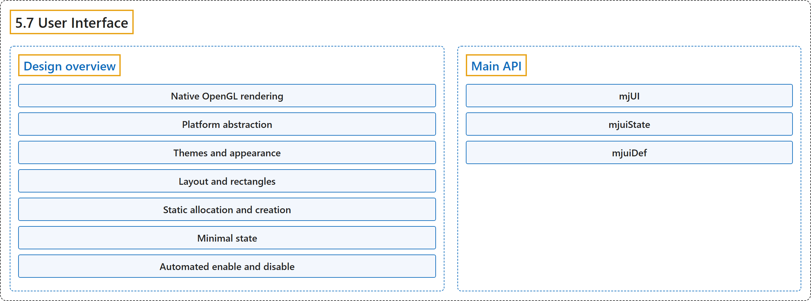

# 5.7 User Interface

## Classification

## Glossary

| Term | Definition | 中文翻译 | Source |
|---|---|---|---|
| **5.7 User Interface** 用户界面 | (context) "MuJoCo has **a native UI framework**." | （语境）MuJoCo 有**一个原生的 UI 框架**。 | [Google DeepMind, n.d., "User Interface", para. 1](https://mujoco.readthedocs.io/en/stable/programming/ui.html#user-interface) |
| **Design overview** 设计概述 | (No definition) | （无定义） | [Google DeepMind, n.d., "Design overview"](https://mujoco.readthedocs.io/en/stable/programming/ui.html#design-overview) |
| **Native OpenGL rendering** 原生 OpenGL 渲染 | "We do not use any helper tools or libraries. Instead we provide **C code for rendering all UI elements directly in OpenGL**." | 我们不使用任何辅助工具或库，而是提供**直接用 OpenGL 渲染所有 UI 元素的 C 代码**。 | [Google DeepMind, n.d., "Design overview", item 1](https://mujoco.readthedocs.io/en/stable/programming/ui.html#design-overview) |
| **Platform abstraction** 平台抽象 | "The software design has **3 layers**: OpenGL rendering of UI elements working in conjunction with the MuJoCo renderer (which is fully cross-platform); abstract functions for access to windows, keyboard and mouse, defined as pure virtual functions in the PlatformUIAdapter class; and an implementation of those functions in the derived class GlfwAdapter." | 软件设计分为 **3 层**：与 MuJoCo 渲染器协同工作的 UI 元素 OpenGL 渲染（完全跨平台）；访问窗口、键盘和鼠标的抽象函数，定义为 PlatformUIAdapter 类中的纯虚函数；以及这些函数在派生类 GlfwAdapter 中的实现。 | [Google DeepMind, n.d., "Design overview", item 2](https://mujoco.readthedocs.io/en/stable/programming/ui.html#design-overview) |
| **PlatformUIAdapter** 平台 UI 适配器类 PlatformUIAdapter | "The software design has 3 layers: OpenGL rendering of UI elements working in conjunction with the MuJoCo renderer (which is fully cross-platform); **abstract functions for access to windows, keyboard and mouse, defined as pure virtual functions in the PlatformUIAdapter class**; and an implementation of those functions in the derived class GlfwAdapter." | 软件设计分为 3 层：与 MuJoCo 渲染器协同工作的 UI 元素 OpenGL 渲染（完全跨平台）；**访问窗口、键盘和鼠标的抽象函数，定义为 PlatformUIAdapter 类中的纯虚函数**；以及这些函数在派生类 GlfwAdapter 中的实现。 | [Google DeepMind, n.d., "Design overview", item 2](https://mujoco.readthedocs.io/en/stable/programming/ui.html#design-overview) |
| **GlfwAdapter** GLFW 适配器类 GlfwAdapter | "The software design has 3 layers: OpenGL rendering of UI elements working in conjunction with the MuJoCo renderer (which is fully cross-platform); abstract functions for access to windows, keyboard and mouse, defined as pure virtual functions in the PlatformUIAdapter class; and **an implementation of those functions in the derived class GlfwAdapter**." | 软件设计分为 3 层：与 MuJoCo 渲染器协同工作的 UI 元素 OpenGL 渲染（完全跨平台）；访问窗口、键盘和鼠标的抽象函数，定义为 PlatformUIAdapter 类中的纯虚函数；以及**这些函数在派生类 GlfwAdapter 中的实现**。 | [Google DeepMind, n.d., "Design overview", item 2](https://mujoco.readthedocs.io/en/stable/programming/ui.html#design-overview) |
| **Themes and appearance** 主题与外观 | "Instead, we **use themes for colors and spacing, and arrange all UI elements automatically**." | 取而代之的是，我们**用主题来规定颜色和间距，并自动排列所有 UI 元素**。 | [Google DeepMind, n.d., "Design overview", item 3](https://mujoco.readthedocs.io/en/stable/programming/ui.html#design-overview) |
| **Layout and rectangles** 布局与矩形 | "Each UI is **one virtual rectangle**, whose width is determined by the theme and whose height is determined by the sections, items within each section, and also the expand/collapse state of each section." | 每个 UI 是**一个虚拟矩形**，其宽度由主题决定，高度由各分区、每个分区中的条目以及各分区的展开或折叠状态决定。 | [Google DeepMind, n.d., "Design overview", item 4](https://mujoco.readthedocs.io/en/stable/programming/ui.html#design-overview) |
| **Static allocation and creation** 静态分配与创建 | "Rather than allocating and deallocating a large number of objects corresponding to UI elements and linking them together, we **create a single C struct (type mjUI) with static allocation** supporting some maximum number of sections and elements; and then keep a record of how many are in use." | 我们不分配和释放大量对应 UI 元素的对象再把它们链接起来，而是**创建单个静态分配的 C 结构体（类型 mjUI）**，支持一定的最大分区数和元素数，再记录实际用了多少。 | [Google DeepMind, n.d., "Design overview", item 5](https://mujoco.readthedocs.io/en/stable/programming/ui.html#design-overview) |
| **Minimal state** 最小状态 | "The UI is designed to be **as stateless as possible**, so as to simplify development." | UI 设计为**尽可能无状态**，以简化开发。 | [Google DeepMind, n.d., "Design overview", item 6](https://mujoco.readthedocs.io/en/stable/programming/ui.html#design-overview) |
| **Automated enable and disable** 自动启用与禁用 | "Each UI item can be assigned an integer category. Then a mjfItemEnable callback **determines whether each category should be enabled or disabled**, based on some program-specific conditions." | 每个 UI 条目可以被赋予一个整数类别。然后由一个 mjfItemEnable 回调根据程序特定的条件**决定每个类别应启用还是禁用**。 | [Google DeepMind, n.d., "Design overview", item 7](https://mujoco.readthedocs.io/en/stable/programming/ui.html#design-overview) |
| **mjfItemEnable** 条目启用回调类型 mjfItemEnable | (context) "Then **a mjfItemEnable callback** determines whether each category should be enabled or disabled, based on some program-specific conditions." | （语境）然后由**一个 mjfItemEnable 回调**根据程序特定的条件决定每个类别应启用还是禁用。 | [Google DeepMind, n.d., "Design overview", item 7](https://mujoco.readthedocs.io/en/stable/programming/ui.html#design-overview) |
| **Main API** 主要 API | (context) "Click on the links below for **detailed API reference of the main UI data structures and functions**." | （语境）点击下面的链接可查看**主要 UI 数据结构和函数的详细 API 参考**。 | [Google DeepMind, n.d., "Main API", para. 1](https://mujoco.readthedocs.io/en/stable/programming/ui.html#main-api) |
| **mjUI** UI 结构体 mjUI | "An **entire UI**." | 一个完整的 UI。 | [Google DeepMind, n.d., "Main API", item 1](https://mujoco.readthedocs.io/en/stable/programming/ui.html#main-api) |
| **mjuiState** UI 状态结构体 mjuiState | "Global **UI state**." | 全局 **UI 状态**。 | [Google DeepMind, n.d., "Main API", item 2](https://mujoco.readthedocs.io/en/stable/programming/ui.html#main-api) |
| **mjuiDef** UI 定义结构体 mjuiDef | "One entry in **the definition table used for UI construction**." | 用于构建 UI 的定义表中的一项。 | [Google DeepMind, n.d., "Main API", item 3](https://mujoco.readthedocs.io/en/stable/programming/ui.html#main-api) |

## References

Google DeepMind. (n.d.). *User Interface*. MuJoCo Documentation (Version 3.17.0). Retrieved October 31, 2026, from <https://mujoco.readthedocs.io/en/stable/programming/ui.html>
