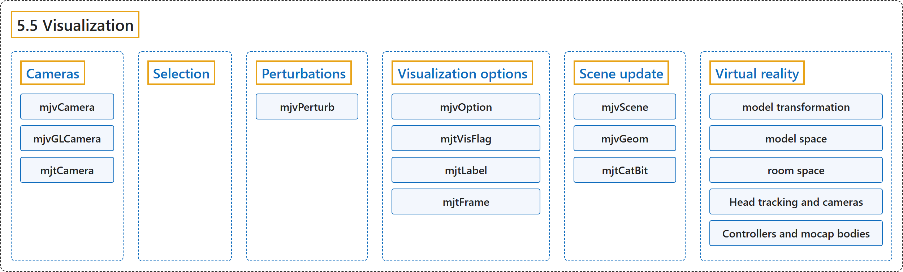

# 5.5 Visualization

## Classification

## Glossary

| Term | Definition | 中文翻译 | Source |
|---|---|---|---|
| **5.5 Visualization** 可视化 | (context) "MuJoCo has **a native 3D visualization layer that is independent of any graphics library**." | （语境）MuJoCo 有**一个不依赖任何图形库的原生三维可视化层**。 | [Google DeepMind, n.d., "Visualization", para. 1](https://mujoco.readthedocs.io/en/stable/programming/visualization.html#abstract) |
| **Cameras** 相机 | "There are **two types of camera objects**: an abstract camera represented with the stand-alone data structure mjvCamera, and a low-level camera represented with the data structure mjvGLCamera (also aliased as mjrCamera) which is embedded in mjvScene or computed directly via mjv_camera2GLCamera." | 相机对象有**两种类型**：一种是用独立数据结构 mjvCamera 表示的抽象相机，另一种是用数据结构 mjvGLCamera（别名 mjrCamera）表示的底层相机，它嵌在 mjvScene 中，或直接通过 mjv_camera2GLCamera 计算得到。 | [Google DeepMind, n.d., "Cameras", para. 1](https://mujoco.readthedocs.io/en/stable/programming/visualization.html#cameras) |
| **mjvCamera** 抽象相机 mjvCamera | "mjvCamera and mjvGLCamera represent **high-level interactive cameras** and low-level frustum cameras." | mjvCamera 和 mjvGLCamera 分别表示**高层交互式相机**和底层视锥相机。 | [Google DeepMind, n.d., "Visualization", item 1](https://mujoco.readthedocs.io/en/stable/programming/visualization.html#abstract) |
| **mjvGLCamera** 底层相机 mjvGLCamera | "The low-level mjvGLCamera is **what determines the actual rendering**." | 底层的 mjvGLCamera **决定实际的渲染**。 | [Google DeepMind, n.d., "Cameras", para. 3](https://mujoco.readthedocs.io/en/stable/programming/visualization.html#cameras) |
| **mjtCamera** 相机类型枚举 mjtCamera | (context) "The abstract camera can represent three different camera types as determined by mjvCamera.type. The possible settings are **defined by the enum mjtCamera**:" | （语境）抽象相机可以表示三种不同的相机类型，由 mjvCamera.type 决定。可能的取值**由枚举 mjtCamera 定义**： | [Google DeepMind, n.d., "Cameras", para. 2](https://mujoco.readthedocs.io/en/stable/programming/visualization.html#cameras) |
| **Selection** 选取 | "In many applications we need to **click on a point and determine the 3D object to which this point/pixel belongs**." | 在许多应用中，我们需要**点击一个点，并确定这个点或像素所属的三维物体**。 | [Google DeepMind, n.d., "Selection", para. 1](https://mujoco.readthedocs.io/en/stable/programming/visualization.html#selection) |
| **Perturbations** 扰动 | (context) "Interactive perturbations have proven very useful in **exploring the model dynamics as well as probing closed-loop control systems**." | （语境）交互式扰动已被证明在**探索模型动力学以及检验闭环控制系统**方面非常有用。 | [Google DeepMind, n.d., "Perturbations", para. 1](https://mujoco.readthedocs.io/en/stable/programming/visualization.html#perturbations) |
| **mjvPerturb** 扰动结构体 mjvPerturb | "All objects needed to implement interactive perturbations are **grouped into the data structure mjvPerturb**." | 实现交互式扰动所需的全部对象**都归集在数据结构 mjvPerturb 中**。 | [Google DeepMind, n.d., "Perturbations", para. 2](https://mujoco.readthedocs.io/en/stable/programming/visualization.html#perturbations) |
| **Visualization options** 可视化选项 | "The data structure mjvOption **controls what is shown, independently of how it is rendered**." | 数据结构 mjvOption **控制显示什么，而与如何渲染无关**。 | [Google DeepMind, n.d., "Visualization options", para. 1](https://mujoco.readthedocs.io/en/stable/programming/visualization.html#visualization-options) |
| **mjvOption** 可视化选项结构体 mjvOption | "mjvOption **controls which element categories, geom groups, and diagnostic overlays are visible**." | mjvOption **控制哪些元素类别、geom 分组和诊断叠加层可见**。 | [Google DeepMind, n.d., "Visualization", item 2](https://mujoco.readthedocs.io/en/stable/programming/visualization.html#abstract) |
| **mjtVisFlag** 可视化标志枚举 mjtVisFlag | (context) "flags, indexed by mjtVisFlag, **enable the decorative and diagnostic elements**: contact points and forces, joint and actuator axes, constraint violations, inertia boxes, convex hulls, skins, tendons, perturbation forces, and so on." | （语境）flags 由 mjtVisFlag 索引，**用来启用装饰性和诊断性元素**：接触点和接触力、关节轴和执行器轴、约束违背、惯性盒、凸包、蒙皮、肌腱、扰动力等。 | [Google DeepMind, n.d., "Visualization options", item 1](https://mujoco.readthedocs.io/en/stable/programming/visualization.html#visualization-options) |
| **mjtLabel** 标签枚举 mjtLabel | (context) "label (mjtLabel) and frame (mjtFrame) **select which category of objects is labeled with text and which spatial frames are drawn**." | （语境）label（mjtLabel）和 frame（mjtFrame）**选择哪一类对象加文字标签，以及绘制哪些空间坐标系**。 | [Google DeepMind, n.d., "Visualization options", item 3](https://mujoco.readthedocs.io/en/stable/programming/visualization.html#visualization-options) |
| **mjtFrame** 坐标系枚举 mjtFrame | (context) "label (mjtLabel) and frame (mjtFrame) **select which category of objects is labeled with text and which spatial frames are drawn**." | （语境）label（mjtLabel）和 frame（mjtFrame）**选择哪一类对象加文字标签，以及绘制哪些空间坐标系**。 | [Google DeepMind, n.d., "Visualization options", item 3](https://mujoco.readthedocs.io/en/stable/programming/visualization.html#visualization-options) |
| **Scene update** 场景更新 | (context) "Finally, we bring all of the above elements together and explain **how mjvScene is updated**." | （语境）最后，我们把上述所有元素结合起来，说明**如何更新 mjvScene**。 | [Google DeepMind, n.d., "Scene update", para. 1](https://mujoco.readthedocs.io/en/stable/programming/visualization.html#scene-update) |
| **mjvScene** 抽象场景 mjvScene | "mjvScene and mjvGeom hold **a complete per-frame geometric description of the 3D scene and its decorations**." | mjvScene 和 mjvGeom 保存**三维场景及其装饰的完整逐帧几何描述**。 | [Google DeepMind, n.d., "Visualization", item 4](https://mujoco.readthedocs.io/en/stable/programming/visualization.html#abstract) |
| **mjvGeom** 抽象几何体 mjvGeom | "Note that mjvGeom is **an abstract geom**, and is not in one-to-one correspondence with the simulation geoms in mjModel and mjData." | 注意 mjvGeom 是**一个抽象 geom**，它与 mjModel 和 mjData 中的仿真 geom 并非一一对应。 | [Google DeepMind, n.d., "Scene update", para. 2](https://mujoco.readthedocs.io/en/stable/programming/visualization.html#scene-update) |
| **mjtCatBit** 类别位枚举 mjtCatBit | (context) "Importantly, the user can select which geom categories will be added, via **a bitmask of enum type mjtCatBit**:" | （语境）重要的是，用户可以通过**枚举类型 mjtCatBit 的位掩码**选择添加哪些 geom 类别： | [Google DeepMind, n.d., "Scene update", para. 4](https://mujoco.readthedocs.io/en/stable/programming/visualization.html#scene-update) |
| **Virtual reality** 虚拟现实 | (context) "While MuJoCo does not provide a built-in VR application, it provides **data structures and functions to support VR integration in user code**." | （语境）虽然 MuJoCo 不提供内置的 VR 应用，但它提供**在用户代码中支持 VR 集成的数据结构和函数**。 | [Google DeepMind, n.d., "Virtual reality", para. 3](https://mujoco.readthedocs.io/en/stable/programming/visualization.html#virtual-reality) |
| **model transformation** 模型变换 | "If anything can be moved by the user (with a mouse or other input device) it is **the position, orientation and scale of the model relative to the room**. This is called model transformation, and is represented in mjvScene." | 如果有什么能被用户（用鼠标或其他输入设备）移动，那就是**模型相对于房间的位置、朝向和缩放**。这称为模型变换，在 mjvScene 中表示。 | [Google DeepMind, n.d., "Virtual reality", para. 1](https://mujoco.readthedocs.io/en/stable/programming/visualization.html#virtual-reality) |
| **model space** 模型空间 | "Everything accessible by the simulator **lives in the model space**." | 仿真器能访问的一切**都位于模型空间中**。 | [Google DeepMind, n.d., "Virtual reality", para. 2](https://mujoco.readthedocs.io/en/stable/programming/visualization.html#virtual-reality) |
| **room space** 房间空间 | "The room space is **only accessible by the visualizer**." | 房间空间**只有可视化器能访问**。 | [Google DeepMind, n.d., "Virtual reality", para. 2](https://mujoco.readthedocs.io/en/stable/programming/visualization.html#virtual-reality) |
| **Head tracking and cameras** 头部跟踪与相机 | "In a typical VR application, a tracking device **provides the positions and orientations of the user’s eyes in real-time**." | 在典型的 VR 应用中，跟踪设备**实时提供用户双眼的位置和朝向**。 | [Google DeepMind, n.d., "Virtual reality", item 1](https://mujoco.readthedocs.io/en/stable/programming/visualization.html#virtual-reality) |
| **Controllers and mocap bodies** 控制器与动捕刚体 | (context) "Hand-held spatial controllers are also **tracked in room space**." | （语境）手持空间控制器同样**在房间空间中被跟踪**。 | [Google DeepMind, n.d., "Virtual reality", item 2](https://mujoco.readthedocs.io/en/stable/programming/visualization.html#virtual-reality) |
| **mocap bodies** 动捕刚体 | "Mocap bodies are **treated as fixed from the viewpoint of physics, yet the user is expected to move them programmatically at each simulation step**." | 从物理的角度看，动捕刚体**被视为固定的，但用户应在每个仿真步以编程方式移动它们**。 | [Google DeepMind, n.d., "Virtual reality", item 2](https://mujoco.readthedocs.io/en/stable/programming/visualization.html#virtual-reality) |

## References

Google DeepMind. (n.d.). *Visualization*. MuJoCo Documentation (Version 3.17.0). Retrieved October 31, 2026, from <https://mujoco.readthedocs.io/en/stable/programming/visualization.html>
