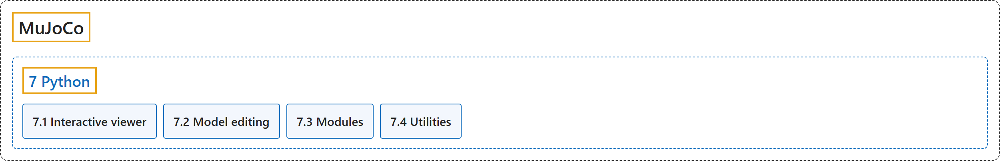

# 7. Python

## Classification

## Glossary

| Term | Definition | 中文翻译 | Source |
|---|---|---|---|
| **7 Python** Python | "MuJoCo comes with **native Python bindings that are developed in C++ using pybind11**." | MuJoCo 自带**用 pybind11 在 C++ 中开发的原生 Python 绑定**。 | [Google DeepMind, n.d., "Python", para. 1](https://mujoco.readthedocs.io/en/stable/python.html#python) |
| **[7.1 Interactive viewer](interactive-viewer.md)** 交互式查看器 | "**An interactive GUI viewer** is provided as part of the Python package in the mujoco.viewer module." | **一个交互式图形界面查看器**作为 Python 包的一部分，在 mujoco.viewer 模块中提供。 | [Google DeepMind, n.d., "Interactive viewer", para. 1](https://mujoco.readthedocs.io/en/stable/python.html#interactive-viewer) |
| **[7.2 Model editing](model-editing.md)** 模型编辑 | (No definition) | （无定义） | [Google DeepMind, n.d., "Model editing"](https://mujoco.readthedocs.io/en/stable/python.html#model-editing) |
| **[7.3 Modules](modules.md)** 模块 | (context) "The mujoco package contains **two sub-modules: mujoco.rollout and mujoco.minimize**" | （语境）mujoco 包包含**两个子模块：mujoco.rollout 和 mujoco.minimize** | [Google DeepMind, n.d., "Modules", para. 1](https://mujoco.readthedocs.io/en/stable/python.html#modules) |
| **[7.4 Utilities](utilities.md)** 工具脚本 | (context) "The python/mujoco directory also contains **utility scripts**." | （语境）python/mujoco 目录中还包含**工具脚本**。 | [Google DeepMind, n.d., "Utilities", para. 1](https://mujoco.readthedocs.io/en/stable/python.html#utilities) |

## References

Google DeepMind. (n.d.). *Python*. MuJoCo Documentation (Version 3.17.0). Retrieved October 31, 2026, from <https://mujoco.readthedocs.io/en/stable/python.html>
