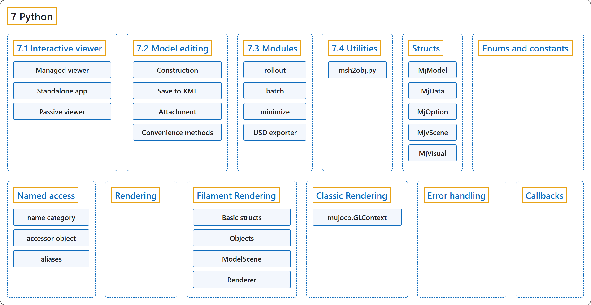

# 7. Python

## Classification

## Glossary

| Term | Definition | 中文翻译 | Source |
|---|---|---|---|
| **7 Python** Python | "MuJoCo comes with **native Python bindings that are developed in C++ using pybind11**." | MuJoCo 自带**用 pybind11 在 C++ 中开发的原生 Python 绑定**。 | [Google DeepMind, n.d., "Python", para. 1](https://mujoco.readthedocs.io/en/stable/python.html#python) |
| **[7.1 Interactive viewer](interactive-viewer.md)** 交互式查看器 | "**An interactive GUI viewer** is provided as part of the Python package in the mujoco.viewer module." | **一个交互式图形界面查看器**作为 Python 包的一部分，在 mujoco.viewer 模块中提供。 | [Google DeepMind, n.d., "Interactive viewer", para. 1](https://mujoco.readthedocs.io/en/stable/python.html#interactive-viewer) |
| **[7.2 Model editing](model-editing.md)** 模型编辑 | (No definition) | （无定义） | [Google DeepMind, n.d., "Model editing"](https://mujoco.readthedocs.io/en/stable/python.html#model-editing) |
| **[7.3 Modules](modules.md)** 模块 | (context) "The mujoco package contains **two sub-modules: mujoco.rollout and mujoco.minimize**" | （语境）mujoco 包包含**两个子模块：mujoco.rollout 和 mujoco.minimize** | [Google DeepMind, n.d., "Modules", para. 1](https://mujoco.readthedocs.io/en/stable/python.html#modules) |
| **[7.4 Utilities](utilities.md)** 工具脚本 | (context) "The python/mujoco directory also contains **utility scripts**." | （语境）python/mujoco 目录中还包含**工具脚本**。 | [Google DeepMind, n.d., "Utilities", para. 1](https://mujoco.readthedocs.io/en/stable/python.html#utilities) |
| **Structs** 结构体 | "The bindings include **Python classes that expose MuJoCo data structures**." | 绑定包含**提供 MuJoCo 数据结构的 Python 类**。 | [Google DeepMind, n.d., "Structs", para. 1](https://mujoco.readthedocs.io/en/stable/python.html#structs) |
| **MjModel** MjModel 类 | (context) "The mujoco.MjModel class does not have a Python constructor. Instead, we provide **three static factory functions that create a new mjModel instance**: mujoco.MjModel.from_xml_string, mujoco.MjModel.from_xml_path, and mujoco.MjModel.from_binary_path." | （语境）mujoco.MjModel 类没有 Python 构造函数。取而代之，我们提供**三个创建新 mjModel 实例的静态工厂函数**：mujoco.MjModel.from_xml_string、mujoco.MjModel.from_xml_path 和 mujoco.MjModel.from_binary_path。 | [Google DeepMind, n.d., "Structs", para. 5](https://mujoco.readthedocs.io/en/stable/python.html#structs) |
| **MjData** MjData 类 | (context) "In order to conform to PEP 8 naming guidelines, struct names begin with a capital letter, for example **mjData becomes mujoco.MjData in Python**." | （语境）为了符合 PEP 8 命名规范，结构体名称以大写字母开头，例如 **mjData 在 Python 中变为 mujoco.MjData**。 | [Google DeepMind, n.d., "Structs", para. 2](https://mujoco.readthedocs.io/en/stable/python.html#structs) |
| **MjOption** MjOption 类 | "For structs that have an mj_defaultFoo-style initialization function, the Python constructor calls the default initializer automatically, so for example mujoco.MjOption() **creates a new mjOption instance that is pre-initialized with mj_defaultOption**." | 对于有 mj_defaultFoo 式初始化函数的结构体，Python 构造函数会自动调用默认初始化函数，例如 mujoco.MjOption() **创建一个用 mj_defaultOption 预先初始化的新 mjOption 实例**。 | [Google DeepMind, n.d., "Structs", para. 3](https://mujoco.readthedocs.io/en/stable/python.html#structs) |
| **MjvScene** MjvScene 类 | "Structs with a mj_makeFoo-style initialization function have corresponding constructor overloads in Python, for example mujoco.MjvScene(model, maxgeom=10) in Python **creates a new mjvScene instance that is initialized with mjv_makeScene(model, [the new mjvScene instance], 10) in C**." | 有 mj_makeFoo 式初始化函数的结构体在 Python 中有相应的构造函数重载，例如 Python 中的 mujoco.MjvScene(model, maxgeom=10) **创建一个新的 mjvScene 实例，它在 C 中用 mjv_makeScene(model, [新的 mjvScene 实例], 10) 初始化**。 | [Google DeepMind, n.d., "Structs", para. 4](https://mujoco.readthedocs.io/en/stable/python.html#structs) |
| **MjVisual** MjVisual 类 | (context) "Likewise, the sub-struct attributes of MjModel (opt, vis, stat) and MjVisual (global_, quality, headlight, map, scale, rgba) **can be assigned to**, for example model.opt = new_opt, which copies the fields of new_opt into the model’s own mjOption struct in place." | （语境）同样，MjModel 的子结构体属性（opt、vis、stat）和 MjVisual 的子结构体属性（global_、quality、headlight、map、scale、rgba）**可以被赋值**，例如 model.opt = new_opt，它把 new_opt 的字段就地复制到模型自己的 mjOption 结构体中。 | [Google DeepMind, n.d., "Structs", para. 6](https://mujoco.readthedocs.io/en/stable/python.html#structs) |
| **Enums and constants** 枚举与常量 | (context) "MuJoCo enums are available as **mujoco.mjtEnumType.ENUM_VALUE**, for example mujoco.mjtObj.mjOBJ_SITE." | （语境）MuJoCo 枚举以 **mujoco.mjtEnumType.ENUM_VALUE** 的形式提供，例如 mujoco.mjtObj.mjOBJ_SITE。 | [Google DeepMind, n.d., "Enums and constants", para. 1](https://mujoco.readthedocs.io/en/stable/python.html#enums-and-constants) |
| **Named access** 按名称访问 | "For convenience and code readability, the Python bindings provide **“named access” API on MjModel and MjData**." | 为了方便和代码可读性，Python 绑定在 MjModel 和 MjData 上提供“**按名称访问”API**。 | [Google DeepMind, n.d., "Named access", para. 1](https://mujoco.readthedocs.io/en/stable/python.html#named-access) |
| **name category** 名称类别 | "Each name_fooadr field in the mjModel struct **defines a name category foo**." | mjModel 结构体中的每个 name_fooadr 字段**定义一个名称类别 foo**。 | [Google DeepMind, n.d., "Named access", para. 1](https://mujoco.readthedocs.io/en/stable/python.html#named-access) |
| **accessor object** 访问器对象 | "The accessor object **contains attributes whose names correspond to the fields of either mujoco.MjModel or mujoco.MjData but with the part before the underscore removed**." | 访问器对象**包含一些属性，其名称对应 mujoco.MjModel 或 mujoco.MjData 的字段，但去掉了下划线之前的部分**。 | [Google DeepMind, n.d., "Named access", para. 2](https://mujoco.readthedocs.io/en/stable/python.html#named-access) |
| **aliases** 别名 | "Additionally, the Python API define **a number of aliases for some name categories corresponding to the XML element name in the MJCF schema** that defines an entity of that category." | 此外，Python API 为某些名称类别定义了**若干别名，对应 MJCF 模式中定义该类别实体的 XML 元素名**。 | [Google DeepMind, n.d., "Named access", para. 3](https://mujoco.readthedocs.io/en/stable/python.html#named-access) |
| **Rendering** 渲染 | (context) "MuJoCo provides **two rendering APIs**: the classic rendering API (which uses OpenGL 1.5) and the filament rendering API (which provides more modern physically-based rendering capabilities)." | （语境）MuJoCo 提供**两套渲染 API**：经典渲染 API（使用 OpenGL 1.5）和 Filament 渲染 API（提供更现代的基于物理的渲染能力）。 | [Google DeepMind, n.d., "Rendering", para. 1](https://mujoco.readthedocs.io/en/stable/python.html#rendering) |
| **Filament Rendering** Filament 渲染 | "The Python mjrf module **exposes the mjrf_ C API to python**." | Python 的 mjrf 模块**把 mjrf_ C API 提供给 Python**。 | [Google DeepMind, n.d., "Filament Rendering", para. 1](https://mujoco.readthedocs.io/en/stable/python.html#filament-rendering) |
| **Basic structs** 基本结构体 | "Basic structs (e.g. mjrRect, mjrCamera, etc.) are **considered to be simple POD data types and are bound directly as python types** allowing copies to be made as needed." | 基本结构体（例如 mjrRect、mjrCamera 等）**被视为简单的 POD 数据类型，直接绑定为 Python 类型**，可以按需复制。 | [Google DeepMind, n.d., "Filament Rendering", item 3](https://mujoco.readthedocs.io/en/stable/python.html#filament-rendering) |
| **Objects** 对象 | "mjrf types that have explicit create/destroy functions in the C API (e.g. mjrfContext, mjrfTexture, etc.) are **treated as “Objects”**." | 在 C API 中有显式创建或销毁函数的 mjrf 类型（例如 mjrfContext、mjrfTexture 等）**被当作“对象”**。 | [Google DeepMind, n.d., "Filament Rendering", item 4](https://mujoco.readthedocs.io/en/stable/python.html#filament-rendering) |
| **ModelScene** ModelScene 类 | "We also provide a ModelScene helper class under mujoco.rendering.filament. This class can be used to **add and update mjrfRenderable and mjrfLight objects in an mjrfScene based on the contents of an mjModel and mjData**." | 我们还在 mujoco.rendering.filament 下提供 ModelScene 辅助类。这个类可用来**根据 mjModel 和 mjData 的内容，在 mjrfScene 中添加和更新 mjrfRenderable 与 mjrfLight 对象**。 | [Google DeepMind, n.d., "Filament Rendering", para. 2](https://mujoco.readthedocs.io/en/stable/python.html#filament-rendering) |
| **Renderer** Renderer 类 | "Similarly, we also provide a Renderer class under mujoco.rendering.filament. This class can be used to **manage the lifetimes of key objects (such as the mjrfContext and mjrfScene) and provides useful functions for controlling the camera and reading pixels**." | 类似地，我们还在 mujoco.rendering.filament 下提供 Renderer 类。这个类可用来**管理关键对象（如 mjrfContext 和 mjrfScene）的生命周期，并提供控制相机和读取像素的实用函数**。 | [Google DeepMind, n.d., "Filament Rendering", para. 3](https://mujoco.readthedocs.io/en/stable/python.html#filament-rendering) |
| **Classic Rendering** 经典渲染 | (context) "The MuJoCo classic renderer expects users to **set up a working OpenGL context before calling any of its mjr_ rendering routines**." | （语境）MuJoCo 经典渲染器要求用户**在调用其任何 mjr_ 渲染例程之前建立一个可用的 OpenGL 上下文**。 | [Google DeepMind, n.d., "Classic Rendering", para. 1](https://mujoco.readthedocs.io/en/stable/python.html#classic-rendering) |
| **mujoco.GLContext** mujoco.GLContext 类 | "The Python bindings provide **a basic class mujoco.GLContext that helps users set up such a context for offscreen rendering**." | Python 绑定提供**一个基础类 mujoco.GLContext，帮助用户为离屏渲染建立这样的上下文**。 | [Google DeepMind, n.d., "Classic Rendering", para. 1](https://mujoco.readthedocs.io/en/stable/python.html#classic-rendering) |
| **make_current()** make_current() 方法 | (context) "Once the context is created, it must be **made current before MuJoCo rendering functions can be called**, which you can do so via ctx.make_current()." | （语境）上下文创建之后，必须**先把它设为当前上下文，才能调用 MuJoCo 渲染函数**，可以通过 ctx.make_current() 完成。 | [Google DeepMind, n.d., "Classic Rendering", para. 1](https://mujoco.readthedocs.io/en/stable/python.html#classic-rendering) |
| **free()** free() 方法 | (context) "The context is freed automatically when the ctx object is deleted, but in some multi-threaded scenario it may be necessary to **explicitly free the underlying OpenGL context**." | （语境）删除 ctx 对象时上下文会自动释放，但在某些多线程场景中，可能需要**显式释放底层的 OpenGL 上下文**。 | [Google DeepMind, n.d., "Classic Rendering", para. 2](https://mujoco.readthedocs.io/en/stable/python.html#classic-rendering) |
| **Error handling** 错误处理 | "The Python bindings utilizes longjmp to allow it to **convert irrecoverable MuJoCo errors into Python exceptions** of type mujoco.FatalError that can be caught and processed in the usual Pythonic way." | Python 绑定利用 longjmp，**把不可恢复的 MuJoCo 错误转换为 Python 异常**（类型为 mujoco.FatalError），可以按通常的 Python 方式捕获和处理。 | [Google DeepMind, n.d., "Error handling", para. 2](https://mujoco.readthedocs.io/en/stable/python.html#error-handling) |
| **Callbacks** 回调 | "MuJoCo allows users to **install custom callback functions to modify certain parts of its computation pipeline**." | MuJoCo 允许用户**安装自定义回调函数，以修改其计算流水线的某些部分**。 | [Google DeepMind, n.d., "Callbacks", para. 1](https://mujoco.readthedocs.io/en/stable/python.html#callbacks) |

## References

Google DeepMind. (n.d.). *Python*. MuJoCo Documentation (Version 3.17.0). Retrieved October 31, 2026, from <https://mujoco.readthedocs.io/en/stable/python.html>
