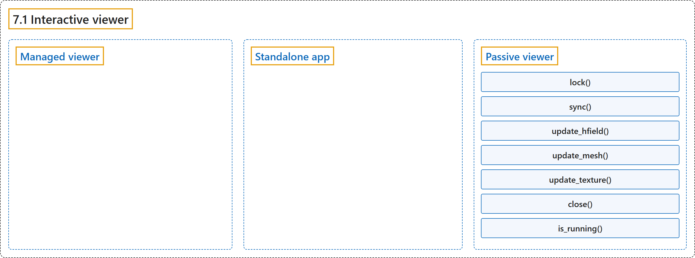

# 7.1 Interactive viewer

## Classification

## Glossary

| Term | Definition | 中文翻译 | Source |
|---|---|---|---|
| **7.1 Interactive viewer** 交互式查看器 | "**An interactive GUI viewer** is provided as part of the Python package in the mujoco.viewer module." | **一个交互式图形界面查看器**作为 Python 包的一部分，在 mujoco.viewer 模块中提供。 | [Google DeepMind, n.d., "Interactive viewer", para. 1](https://mujoco.readthedocs.io/en/stable/python.html#interactive-viewer) |
| **Managed viewer** 托管查看器 | "The viewer.launch function **launches the interactive viewer and blocks user code** which is useful to support precise timing of the physics loop." | viewer.launch 函数**启动交互式查看器并阻塞用户代码**，这有助于支持物理循环的精确计时。 | [Google DeepMind, n.d., "Managed viewer", para. 1](https://mujoco.readthedocs.io/en/stable/python.html#managed-viewer) |
| **Standalone app** 独立应用 | "allow **the managed viewer to be called directly from the command line as a standalone app**" | 使**托管查看器能作为独立应用直接从命令行调用** | [Google DeepMind, n.d., "Standalone app", para. 1](https://mujoco.readthedocs.io/en/stable/python.html#standalone-app) |
| **Passive viewer** 被动查看器 | "The viewer.launch_passive function **launches the interactive viewer in a way which does not block**, allowing user code to continue execution." | viewer.launch_passive 函数**以不阻塞的方式启动交互式查看器**，让用户代码可以继续执行。 | [Google DeepMind, n.d., "Passive viewer", para. 1](https://mujoco.readthedocs.io/en/stable/python.html#passive-viewer) |
| **lock()** lock() 方法 | "provides **a mutex lock for the viewer as a context manager**." | 以上下文管理器的形式提供**查看器的互斥锁**。 | [Google DeepMind, n.d., "Passive viewer", item 2](https://mujoco.readthedocs.io/en/stable/python.html#passive-viewer) |
| **sync()** sync() 方法 | "synchronizes **between the user’s mjModel, mjData and the GUI**." | 在**用户的 mjModel、mjData 与图形界面之间**同步。 | [Google DeepMind, n.d., "Passive viewer", item 3](https://mujoco.readthedocs.io/en/stable/python.html#passive-viewer) |
| **update_hfield()** update_hfield() 方法 | "updates **the height field data at the specified hfieldid for subsequent renderings**." | 为后续渲染更新指定 hfieldid 处的高度场数据。 | [Google DeepMind, n.d., "Passive viewer", item 4](https://mujoco.readthedocs.io/en/stable/python.html#passive-viewer) |
| **update_mesh()** update_mesh() 方法 | "updates **the mesh data at the specified meshid for subsequent renderings**." | 为后续渲染更新指定 meshid 处的网格数据。 | [Google DeepMind, n.d., "Passive viewer", item 5](https://mujoco.readthedocs.io/en/stable/python.html#passive-viewer) |
| **update_texture()** update_texture() 方法 | "updates **the texture data at the specified texid for subsequent renderings**." | 为后续渲染更新指定 texid 处的纹理数据。 | [Google DeepMind, n.d., "Passive viewer", item 6](https://mujoco.readthedocs.io/en/stable/python.html#passive-viewer) |
| **close()** close() 方法 | "programmatically **closes the viewer window**." | 以编程方式**关闭查看器窗口**。 | [Google DeepMind, n.d., "Passive viewer", item 7](https://mujoco.readthedocs.io/en/stable/python.html#passive-viewer) |
| **is_running()** is_running() 方法 | "returns **True if the viewer window is running and False if it is closed**." | 查看器窗口正在运行时返回 True，已关闭时返回 False。 | [Google DeepMind, n.d., "Passive viewer", item 8](https://mujoco.readthedocs.io/en/stable/python.html#passive-viewer) |

## References

Google DeepMind. (n.d.). *Python*. MuJoCo Documentation (Version 3.17.0). Retrieved October 31, 2026, from <https://mujoco.readthedocs.io/en/stable/python.html>
