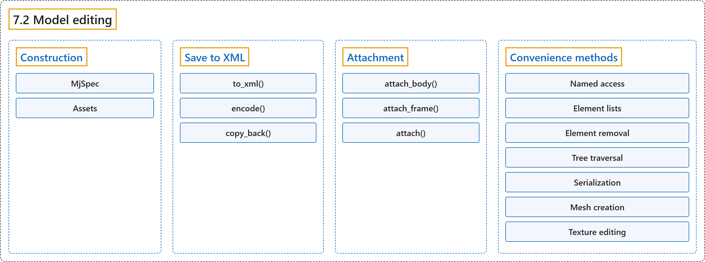

# 7.2 Model editing

## Classification

## Glossary

| Term | Definition | 中文翻译 | Source |
|---|---|---|---|
| **7.2 Model editing** 模型编辑 | (No definition) | （无定义） | [Google DeepMind, n.d., "Model editing"](https://mujoco.readthedocs.io/en/stable/python.html#model-editing) |
| **Construction** 构造 | (context) "The MjSpec object wraps the mjSpec struct and can be constructed in **three ways**:" | （语境）MjSpec 对象封装了 mjSpec 结构体，可以用**三种方式**构造： | [Google DeepMind, n.d., "Construction", para. 1](https://mujoco.readthedocs.io/en/stable/python.html#construction) |
| **MjSpec** MjSpec 类 | "The MjSpec object **wraps the mjSpec struct** and can be constructed in three ways:" | MjSpec 对象**封装了 mjSpec 结构体**，可以用三种方式构造： | [Google DeepMind, n.d., "Construction", para. 1](https://mujoco.readthedocs.io/en/stable/python.html#construction) |
| **from_string()** from_string() 方法 | (context) "Note the from_string() and from_file() methods **can only be called at construction time**." | （语境）注意，from_string() 和 from_file() 方法**只能在构造时调用**。 | [Google DeepMind, n.d., "Construction", para. 2](https://mujoco.readthedocs.io/en/stable/python.html#construction) |
| **from_file()** from_file() 方法 | (context) "Note the from_string() and from_file() methods **can only be called at construction time**." | （语境）注意，from_string() 和 from_file() 方法**只能在构造时调用**。 | [Google DeepMind, n.d., "Construction", para. 2](https://mujoco.readthedocs.io/en/stable/python.html#construction) |
| **Assets** 资源 | "MuJoCo optionally uses a Virtual File System (VFS) to **load assets (like meshes and textures) from memory**." | MuJoCo 可选地使用虚拟文件系统（VFS）**从内存加载资源（如网格和纹理）**。 | [Google DeepMind, n.d., "Assets", para. 1](https://mujoco.readthedocs.io/en/stable/python.html#assets) |
| **MjVfs** MjVfs 类 | "The Python bindings provide the mujoco.MjVfs as **a wrapper around the mjVFS C struct**." | Python 绑定提供 mujoco.MjVfs，作为 **mjVFS C 结构体的封装**。 | [Google DeepMind, n.d., "Assets", para. 2](https://mujoco.readthedocs.io/en/stable/python.html#assets) |
| **Save to XML** 保存为 XML | "MjSpec objects can be **saved to an XML string with the to_xml() method**." | MjSpec 对象可以**用 to_xml() 方法保存为 XML 字符串**。 | [Google DeepMind, n.d., "Save to XML", para. 1](https://mujoco.readthedocs.io/en/stable/python.html#save-to-xml) |
| **to_xml()** to_xml() 方法 | "Unlike mj_saveXMLString, to_xml() **compiles the spec before it saves it**: the spec must compile, with its assets, and the compilation changes it as mj_compile says, for example by applying fusestatic." | 与 mj_saveXMLString 不同，to_xml() **在保存之前先编译 spec**：spec 连同其资源必须能编译，而且编译会按 mj_compile 所述改变它，例如应用 fusestatic。 | [Google DeepMind, n.d., "Save to XML", para. 1](https://mujoco.readthedocs.io/en/stable/python.html#save-to-xml) |
| **encode()** encode() 方法 | "Alternatively, specs or compiled models can be **serialized to a file using encode()**:" | 另外，spec 或编译后的模型也可以**用 encode() 序列化到文件**： | [Google DeepMind, n.d., "Save to XML", para. 2](https://mujoco.readthedocs.io/en/stable/python.html#save-to-xml) |
| **copy_back()** copy_back() 方法 | "Values which were changed in a compiled model can be **written to the spec itself with copy_back()**." | 在编译后的模型中被修改的值可以**用 copy_back() 写回 spec 本身**。 | [Google DeepMind, n.d., "Save to XML", para. 4](https://mujoco.readthedocs.io/en/stable/python.html#save-to-xml) |
| **Attachment** 附加 | "It is possible to **combine multiple specs by using attachments**." | 可以**通过附加把多个 spec 组合起来**。 | [Google DeepMind, n.d., "Attachment", para. 1](https://mujoco.readthedocs.io/en/stable/python.html#attachment) |
| **attach_body()** attach_body() 方法 | "Attach a body from the child spec to a frame in the parent spec: body.attach_body(body, prefix, suffix), **returns the reference to the attached body**, which should be identical to the body used as input." | 把子 spec 中的一个刚体附加到父 spec 中的一个 frame 上：body.attach_body(body, prefix, suffix)，**返回对被附加刚体的引用**，它应与作为输入的刚体相同。 | [Google DeepMind, n.d., "Attachment", item 1](https://mujoco.readthedocs.io/en/stable/python.html#attachment) |
| **attach_frame()** attach_frame() 方法 | "Attach a frame from the child spec to a body in the parent spec: body.attach_frame(frame, prefix, suffix), **returns the reference to the attached frame**, which should be identical to the frame used as input." | 把子 spec 中的一个 frame 附加到父 spec 中的一个刚体上：body.attach_frame(frame, prefix, suffix)，**返回对被附加 frame 的引用**，它应与作为输入的 frame 相同。 | [Google DeepMind, n.d., "Attachment", item 2](https://mujoco.readthedocs.io/en/stable/python.html#attachment) |
| **attach()** attach() 方法 | "Attach a child spec to a site in the parent spec: parent_spec.attach(child_spec, site=site_name_or_obj), **returns the reference to a frame, which is the attached worldbody transformed into a frame**." | 把子 spec 附加到父 spec 中的一个 site 上：parent_spec.attach(child_spec, site=site_name_or_obj)，**返回对一个 frame 的引用，即被附加的 worldbody 转换成的 frame**。 | [Google DeepMind, n.d., "Attachment", item 3](https://mujoco.readthedocs.io/en/stable/python.html#attachment) |
| **Convenience methods** 便捷方法 | "The Python bindings provide **a number of convenience methods and attributes not directly available in the C API** in order to make model editing easier:" | Python 绑定提供了**一些 C API 中没有直接提供的便捷方法和属性**，以便更容易地编辑模型： | [Google DeepMind, n.d., "Convenience methods", para. 1](https://mujoco.readthedocs.io/en/stable/python.html#convenience-methods) |
| **Named access** 按名称访问 | "The MjSpec object has methods like .body(), .joint(), .site(), ... **for named access of elements**." | MjSpec 对象有 .body()、.joint()、.site() 等方法，**用于按名称访问元素**。 | [Google DeepMind, n.d., "Named access", para. 1](https://mujoco.readthedocs.io/en/stable/python.html#convenience-methods) |
| **Element lists** 元素列表 | "Lists of all elements in a spec can be **accessed using named properties, using the plural form**." | spec 中所有元素的列表可以**通过以复数形式命名的属性访问**。 | [Google DeepMind, n.d., "Element lists", para. 1](https://mujoco.readthedocs.io/en/stable/python.html#element-lists) |
| **Element removal** 元素删除 | "The method delete() **removes the corresponding element from the spec**," | 方法 delete() **从 spec 中删除相应的元素**， | [Google DeepMind, n.d., "Element removal", para. 1](https://mujoco.readthedocs.io/en/stable/python.html#element-removal) |
| **Tree traversal** 树遍历 | "Traversal of the kinematic tree is aided by **the following methods which return tree-related lists of elements**:" | 运动学树的遍历借助**以下返回与树相关的元素列表的方法**： | [Google DeepMind, n.d., "Tree traversal", para. 1](https://mujoco.readthedocs.io/en/stable/python.html#tree-traversal) |
| **Direct children** 直接子元素 | "Like the spec-level element lists described above, bodies have **properties which return lists of all direct children**." | 与上面介绍的 spec 级元素列表类似，刚体有**返回其所有直接子元素列表的属性**。 | [Google DeepMind, n.d., "Tree traversal", item 1](https://mujoco.readthedocs.io/en/stable/python.html#tree-traversal) |
| **Recursive search** 递归查找 | "body.find_all() returns **a list of all elements of the given type which are in the subtree of the given body**." | body.find_all() 返回**给定刚体子树中所有给定类型元素的列表**。 | [Google DeepMind, n.d., "Tree traversal", item 2](https://mujoco.readthedocs.io/en/stable/python.html#tree-traversal) |
| **Parent** 父元素 | "The parent body of a given element – including bodies and frames – can be **accessed via the parent property**." | 给定元素（包括刚体和 frame）的父刚体可以**通过 parent 属性访问**。 | [Google DeepMind, n.d., "Tree traversal", item 3](https://mujoco.readthedocs.io/en/stable/python.html#tree-traversal) |
| **Serialization** 序列化 | "The MjSpec object can be **serialized with all of its assets using the function spec.to_zip(file)**, where file can be either a path to a file or a file object." | MjSpec 对象可以**用函数 spec.to_zip(file) 连同其全部资源一起序列化**，其中 file 可以是文件路径或文件对象。 | [Google DeepMind, n.d., "Serialization", para. 1](https://mujoco.readthedocs.io/en/stable/python.html#serialization) |
| **Mesh creation** 网格创建 | "The mjsMesh object includes **convenience methods for model creation with named attributes**, corresponding to the mesh/builtin semantics." | mjsMesh 对象包含**用命名属性创建模型的便捷方法**，对应 mesh/builtin 的语义。 | [Google DeepMind, n.d., "Mesh creation", para. 1](https://mujoco.readthedocs.io/en/stable/python.html#mesh-creation) |
| **Texture editing** 纹理编辑 | "The mjsTexture buffer option **stores the texture bytes in the data attribute**." | mjsTexture 的缓冲区选项**把纹理字节存储在 data 属性中**。 | [Google DeepMind, n.d., "Texture editing", para. 1](https://mujoco.readthedocs.io/en/stable/python.html#texture-editing) |

## References

Google DeepMind. (n.d.). *Python*. MuJoCo Documentation (Version 3.17.0). Retrieved October 31, 2026, from <https://mujoco.readthedocs.io/en/stable/python.html>
