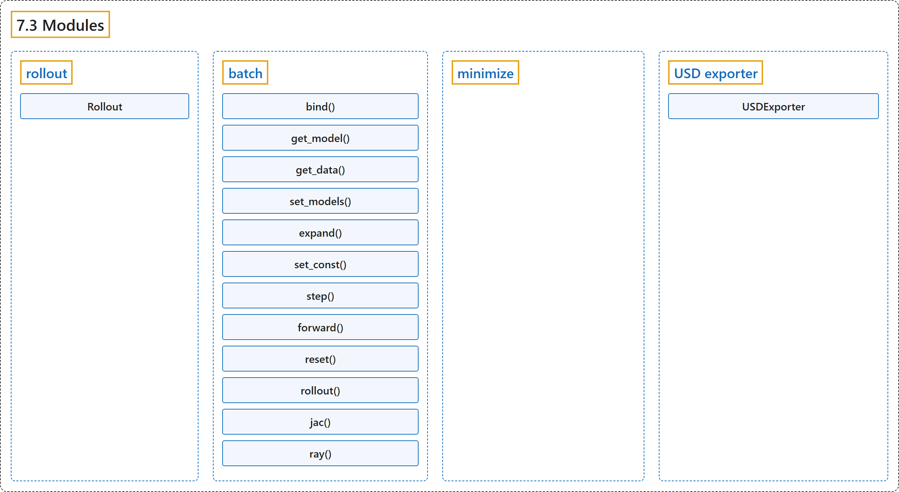

# 7.3 Modules

## Classification

## Glossary

| Term | Definition | 中文翻译 | Source |
|---|---|---|---|
| **7.3 Modules** 模块 | (context) "The mujoco package contains **two sub-modules: mujoco.rollout and mujoco.minimize**" | （语境）mujoco 包包含**两个子模块：mujoco.rollout 和 mujoco.minimize** | [Google DeepMind, n.d., "Modules", para. 1](https://mujoco.readthedocs.io/en/stable/python.html#modules) |
| **rollout** rollout 模块 | "The module addresses a common use-case where tight loops implemented outside of Python are beneficial: **rolling out a trajectory** (i.e., calling mj_step in a loop), given an initial state and sequence of controls, and returning subsequent states and sensor values." | 该模块针对一种常见用例，即在 Python 之外实现的紧凑循环更有利的情形：**展开一条轨迹**（即在循环中调用 mj_step），给定初始状态和控制序列，返回随后的状态和传感器值。 | [Google DeepMind, n.d., "rollout", para. 1](https://mujoco.readthedocs.io/en/stable/python.html#rollout) |
| **Rollout** Rollout 类 | (context) "To use multiple thread pools from multiple threads, **use Rollout objects**." | （语境）要从多个线程使用多个线程池，**请使用 Rollout 对象**。 | [Google DeepMind, n.d., "rollout", para. 7](https://mujoco.readthedocs.io/en/stable/python.html#rollout) |
| **batch** batch 模块 | "mujoco.batch.Batch **runs many simulations of one model on a thread pool and exposes their fields as rows of NumPy arrays**." | mujoco.batch.Batch **在一个线程池上运行同一模型的许多仿真，并把它们的字段作为 NumPy 数组的行提供出来**。 | [Google DeepMind, n.d., "batch", para. 1](https://mujoco.readthedocs.io/en/stable/python.html#batch) |
| **bind()** bind() 方法 | "bind(name) **returns a live nsim x ... array over an MjData field**." | bind(name) **返回一个覆盖某个 MjData 字段的实时 nsim x ... 数组**。 | [Google DeepMind, n.d., "batch", item 1](https://mujoco.readthedocs.io/en/stable/python.html#batch) |
| **get_model()** get_model() 方法 | "get_model(sim) and get_data(sim) **materialize one simulation as an MjModel and MjData**, for rendering or for any function;" | get_model(sim) 和 get_data(sim) **把一个仿真具体化为 MjModel 和 MjData**，用于渲染或任何函数； | [Google DeepMind, n.d., "batch", item 3](https://mujoco.readthedocs.io/en/stable/python.html#batch) |
| **get_data()** get_data() 方法 | "get_model(sim) and get_data(sim) **materialize one simulation as an MjModel and MjData**, for rendering or for any function;" | get_model(sim) 和 get_data(sim) **把一个仿真具体化为 MjModel 和 MjData**，用于渲染或任何函数； | [Google DeepMind, n.d., "batch", item 3](https://mujoco.readthedocs.io/en/stable/python.html#batch) |
| **set_models()** set_models() 方法 | "set_models(models) **runs each simulation on a model of the caller’s**, an MjModel per simulation or one for all, instead of the batch’s model, in place of expanded fields;" | set_models(models) **让每个仿真在调用者提供的模型上运行**（每个仿真一个 MjModel，或全部共用一个），而不是在批量对象自己的模型上运行，以此代替扩展字段； | [Google DeepMind, n.d., "batch", item 4](https://mujoco.readthedocs.io/en/stable/python.html#batch) |
| **expand()** expand() 方法 | "expand(name) **gives an MjModel field, or an MjOption field named opt.<name>, per-simulation values**, applied before each call." | expand(name) **为一个 MjModel 字段或名为 opt.<name> 的 MjOption 字段提供逐仿真的值**，在每次调用前应用。 | [Google DeepMind, n.d., "batch", item 5](https://mujoco.readthedocs.io/en/stable/python.html#batch) |
| **set_const()** set_const() 方法 | "set_const **runs mj_setConst per simulation**, and the fields it derives become per-simulation as well." | set_const **对每个仿真运行 mj_setConst**，它推导出的字段也随之成为逐仿真的。 | [Google DeepMind, n.d., "batch", item 5](https://mujoco.readthedocs.io/en/stable/python.html#batch) |
| **step()** step() 方法 | (context) "step(ids, nstep), forward(ids), reset(ids, keyframe) and set_const(ids) **run on the simulations ids**, sorted, unique and non-negative integers or a boolean mask, or on all of them." | （语境）step(ids, nstep)、forward(ids)、reset(ids, keyframe) 和 set_const(ids) **在仿真 ids 上运行**（ids 为已排序、不重复的非负整数或布尔掩码），或在全部仿真上运行。 | [Google DeepMind, n.d., "batch", item 6](https://mujoco.readthedocs.io/en/stable/python.html#batch) |
| **forward()** forward() 方法 | (context) "step(ids, nstep), forward(ids), reset(ids, keyframe) and set_const(ids) **run on the simulations ids**, sorted, unique and non-negative integers or a boolean mask, or on all of them." | （语境）step(ids, nstep)、forward(ids)、reset(ids, keyframe) 和 set_const(ids) **在仿真 ids 上运行**（ids 为已排序、不重复的非负整数或布尔掩码），或在全部仿真上运行。 | [Google DeepMind, n.d., "batch", item 6](https://mujoco.readthedocs.io/en/stable/python.html#batch) |
| **reset()** reset() 方法 | (context) "step(ids, nstep), forward(ids), reset(ids, keyframe) and set_const(ids) **run on the simulations ids**, sorted, unique and non-negative integers or a boolean mask, or on all of them." | （语境）step(ids, nstep)、forward(ids)、reset(ids, keyframe) 和 set_const(ids) **在仿真 ids 上运行**（ids 为已排序、不重复的非负整数或布尔掩码），或在全部仿真上运行。 | [Google DeepMind, n.d., "batch", item 6](https://mujoco.readthedocs.io/en/stable/python.html#batch) |
| **rollout()** rollout() 方法 | "rollout(nstep, control, control_spec, record, ids) **steps as rollout does, records any MjData fields or state vectors after every substep**, and returns them as n x nstep x ... arrays." | rollout(nstep, control, control_spec, record, ids) **像 rollout 那样步进，并在每个子步之后记录任意 MjData 字段或状态向量**，以 n x nstep x ... 数组返回。 | [Google DeepMind, n.d., "batch", item 8](https://mujoco.readthedocs.io/en/stable/python.html#batch) |
| **jac()** jac() 方法 | "jac(body, point, ids) and ray(pnt, vec, ..., normal=False) **evaluate mj_jac and mj_ray per simulation**, with a body per simulation and a body to exclude per ray if given, and the surface normals of the hits on request." | jac(body, point, ids) 和 ray(pnt, vec, ..., normal=False) **对每个仿真计算 mj_jac 和 mj_ray**，可为每个仿真给一个刚体、为每条射线给一个要排除的刚体，并可按需返回命中点的表面法线。 | [Google DeepMind, n.d., "batch", item 9](https://mujoco.readthedocs.io/en/stable/python.html#batch) |
| **ray()** ray() 方法 | "jac(body, point, ids) and ray(pnt, vec, ..., normal=False) **evaluate mj_jac and mj_ray per simulation**, with a body per simulation and a body to exclude per ray if given, and the surface normals of the hits on request." | jac(body, point, ids) 和 ray(pnt, vec, ..., normal=False) **对每个仿真计算 mj_jac 和 mj_ray**，可为每个仿真给一个刚体、为每条射线给一个要排除的刚体，并可按需返回命中点的表面法线。 | [Google DeepMind, n.d., "batch", item 9](https://mujoco.readthedocs.io/en/stable/python.html#batch) |
| **minimize** minimize 模块 | "This module contains **optimization-related utilities**." | 该模块包含**与优化相关的工具**。 | [Google DeepMind, n.d., "minimize", para. 1](https://mujoco.readthedocs.io/en/stable/python.html#minimize) |
| **USD exporter** USD 导出器 | "The USD exporter module **allows users to save scenes and trajectories in the USD format for rendering in external renderers** such as NVIDIA Omniverse or Blender." | USD 导出器模块**允许用户把场景和轨迹保存为 USD 格式，以便在外部渲染器中渲染**，例如 NVIDIA Omniverse 或 Blender。 | [Google DeepMind, n.d., "USD exporter", para. 1](https://mujoco.readthedocs.io/en/stable/python.html#usd-exporter) |
| **USDExporter** USDExporter 类 | "The USDExporter class in the mujoco.usd.exporter module **allows saving full trajectories in addition to defining custom cameras and lights**." | mujoco.usd.exporter 模块中的 USDExporter 类**除了可以定义自定义相机和灯光，还允许保存完整的轨迹**。 | [Google DeepMind, n.d., "USDExporter", para. 1](https://mujoco.readthedocs.io/en/stable/python.html#usdexporter) |
| **update_scene()** update_scene() 方法 | "updates **the scene with the latest simulation data passed in by the user**." | 用用户传入的最新仿真数据更新场景。 | [Google DeepMind, n.d., "USD Export API", item 1](https://mujoco.readthedocs.io/en/stable/python.html#usd-export-api) |
| **add_light()** add_light() 方法 | "adds **a light to the USD scene with the given properties post hoc**." | 事后向 USD 场景添加一个具有给定属性的灯光。 | [Google DeepMind, n.d., "USD Export API", item 2](https://mujoco.readthedocs.io/en/stable/python.html#usd-export-api) |
| **add_camera()** add_camera() 方法 | "adds **a camera to the USD scene with the given properties post hoc**." | 事后向 USD 场景添加一个具有给定属性的相机。 | [Google DeepMind, n.d., "USD Export API", item 3](https://mujoco.readthedocs.io/en/stable/python.html#usd-export-api) |
| **save_scene()** save_scene() 方法 | "exports **the USD scene using one of the USD filetype extensions** .usd, .usda, or .usdc." | 用 USD 文件类型扩展名之一导出 USD 场景：.usd、.usda 或 .usdc。 | [Google DeepMind, n.d., "USD Export API", item 4](https://mujoco.readthedocs.io/en/stable/python.html#usd-export-api) |

## References

Google DeepMind. (n.d.). *Python*. MuJoCo Documentation (Version 3.17.0). Retrieved October 31, 2026, from <https://mujoco.readthedocs.io/en/stable/python.html>
