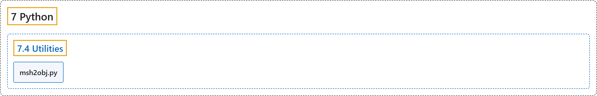

# 7.4 Utilities

## Classification

## Glossary

| Term | Definition | 中文翻译 | Source |
|---|---|---|---|
| **7.4 Utilities** 工具脚本 | (context) "The python/mujoco directory also contains **utility scripts**." | （语境）python/mujoco 目录中还包含**工具脚本**。 | [Google DeepMind, n.d., "Utilities", para. 1](https://mujoco.readthedocs.io/en/stable/python.html#utilities) |
| **msh2obj.py** msh2obj.py 脚本 | "The msh2obj.py script **converts the legacy .msh format for surface meshes** (different from the possibly-volumetric gmsh format also using .msh), **to OBJ files**." | msh2obj.py 脚本**把表面网格的旧式 .msh 格式**（不同于同样使用 .msh、可能是体网格的 gmsh 格式）**转换为 OBJ 文件**。 | [Google DeepMind, n.d., "msh2obj.py", para. 1](https://mujoco.readthedocs.io/en/stable/python.html#msh2obj-py) |

## References

Google DeepMind. (n.d.). *Python*. MuJoCo Documentation (Version 3.17.0). Retrieved October 31, 2026, from <https://mujoco.readthedocs.io/en/stable/python.html>
