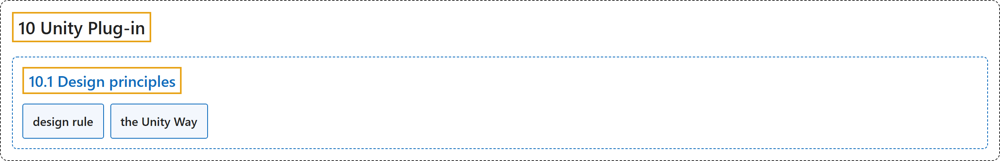

# 10.1 Design principles

## Classification

## Glossary

| Term | Definition | 中文翻译 | Source |
|---|---|---|---|
| **10.1 Design principles** 设计原则 | (context) "The plug-in design provides **a one-to-one mapping between MJCF elements and Unity components**." | （语境）插件的设计提供了 **MJCF 元素与 Unity 组件之间的一一对应**。 | [Google DeepMind, n.d., "Design principles", para. 1](https://mujoco.readthedocs.io/en/stable/unity.html#design-principles) |
| **design rule** 设计规则 | "Therefore, we adopt a design rule that **every game object must have at most one MuJoCo component**." | 因此，我们采用一条设计规则：**每个游戏对象最多只能有一个 MuJoCo 组件**。 | [Google DeepMind, n.d., "Design principles", item 2](https://mujoco.readthedocs.io/en/stable/unity.html#design-principles) |
| **the Unity Way** Unity 方式 | "Wherever possible, we do things the Unity Way: **gravity is read from Unity’s physics settings, and the simulation step is read from Unity’s Time Manager’s Fixed Timestep**." | 只要可能，我们就按 Unity 方式行事：**重力从 Unity 的物理设置中读取，仿真步长从 Unity 时间管理器的 Fixed Timestep 中读取**。 | [Google DeepMind, n.d., "Design principles", para. 3](https://mujoco.readthedocs.io/en/stable/unity.html#design-principles) |

## References

Google DeepMind. (n.d.). *Unity Plug-in*. MuJoCo Documentation (Version 3.17.0). Retrieved October 31, 2026, from <https://mujoco.readthedocs.io/en/stable/unity.html>
