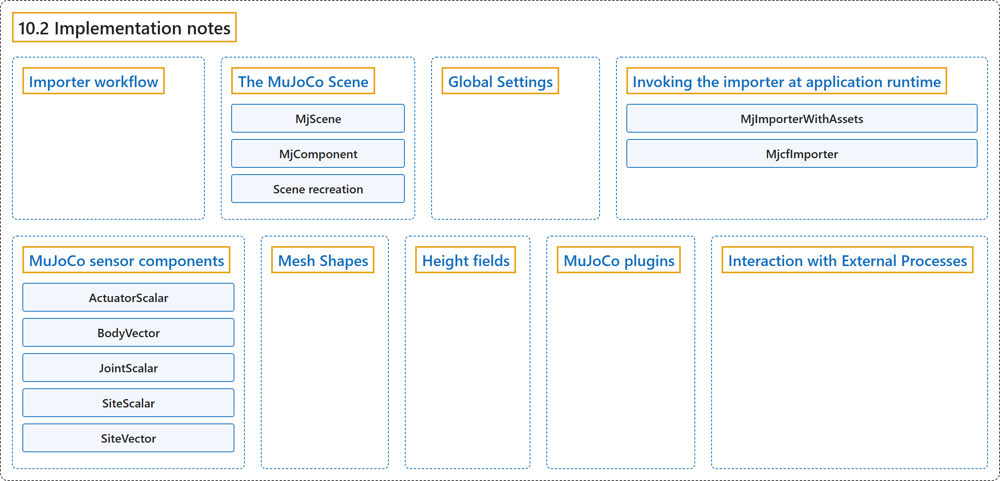

# 10.2 Implementation notes

## Classification

## Glossary

| Term | Definition | 中文翻译 | Source |
|---|---|---|---|
| **10.2 Implementation notes** 实现说明 | (No definition) | （无定义） | [Google DeepMind, n.d., "Implementation notes"](https://mujoco.readthedocs.io/en/stable/unity.html#implementation-notes) |
| **Importer workflow** 导入器工作流程 | "When the user selects an MJCF file, the importer **first loads the file in MuJoCo, saves it to a temporary location, and then processes the generated saved file**." | 用户选择一个 MJCF 文件时，导入器**先在 MuJoCo 中加载该文件，把它保存到临时位置，然后处理生成的保存文件**。 | [Google DeepMind, n.d., "Importer workflow", para. 1](https://mujoco.readthedocs.io/en/stable/unity.html#importer-workflow) |
| **The MuJoCo Scene** MuJoCo 场景 | (context) "When a MuJoCo scene is created, the MjScene component **first scans the scene for all instances of MjComponent**." | （语境）创建 MuJoCo 场景时，MjScene 组件**先扫描场景，找出所有 MjComponent 实例**。 | [Google DeepMind, n.d., "The MuJoCo Scene", para. 1](https://mujoco.readthedocs.io/en/stable/unity.html#the-mujoco-scene) |
| **MjScene** MjScene 组件类 | "MjScene **combines these XML elements according to the hierarchy of the respective game objects and creates a single MJCF description of the physics model**." | MjScene **按照各个游戏对象的层级组合这些 XML 元素，生成物理模型的单个 MJCF 描述**。 | [Google DeepMind, n.d., "The MuJoCo Scene", para. 1](https://mujoco.readthedocs.io/en/stable/unity.html#the-mujoco-scene) |
| **MjComponent** MjComponent 组件类 | "Each component **creates its own MJCF element using Unity scene’s spatial structure to describe the model’s initial reference pose** (called qpos0 in MuJoCo)." | 每个组件**利用 Unity 场景的空间结构创建自己的 MJCF 元素，以描述模型的初始参考位姿**（在 MuJoCo 中称为 qpos0）。 | [Google DeepMind, n.d., "The MuJoCo Scene", para. 1](https://mujoco.readthedocs.io/en/stable/unity.html#the-mujoco-scene) |
| **Scene recreation** 场景重建 | "Scene recreation **maintains continuity of physics and state** in the following way:" | 场景重建按以下方式**保持物理和状态的连续性**： | [Google DeepMind, n.d., "The MuJoCo Scene", para. 3](https://mujoco.readthedocs.io/en/stable/unity.html#the-mujoco-scene) |
| **Global Settings** 全局设置 | "This component is **responsible for all the configuration options that are included in the fixed-size, singleton, global elements of MJCF**." | 这个组件**负责 MJCF 中固定大小、单例的全局元素所包含的所有配置选项**。 | [Google DeepMind, n.d., "Global Settings", para. 1](https://mujoco.readthedocs.io/en/stable/unity.html#global-settings) |
| **Invoking the importer at application runtime** 在应用运行时调用导入器 | (context) "It can be **invoked at play-time** (it doesn’t involve Editor functionality), and it doesn’t invoke any functions of the MuJoCo library." | （语境）它可以**在运行（play）时调用**（不涉及编辑器功能），也不调用 MuJoCo 库的任何函数。 | [Google DeepMind, n.d., "Invoking the importer at application runtime", para. 1](https://mujoco.readthedocs.io/en/stable/unity.html#invoking-the-importer-at-application-runtime) |
| **MjImporterWithAssets** MjImporterWithAssets 类 | "The importer is implemented by the class MjImporterWithAssets, which is **a subclass of MjcfImporter**." | 导入器由类 MjImporterWithAssets 实现，它是 **MjcfImporter 的子类**。 | [Google DeepMind, n.d., "Invoking the importer at application runtime", para. 1](https://mujoco.readthedocs.io/en/stable/unity.html#invoking-the-importer-at-application-runtime) |
| **MjcfImporter** MjcfImporter 类 | "This parent class **takes an MJCF string and generates the hierarchy of components**." | 这个父类**接收一个 MJCF 字符串并生成组件的层级结构**。 | [Google DeepMind, n.d., "Invoking the importer at application runtime", para. 1](https://mujoco.readthedocs.io/en/stable/unity.html#invoking-the-importer-at-application-runtime) |
| **MuJoCo sensor components** MuJoCo 传感器组件 | "Therefore, we **created classes according to the type of object (actuator / body / geom / joint / site) whose properties are measured, and the type (scalar / vector / quaternion) of the measured data**." | 因此，我们**按照被测属性所属对象的类型（执行器 / 刚体 / geom / 关节 / site）和被测数据的类型（标量 / 向量 / 四元数）来创建类**。 | [Google DeepMind, n.d., "MuJoCo sensor components", para. 1](https://mujoco.readthedocs.io/en/stable/unity.html#mujoco-sensor-components) |
| **ActuatorScalar** ActuatorScalar 类 | (No definition) | （无定义） | [Google DeepMind, n.d., "MuJoCo sensor components"](https://mujoco.readthedocs.io/en/stable/unity.html#mujoco-sensor-components) |
| **BodyVector** BodyVector 类 | (No definition) | （无定义） | [Google DeepMind, n.d., "MuJoCo sensor components"](https://mujoco.readthedocs.io/en/stable/unity.html#mujoco-sensor-components) |
| **JointScalar** JointScalar 类 | (No definition) | （无定义） | [Google DeepMind, n.d., "MuJoCo sensor components"](https://mujoco.readthedocs.io/en/stable/unity.html#mujoco-sensor-components) |
| **SiteScalar** SiteScalar 类 | (No definition) | （无定义） | [Google DeepMind, n.d., "MuJoCo sensor components"](https://mujoco.readthedocs.io/en/stable/unity.html#mujoco-sensor-components) |
| **SiteVector** SiteVector 类 | (No definition) | （无定义） | [Google DeepMind, n.d., "MuJoCo sensor components"](https://mujoco.readthedocs.io/en/stable/unity.html#mujoco-sensor-components) |
| **Mesh Shapes** 网格形状 | "The plug-in allows **using arbitrary Unity meshes for MuJoCo collision**." | 插件允许**把任意 Unity 网格用于 MuJoCo 碰撞**。 | [Google DeepMind, n.d., "Mesh Shapes", para. 1](https://mujoco.readthedocs.io/en/stable/unity.html#mesh-shapes) |
| **Height fields** 高度场 | "MuJoCo hfields are **represented in Unity through terrain gameobjects**." | MuJoCo 的高度场**在 Unity 中通过地形游戏对象表示**。 | [Google DeepMind, n.d., "Height fields", para. 1](https://mujoco.readthedocs.io/en/stable/unity.html#height-fields) |
| **MuJoCo plugins** MuJoCo 插件 | (context) "The current version of the Unity package **does not support loading MJCF scenes that use MuJoCo plugins**" | （语境）当前版本的 Unity 包**不支持加载使用 MuJoCo 插件的 MJCF 场景** | [Google DeepMind, n.d., "MuJoCo plugins", para. 1](https://mujoco.readthedocs.io/en/stable/unity.html#mujoco-plugins) |
| **Interaction with External Processes** 与外部进程的交互 | (context) "In contrast, our plug-in **relies on Unity to step the simulation**." | （语境）相比之下，我们的插件**依靠 Unity 来步进仿真**。 | [Google DeepMind, n.d., "Interaction with External Processes", para. 1](https://mujoco.readthedocs.io/en/stable/unity.html#interaction-with-external-processes) |

## References

Google DeepMind. (n.d.). *Unity Plug-in*. MuJoCo Documentation (Version 3.17.0). Retrieved October 31, 2026, from <https://mujoco.readthedocs.io/en/stable/unity.html>
