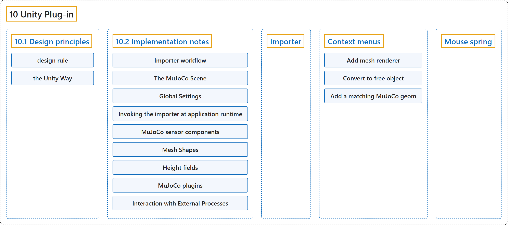

# 10. Unity Plug-in

## Classification

## Glossary

| Term | Definition | 中文翻译 | Source |
|---|---|---|---|
| **10 Unity Plug-in** Unity 插件 | "The MuJoCo Unity plug-in **allows the Unity Editor and runtime to use the MuJoCo physics engine**." | MuJoCo 的 Unity 插件**让 Unity 编辑器和运行时能够使用 MuJoCo 物理引擎**。 | [Google DeepMind, n.d., "Introduction", para. 1](https://mujoco.readthedocs.io/en/stable/unity.html#introduction) |
| **[10.1 Design principles](design-principles.md)** 设计原则 | (context) "The plug-in design provides **a one-to-one mapping between MJCF elements and Unity components**." | （语境）插件的设计提供了 **MJCF 元素与 Unity 组件之间的一一对应**。 | [Google DeepMind, n.d., "Design principles", para. 1](https://mujoco.readthedocs.io/en/stable/unity.html#design-principles) |
| **[10.2 Implementation notes](implementation-notes.md)** 实现说明 | (No definition) | （无定义） | [Google DeepMind, n.d., "Implementation notes"](https://mujoco.readthedocs.io/en/stable/unity.html#implementation-notes) |
| **Importer** 导入器 | "The importer is **invoked from the Editor’s Asset menu**: click on “Import MuJoCo Scene” and select the XML file with your model’s MJCF specification." | 导入器**从编辑器的 Asset 菜单调用**：点击“Import MuJoCo Scene”，再选择包含模型 MJCF 描述的 XML 文件。 | [Google DeepMind, n.d., "Importer", para. 1](https://mujoco.readthedocs.io/en/stable/unity.html#importer) |
| **Context menus** 右键菜单 | (No definition) | （无定义） | [Google DeepMind, n.d., "Context menus"](https://mujoco.readthedocs.io/en/stable/unity.html#context-menus) |
| **Add mesh renderer** 添加网格渲染器 | "“Add mesh renderer” **adds components to the same game object that render the geom**:" | “Add mesh renderer”**向同一个游戏对象添加渲染该 geom 的组件**： | [Google DeepMind, n.d., "Context menus", item 1](https://mujoco.readthedocs.io/en/stable/unity.html#context-menus) |
| **MjMeshFilter** MjMeshFilter 组件类 | "a MjMeshFilter that **creates a procedural mesh that is recreated when the geom shape properties change**." | 一个 MjMeshFilter，它**创建一个程序化网格，在 geom 形状属性变化时重新生成**。 | [Google DeepMind, n.d., "Context menus", item 1](https://mujoco.readthedocs.io/en/stable/unity.html#context-menus) |
| **Convert to free object** 转换为自由物体 | "“Convert to free object” **adds two new game objects: a parent with an MjBody component and a sibling with an MjFreeJoint component**." | “Convert to free object”**添加两个新的游戏对象：一个带 MjBody 组件的父对象和一个带 MjFreeJoint 组件的兄弟对象**。 | [Google DeepMind, n.d., "Context menus", item 1](https://mujoco.readthedocs.io/en/stable/unity.html#context-menus) |
| **“world” geoms** “世界”geom | "This action only applies to “world” geoms – **those that do not currently have an MjBody parent**." | 这个操作只适用于“世界”geom，即**当前没有 MjBody 父对象的 geom**。 | [Google DeepMind, n.d., "Context menus", item 1](https://mujoco.readthedocs.io/en/stable/unity.html#context-menus) |
| **MjBody** MjBody 组件类 | (context) "“Convert to free object” adds two new game objects: **a parent with an MjBody component** and a sibling with an MjFreeJoint component." | （语境）“Convert to free object”添加两个新的游戏对象：**一个带 MjBody 组件的父对象**和一个带 MjFreeJoint 组件的兄弟对象。 | [Google DeepMind, n.d., "Context menus", item 1](https://mujoco.readthedocs.io/en/stable/unity.html#context-menus) |
| **MjFreeJoint** MjFreeJoint 组件类 | (context) "“Convert to free object” adds two new game objects: a parent with an MjBody component and **a sibling with an MjFreeJoint component**." | （语境）“Convert to free object”添加两个新的游戏对象：一个带 MjBody 组件的父对象和**一个带 MjFreeJoint 组件的兄弟对象**。 | [Google DeepMind, n.d., "Context menus", item 1](https://mujoco.readthedocs.io/en/stable/unity.html#context-menus) |
| **MjGeom** MjGeom 组件类 | (context) "For convenience, we provide a context menu for “freeing” a world geom (i.e., **an MjGeom component without any MjBody ancestor**) by adding a parent MjBody and a sibling MjFreeJoint." | （语境）为了方便，我们提供一个右键菜单，通过添加父 MjBody 和兄弟 MjFreeJoint 来“释放”一个世界 geom（即**没有任何 MjBody 祖先的 MjGeom 组件**）。 | [Google DeepMind, n.d., "Tips to Unity users", item 2](https://mujoco.readthedocs.io/en/stable/unity.html#tips-to-unity-users) |
| **Add a matching MuJoCo geom** 添加匹配的 MuJoCo geom | "Right-clicking a Unity Collider **offers the option to “Add a matching MuJoCo geom” to the same game object**." | 右键点击一个 Unity Collider，**会出现向同一个游戏对象“添加匹配的 MuJoCo geom”的选项**。 | [Google DeepMind, n.d., "Context menus", item 2](https://mujoco.readthedocs.io/en/stable/unity.html#context-menus) |
| **Mouse spring** 鼠标弹簧 | "When the selected game object has an MjBody component, **spring forces can be applied to this body towards the mouse cursor** through a control-left-drag action in the Scene view." | 当选中的游戏对象带有 MjBody 组件时，在场景视图中按住 Ctrl 并左键拖动，**就可以对这个刚体施加指向鼠标光标的弹簧力**。 | [Google DeepMind, n.d., "Mouse spring", para. 1](https://mujoco.readthedocs.io/en/stable/unity.html#mouse-spring) |

## References

Google DeepMind. (n.d.). *Unity Plug-in*. MuJoCo Documentation (Version 3.17.0). Retrieved October 31, 2026, from <https://mujoco.readthedocs.io/en/stable/unity.html>
