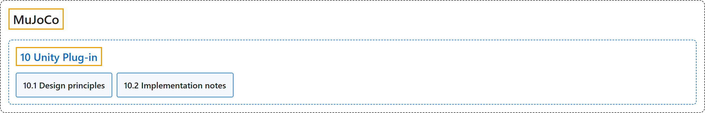

# 10. Unity Plug-in

## Classification

## Glossary

| Term | Definition | 中文翻译 | Source |
|---|---|---|---|
| **10 Unity Plug-in** Unity 插件 | "The MuJoCo Unity plug-in **allows the Unity Editor and runtime to use the MuJoCo physics engine**." | MuJoCo 的 Unity 插件**让 Unity 编辑器和运行时能够使用 MuJoCo 物理引擎**。 | [Google DeepMind, n.d., "Introduction", para. 1](https://mujoco.readthedocs.io/en/stable/unity.html#introduction) |
| **[10.1 Design principles](design-principles.md)** 设计原则 | (context) "The plug-in design provides **a one-to-one mapping between MJCF elements and Unity components**." | （语境）插件的设计提供了 **MJCF 元素与 Unity 组件之间的一一对应**。 | [Google DeepMind, n.d., "Design principles", para. 1](https://mujoco.readthedocs.io/en/stable/unity.html#design-principles) |
| **[10.2 Implementation notes](implementation-notes.md)** 实现说明 | (No definition) | （无定义） | [Google DeepMind, n.d., "Implementation notes"](https://mujoco.readthedocs.io/en/stable/unity.html#implementation-notes) |

## References

Google DeepMind. (n.d.). *Unity Plug-in*. MuJoCo Documentation (Version 3.17.0). Retrieved October 31, 2026, from <https://mujoco.readthedocs.io/en/stable/unity.html>
