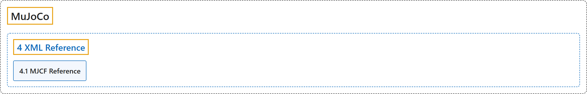

# 4. XML Reference

## Classification

## Glossary

| Term | Definition | 中文翻译 | Source |
|---|---|---|---|
| **4 XML Reference** XML 参考 | "This chapter is **the reference manual for the MJCF modeling language used in MuJoCo**." | 本章是 **MuJoCo 所用 MJCF 建模语言的参考手册**。 | [Google DeepMind, n.d., "Introduction", para. 1](https://mujoco.readthedocs.io/en/stable/XMLreference.html#introduction) |
| **[4.1 MJCF Reference](mjcf-reference.md)** MJCF 参考 | (context) "MJCF files have **a unique top-level element mujoco**." | （语境）MJCF 文件有**唯一的顶层元素 mujoco**。 | [Google DeepMind, n.d., "MJCF Reference", para. 1](https://mujoco.readthedocs.io/en/stable/XMLreference.html#mjcf-reference) |

## References

Google DeepMind. (n.d.). *XML Reference*. MuJoCo Documentation (Version 3.17.0). Retrieved October 31, 2026, from <https://mujoco.readthedocs.io/en/stable/XMLreference.html>
