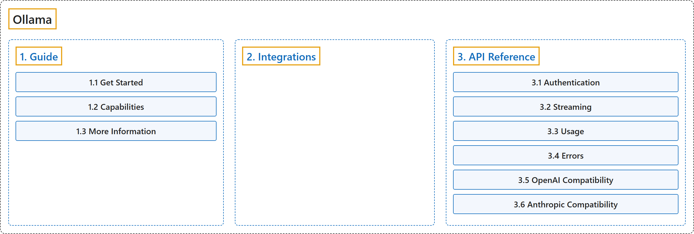

# Ollama

Official source: [Ollama documentation](https://docs.ollama.com/), Ollama.

## Classification

## Glossary

| Term | Definition | 中文翻译 | Source |
|---|---|---|---|
| **Ollama** Ollama | (context) "Use **open models** in your desktop apps and coding agents, or **build them into your application**." | （语境）在桌面应用和编码代理中使用**开放模型**，或**将它们构建到你的应用中**。 | [Ollama, n.d., "Ollama documentation", para. 1](https://docs.ollama.com/) |
| **[1. Guide](guide/index.md)** 指南 | (No definition) | （无定义） | [Ollama, n.d., "Guide"](https://docs.ollama.com/) |
| **[2. Integrations](2-integrations.md)** 集成 | "Use **Ollama models** in **your apps and tools**." | 使用 **Ollama 模型**，用于**你的应用和工具**。 | [Ollama, n.d., "Integrations", para. 1](https://docs.ollama.com/integrations) |
| **[3. API Reference](api-reference/index.md)** API 参考 | "Use **Ollama’s API** to **build applications with cloud or local models**." | 使用 **Ollama 的 API** 来**构建使用云端或本地模型的应用**。 | [Ollama, n.d., "Introduction", para. 1](https://docs.ollama.com/api/introduction) |

## References

Ollama. (n.d.). *Ollama documentation*. Retrieved November 8, 2026, from <https://docs.ollama.com/>
