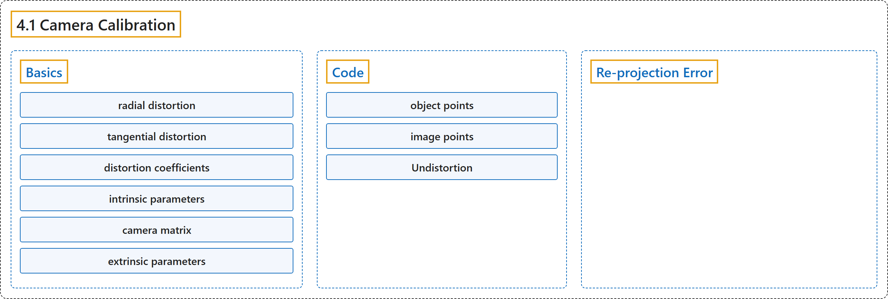

# 4.1 Camera Calibration

## Classification

## Glossary

| Term | Definition | 中文翻译 | Source |
|---|---|---|---|
| **4.1 Camera Calibration** 相机标定 | (context) "Let's find **how good is our camera**." | （语境）让我们看看**我们的相机有多好**。 | [OpenCV team, n.d.-b, "Camera Calibration and 3D Reconstruction", item 1](https://docs.opencv.org/4.x/d9/db7/tutorial_py_table_of_contents_calib3d.html) |
| **Basics** 基础 | (context) "Two major kinds of distortion are **radial distortion and tangential distortion**." | （语境）两种主要的畸变是**径向畸变和切向畸变**。 | [OpenCV team, n.d.-a, "Basics", para. 1](https://docs.opencv.org/4.x/dc/dbb/tutorial_py_calibration.html#autotoc_md1204) |
| **radial distortion** 径向畸变 | "Radial distortion **causes straight lines to appear curved**." | 径向畸变**使直线看起来是弯曲的**。 | [OpenCV team, n.d.-a, "Basics", para. 2](https://docs.opencv.org/4.x/dc/dbb/tutorial_py_calibration.html#autotoc_md1204) |
| **tangential distortion** 切向畸变 | "Similarly, tangential distortion occurs because **the image-taking lense is not aligned perfectly parallel to the imaging plane**." | 类似地，切向畸变的产生是因为**成像镜头没有与成像平面完全平行地对齐**。 | [OpenCV team, n.d.-a, "Basics", para. 5](https://docs.opencv.org/4.x/dc/dbb/tutorial_py_calibration.html#autotoc_md1204) |
| **distortion coefficients** 畸变系数 | (context) "In short, we need to find **five parameters**, known as distortion coefficients given by:" | （语境）简而言之，需要求出**五个参数**，称为畸变系数，由下式给出： | [OpenCV team, n.d.-a, "Basics", para. 6](https://docs.opencv.org/4.x/dc/dbb/tutorial_py_calibration.html#autotoc_md1204) |
| **intrinsic parameters** 内参 | "Intrinsic parameters are **specific to a camera**." | 内参**是某台相机特有的**。 | [OpenCV team, n.d.-a, "Basics", para. 7](https://docs.opencv.org/4.x/dc/dbb/tutorial_py_calibration.html#autotoc_md1204) |
| **camera matrix** 相机矩阵 | "The focal length and optical centers can be used to create a camera matrix, which can be used to **remove distortion due to the lenses of a specific camera**." | 焦距和光学中心可以用来构造相机矩阵，它可用于**去除特定相机镜头造成的畸变**。 | [OpenCV team, n.d.-a, "Basics", para. 7](https://docs.opencv.org/4.x/dc/dbb/tutorial_py_calibration.html#autotoc_md1204) |
| **extrinsic parameters** 外参 | "Extrinsic parameters corresponds to **rotation and translation vectors which translates a coordinates of a 3D point to a coordinate system**." | 外参对应于**把三维点的坐标转换到某个坐标系的旋转向量和平移向量**。 | [OpenCV team, n.d.-a, "Basics", para. 8](https://docs.opencv.org/4.x/dc/dbb/tutorial_py_calibration.html#autotoc_md1204) |
| **Code** 代码 | (No definition) | （无定义） | [OpenCV team, n.d.-a, "Code"](https://docs.opencv.org/4.x/dc/dbb/tutorial_py_calibration.html#autotoc_md1205) |
| **object points** 物点 | "**3D points** are called object points and 2D image points are called image points." | **三维点**称为物点，二维图像点称为像点。 | [OpenCV team, n.d.-a, "Code", para. 3](https://docs.opencv.org/4.x/dc/dbb/tutorial_py_calibration.html#autotoc_md1205) |
| **image points** 像点 | "3D points are called object points and **2D image points** are called image points." | 三维点称为物点，**二维图像点**称为像点。 | [OpenCV team, n.d.-a, "Code", para. 3](https://docs.opencv.org/4.x/dc/dbb/tutorial_py_calibration.html#autotoc_md1205) |
| **Undistortion** 去畸变 | (context) "Now, we can **take an image and undistort it**." | （语境）现在可以**取一幅图像并对它去畸变**。 | [OpenCV team, n.d.-a, "Undistortion", para. 1](https://docs.opencv.org/4.x/dc/dbb/tutorial_py_calibration.html#autotoc_md1208) |
| **remapping** 重映射 | "First, **find a mapping function from the distorted image to the undistorted image**. Then use the remap function." | 首先，**求出从畸变图像到去畸变图像的映射函数**。然后使用 remap 函数。 | [OpenCV team, n.d.-a, "2. Using remapping", para. 1](https://docs.opencv.org/4.x/dc/dbb/tutorial_py_calibration.html#autotoc_md1210) |
| **Re-projection Error** 重投影误差 | "Re-projection error gives **a good estimation of just how exact the found parameters are**." | 重投影误差**很好地估计了所求参数究竟有多准确**。 | [OpenCV team, n.d.-a, "Re-projection Error", para. 1](https://docs.opencv.org/4.x/dc/dbb/tutorial_py_calibration.html#autotoc_md1211) |

## References

OpenCV team. (n.d.-a). *Camera Calibration*. OpenCV-Python Tutorials (Version 4.13.0). Retrieved October 31, 2026, from <https://docs.opencv.org/4.x/dc/dbb/tutorial_py_calibration.html>

OpenCV team. (n.d.-b). *Camera Calibration and 3D Reconstruction*. OpenCV-Python Tutorials (Version 4.13.0). Retrieved October 31, 2026, from <https://docs.opencv.org/4.x/d9/db7/tutorial_py_table_of_contents_calib3d.html>
