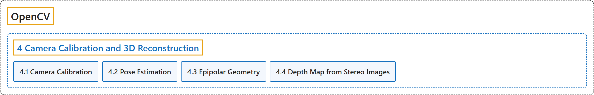

# 4. Camera Calibration and 3D Reconstruction

## Classification

## Glossary

| Term | Definition | 中文翻译 | Source |
|---|---|---|---|
| **4 Camera Calibration and 3D Reconstruction** 相机标定与三维重建 | "In this section we will learn about **camera calibration, stereo imaging etc**." | 在本节中，我们将学习**相机标定、立体成像等**。 | [OpenCV team, n.d.-b, "OpenCV-Python Tutorials", item 7](https://docs.opencv.org/4.x/d6/d00/tutorial_py_root.html) |
| **[4.1 Camera Calibration](camera-calibration.md)** 相机标定 | (context) "Let's find **how good is our camera**." | （语境）让我们看看**我们的相机有多好**。 | [OpenCV team, n.d.-a, "Camera Calibration and 3D Reconstruction", item 1](https://docs.opencv.org/4.x/d9/db7/tutorial_py_table_of_contents_calib3d.html) |
| **[4.2 Pose Estimation](pose-estimation.md)** 位姿估计 | (context) "This is a small section which will help you to **create some cool 3D effects with calib module**." | （语境）这是一个小节，帮助你**用 calib 模块制作一些很酷的三维效果**。 | [OpenCV team, n.d.-a, "Camera Calibration and 3D Reconstruction", item 2](https://docs.opencv.org/4.x/d9/db7/tutorial_py_table_of_contents_calib3d.html) |
| **[4.3 Epipolar Geometry](epipolar-geometry.md)** 对极几何 | (context) "Let's understand **epipolar geometry and epipolar constraint**." | （语境）让我们理解**对极几何和对极约束**。 | [OpenCV team, n.d.-a, "Camera Calibration and 3D Reconstruction", item 3](https://docs.opencv.org/4.x/d9/db7/tutorial_py_table_of_contents_calib3d.html) |
| **[4.4 Depth Map from Stereo Images](depth-map-from-stereo-images.md)** 由立体图像生成深度图 | (context) "**Extract depth information from 2D images.**" | （语境）**从二维图像中提取深度信息。** | [OpenCV team, n.d.-a, "Camera Calibration and 3D Reconstruction", item 4](https://docs.opencv.org/4.x/d9/db7/tutorial_py_table_of_contents_calib3d.html) |

## References

OpenCV team. (n.d.-a). *Camera Calibration and 3D Reconstruction*. OpenCV-Python Tutorials (Version 4.13.0). Retrieved October 31, 2026, from <https://docs.opencv.org/4.x/d9/db7/tutorial_py_table_of_contents_calib3d.html>

OpenCV team. (n.d.-b). *OpenCV-Python Tutorials*. OpenCV-Python Tutorials (Version 4.13.0). Retrieved October 31, 2026, from <https://docs.opencv.org/4.x/d6/d00/tutorial_py_root.html>
