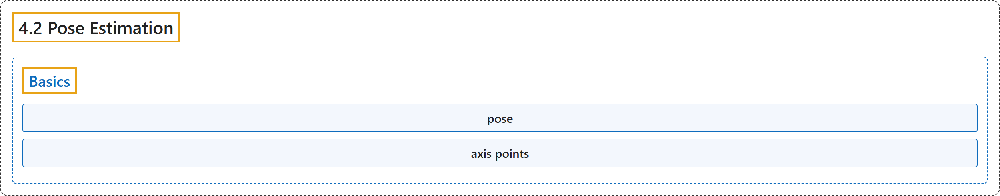

# 4.2 Pose Estimation

## Classification

## Glossary

| Term | Definition | 中文翻译 | Source |
|---|---|---|---|
| **4.2 Pose Estimation** 位姿估计 | (context) "This is a small section which will help you to **create some cool 3D effects with calib module**." | （语境）这是一个小节，帮助你**用 calib 模块制作一些很酷的三维效果**。 | [OpenCV team, n.d.-a, "Camera Calibration and 3D Reconstruction", item 2](https://docs.opencv.org/4.x/d9/db7/tutorial_py_table_of_contents_calib3d.html) |
| **Basics** 基础 | (No definition) | （无定义） | [OpenCV team, n.d.-b, "Basics"](https://docs.opencv.org/4.x/d7/d53/tutorial_py_pose.html#autotoc_md1223) |
| **pose** 位姿 | "Given a pattern image, we can utilize the above information to calculate its pose, or **how the object is situated in space, like how it is rotated, how it is displaced etc**." | 给定一幅图案图像，可以利用上述信息计算它的位姿，即**物体在空间中如何放置，比如如何旋转、如何平移等**。 | [OpenCV team, n.d.-b, "Basics", para. 1](https://docs.opencv.org/4.x/d7/d53/tutorial_py_pose.html#autotoc_md1223) |
| **axis points** 轴点 | "Axis points are **points in 3D space for drawing the axis**." | 轴点是**用于绘制坐标轴的三维空间中的点**。 | [OpenCV team, n.d.-b, "Basics", para. 5](https://docs.opencv.org/4.x/d7/d53/tutorial_py_pose.html#autotoc_md1223) |

## References

OpenCV team. (n.d.-a). *Camera Calibration and 3D Reconstruction*. OpenCV-Python Tutorials (Version 4.13.0). Retrieved October 31, 2026, from <https://docs.opencv.org/4.x/d9/db7/tutorial_py_table_of_contents_calib3d.html>

OpenCV team. (n.d.-b). *Pose Estimation*. OpenCV-Python Tutorials (Version 4.13.0). Retrieved October 31, 2026, from <https://docs.opencv.org/4.x/d7/d53/tutorial_py_pose.html>
