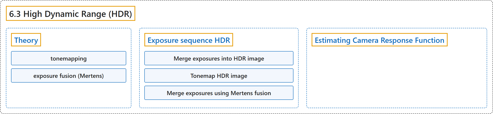

# 6.3 High Dynamic Range (HDR)

## Classification

## Glossary

| Term | Definition | 中文翻译 | Source |
|---|---|---|---|
| **6.3 High Dynamic Range (HDR)** 高动态范围（HDR） | (context) "Learn how to **merge exposure sequence and process high dynamic range images**." | （语境）学习如何**合并曝光序列并处理高动态范围图像**。 | [OpenCV team, n.d.-a, "Computational Photography", item 3](https://docs.opencv.org/4.x/d0/d07/tutorial_py_table_of_contents_photo.html) |
| **Theory** 理论 | "High-dynamic-range imaging (HDRI or HDR) is **a technique used in imaging and photography to reproduce a greater dynamic range of luminosity than is possible with standard digital imaging or photographic techniques**." | 高动态范围成像（HDRI 或 HDR）是**成像和摄影中使用的一种技术，能再现比标准数字成像或摄影技术更大的亮度动态范围**。 | [OpenCV team, n.d.-b, "Theory", para. 1](https://docs.opencv.org/4.x/d2/df0/tutorial_py_hdr.html#autotoc_md1496) |
| **tonemapping** 色调映射 | "After the HDR image has been merged, **it has to be converted back to 8-bit to view it on usual displays**. This process is called tonemapping." | HDR 图像合并之后，**必须转换回 8 位才能在普通显示器上查看**。这个过程称为色调映射。 | [OpenCV team, n.d.-b, "Theory", para. 2](https://docs.opencv.org/4.x/d2/df0/tutorial_py_hdr.html#autotoc_md1496) |
| **exposure fusion (Mertens)** 曝光融合（Mertens） | "In this tutorial we show 2 algorithms (Debevec, Robertson) to generate and display HDR image from an exposure sequence, and demonstrate an alternative approach called exposure fusion (Mertens), that **produces low dynamic range image and does not need the exposure times data**." | 本教程展示 2 种从曝光序列生成并显示 HDR 图像的算法（Debevec、Robertson），并演示另一种称为曝光融合（Mertens）的方法，它**生成低动态范围图像，且不需要曝光时间数据**。 | [OpenCV team, n.d.-b, "Theory", para. 3](https://docs.opencv.org/4.x/d2/df0/tutorial_py_hdr.html#autotoc_md1496) |
| **Exposure sequence HDR** 曝光序列 HDR | (context) "In this tutorial we will look on the following scene, where we have **4 exposure images**, with exposure times of: 15, 2.5, 1/4 and 1/30 seconds." | （语境）本教程将使用下面的场景，其中有 **4 幅曝光图像**，曝光时间分别为 15、2.5、1/4 和 1/30 秒。 | [OpenCV team, n.d.-b, "Exposure sequence HDR", para. 1](https://docs.opencv.org/4.x/d2/df0/tutorial_py_hdr.html#autotoc_md1497) |
| **Merge exposures into HDR image** 把曝光合并为 HDR 图像 | "In this stage we **merge the exposure sequence into one HDR image**, showing 2 possibilities which we have in OpenCV." | 在这一阶段，我们**把曝光序列合并为一幅 HDR 图像**，展示 OpenCV 中的 2 种方法。 | [OpenCV team, n.d.-b, "2. Merge exposures into HDR image", para. 1](https://docs.opencv.org/4.x/d2/df0/tutorial_py_hdr.html#autotoc_md1499) |
| **Debevec** Debevec 方法 | (context) "**The first method** is Debevec and the second one is Robertson." | （语境）**第一种方法**是 Debevec，第二种是 Robertson。 | [OpenCV team, n.d.-b, "2. Merge exposures into HDR image", para. 1](https://docs.opencv.org/4.x/d2/df0/tutorial_py_hdr.html#autotoc_md1499) |
| **Robertson** Robertson 方法 | (context) "The first method is Debevec and **the second one** is Robertson." | （语境）第一种方法是 Debevec，**第二种**是 Robertson。 | [OpenCV team, n.d.-b, "2. Merge exposures into HDR image", para. 1](https://docs.opencv.org/4.x/d2/df0/tutorial_py_hdr.html#autotoc_md1499) |
| **Tonemap HDR image** 对 HDR 图像做色调映射 | "We **map the 32-bit float HDR data into the range [0..1]**." | 我们**把 32 位浮点 HDR 数据映射到 [0..1] 范围**。 | [OpenCV team, n.d.-b, "3. Tonemap HDR image", para. 1](https://docs.opencv.org/4.x/d2/df0/tutorial_py_hdr.html#autotoc_md1500) |
| **Merge exposures using Mertens fusion** 用 Mertens 融合合并曝光 | "Here we show **an alternative algorithm to merge the exposure images, where we do not need the exposure times**." | 这里展示**另一种合并曝光图像的算法，它不需要曝光时间**。 | [OpenCV team, n.d.-b, "4. Merge exposures using Mertens fusion", para. 1](https://docs.opencv.org/4.x/d2/df0/tutorial_py_hdr.html#autotoc_md1501) |
| **Estimating Camera Response Function** 估计相机响应函数 | "The camera response function (CRF) gives us **the connection between the scene radiance to the measured intensity values**." | 相机响应函数（CRF）给出**场景辐射亮度与测得的强度值之间的关系**。 | [OpenCV team, n.d.-b, "Estimating Camera Response Function", para. 1](https://docs.opencv.org/4.x/d2/df0/tutorial_py_hdr.html#autotoc_md1507) |

## References

OpenCV team. (n.d.-a). *Computational Photography*. OpenCV-Python Tutorials (Version 4.13.0). Retrieved October 31, 2026, from <https://docs.opencv.org/4.x/d0/d07/tutorial_py_table_of_contents_photo.html>

OpenCV team. (n.d.-b). *High Dynamic Range (HDR)*. OpenCV-Python Tutorials (Version 4.13.0). Retrieved October 31, 2026, from <https://docs.opencv.org/4.x/d2/df0/tutorial_py_hdr.html>
