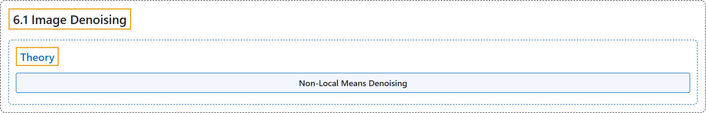

# 6.1 Image Denoising

## Classification

## Glossary

| Term | Definition | 中文翻译 | Source |
|---|---|---|---|
| **6.1 Image Denoising** 图像去噪 | (context) "See a good technique to **remove noises in images called Non-Local Means Denoising**" | （语境）了解一种**去除图像噪声的好技术，叫非局部均值去噪** | [OpenCV team, n.d.-a, "Computational Photography", item 1](https://docs.opencv.org/4.x/d0/d07/tutorial_py_table_of_contents_photo.html) |
| **Theory** 理论 | (No definition) | （无定义） | [OpenCV team, n.d.-b, "Theory"](https://docs.opencv.org/4.x/d5/d69/tutorial_py_non_local_means.html#autotoc_md1516) |
| **Non-Local Means Denoising** 非局部均值去噪 | "So we take a pixel, take small window around it, **search for similar windows in the image, average all the windows and replace the pixel with the result we got**. This method is Non-Local Means Denoising." | 于是我们取一个像素，在它周围取一个小窗口，**在图像中搜索相似的窗口，对所有这些窗口取平均，并用得到的结果替换该像素**。这种方法就是非局部均值去噪。 | [OpenCV team, n.d.-b, "Theory", para. 5](https://docs.opencv.org/4.x/d5/d69/tutorial_py_non_local_means.html#autotoc_md1516) |

## References

OpenCV team. (n.d.-a). *Computational Photography*. OpenCV-Python Tutorials (Version 4.13.0). Retrieved October 31, 2026, from <https://docs.opencv.org/4.x/d0/d07/tutorial_py_table_of_contents_photo.html>

OpenCV team. (n.d.-b). *Image Denoising*. OpenCV-Python Tutorials (Version 4.13.0). Retrieved October 31, 2026, from <https://docs.opencv.org/4.x/d5/d69/tutorial_py_non_local_means.html>
