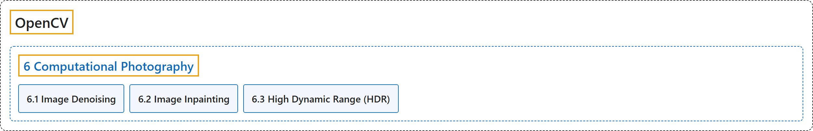

# 6. Computational Photography

## Classification

## Glossary

| Term | Definition | 中文翻译 | Source |
|---|---|---|---|
| **6 Computational Photography** 计算摄影 | "In this section you will learn **different computational photography techniques like image denoising etc**." | 在本节中，你将学习**各种计算摄影技术，如图像去噪等**。 | [OpenCV team, n.d.-b, "OpenCV-Python Tutorials", item 9](https://docs.opencv.org/4.x/d6/d00/tutorial_py_root.html) |
| **[6.1 Image Denoising](image-denoising.md)** 图像去噪 | (context) "See a good technique to **remove noises in images called Non-Local Means Denoising**" | （语境）了解一种**去除图像噪声的好技术，叫非局部均值去噪** | [OpenCV team, n.d.-a, "Computational Photography", item 1](https://docs.opencv.org/4.x/d0/d07/tutorial_py_table_of_contents_photo.html) |
| **[6.2 Image Inpainting](image-inpainting.md)** 图像修复 | (context) "Let's try to restore them with **a technique called image inpainting**." | （语境）让我们用**一种叫图像修复的技术**来恢复它们。 | [OpenCV team, n.d.-a, "Computational Photography", item 2](https://docs.opencv.org/4.x/d0/d07/tutorial_py_table_of_contents_photo.html) |
| **[6.3 High Dynamic Range (HDR)](high-dynamic-range-hdr.md)** 高动态范围（HDR） | (context) "Learn how to **merge exposure sequence and process high dynamic range images**." | （语境）学习如何**合并曝光序列并处理高动态范围图像**。 | [OpenCV team, n.d.-a, "Computational Photography", item 3](https://docs.opencv.org/4.x/d0/d07/tutorial_py_table_of_contents_photo.html) |

## References

OpenCV team. (n.d.-a). *Computational Photography*. OpenCV-Python Tutorials (Version 4.13.0). Retrieved October 31, 2026, from <https://docs.opencv.org/4.x/d0/d07/tutorial_py_table_of_contents_photo.html>

OpenCV team. (n.d.-b). *OpenCV-Python Tutorials*. OpenCV-Python Tutorials (Version 4.13.0). Retrieved October 31, 2026, from <https://docs.opencv.org/4.x/d6/d00/tutorial_py_root.html>
