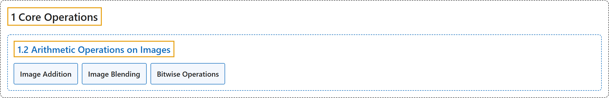

# 1.2 Arithmetic Operations on Images

## Classification

## Glossary

| Term | Definition | 中文翻译 | Source |
|---|---|---|---|
| **1.2 Arithmetic Operations on Images** 图像的算术运算 | (context) "**Perform arithmetic operations on images**" | （语境）**对图像进行算术运算** | [OpenCV team, n.d.-b, "Core Operations", item 2](https://docs.opencv.org/4.x/d7/d16/tutorial_py_table_of_contents_core.html) |
| **Image Addition** 图像加法 | (context) "You can **add two images** with the OpenCV function, cv.add(), or simply by the numpy operation res = img1 + img2." | （语境）可以用 OpenCV 函数 cv.add() **把两幅图像相加**，也可以直接用 numpy 运算 res = img1 + img2。 | [OpenCV team, n.d.-a, "Image Addition", para. 1](https://docs.opencv.org/4.x/d0/d86/tutorial_py_image_arithmetics.html#autotoc_md1232) |
| **Image Blending** 图像融合 | "This is also image addition, but **different weights are given to images in order to give a feeling of blending or transparency**." | 这也是图像加法，但**给各幅图像赋予不同的权重，以产生融合或透明的效果**。 | [OpenCV team, n.d.-a, "Image Blending", para. 1](https://docs.opencv.org/4.x/d0/d86/tutorial_py_image_arithmetics.html#autotoc_md1233) |
| **Bitwise Operations** 按位运算 | "This includes **the bitwise AND, OR, NOT, and XOR operations**." | 这包括**按位与、或、非和异或运算**。 | [OpenCV team, n.d.-a, "Bitwise Operations", para. 1](https://docs.opencv.org/4.x/d0/d86/tutorial_py_image_arithmetics.html#autotoc_md1234) |

## References

OpenCV team. (n.d.-a). *Arithmetic Operations on Images*. OpenCV-Python Tutorials (Version 4.13.0). Retrieved October 31, 2026, from <https://docs.opencv.org/4.x/d0/d86/tutorial_py_image_arithmetics.html>

OpenCV team. (n.d.-b). *Core Operations*. OpenCV-Python Tutorials (Version 4.13.0). Retrieved October 31, 2026, from <https://docs.opencv.org/4.x/d7/d16/tutorial_py_table_of_contents_core.html>
