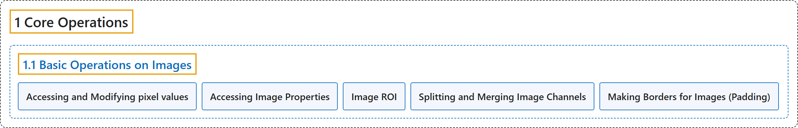

# 1.1 Basic Operations on Images

## Classification

## Glossary

| Term | Definition | 中文翻译 | Source |
|---|---|---|---|
| **1.1 Basic Operations on Images** 图像的基本操作 | (context) "Learn to **read and edit pixel values, working with image ROI and other basic operations**." | （语境）学习**读取和编辑像素值、处理图像 ROI 以及其他基本操作**。 | [OpenCV team, n.d.-b, "Core Operations", item 1](https://docs.opencv.org/4.x/d7/d16/tutorial_py_table_of_contents_core.html) |
| **Accessing and Modifying pixel values** 访问和修改像素值 | "You can access a pixel value **by its row and column coordinates**." | 可以**通过行坐标和列坐标**访问像素值。 | [OpenCV team, n.d.-a, "Accessing and Modifying pixel values", para. 2](https://docs.opencv.org/4.x/d3/df2/tutorial_py_basic_ops.html#autotoc_md1226) |
| **Accessing Image Properties** 访问图像属性 | "Image properties include **number of rows, columns, and channels; type of image data; number of pixels; etc**." | 图像属性包括**行数、列数和通道数；图像数据类型；像素数量；等等**。 | [OpenCV team, n.d.-a, "Accessing Image Properties", para. 1](https://docs.opencv.org/4.x/d3/df2/tutorial_py_basic_ops.html#autotoc_md1227) |
| **Image ROI** 图像感兴趣区域（ROI） | (context) "Sometimes, you will have to play with **certain regions of images**." | （语境）有时你需要处理**图像的某些区域**。 | [OpenCV team, n.d.-a, "Image ROI", para. 1](https://docs.opencv.org/4.x/d3/df2/tutorial_py_basic_ops.html#autotoc_md1228) |
| **Splitting and Merging Image Channels** 图像通道的拆分与合并 | "In this case, you need to **split the BGR image into single channels**. In other cases, you may need to **join these individual channels to create a BGR image**." | 这时需要**把 BGR 图像拆分成单个通道**。另一些情况下，可能需要**把这些单独的通道合并成一幅 BGR 图像**。 | [OpenCV team, n.d.-a, "Splitting and Merging Image Channels", para. 1](https://docs.opencv.org/4.x/d3/df2/tutorial_py_basic_ops.html#autotoc_md1229) |
| **Making Borders for Images (Padding)** 为图像加边框（填充） | "If you want to **create a border around an image, something like a photo frame**, you can use cv.copyMakeBorder()." | 如果想**在图像周围加一个边框，类似相框**，可以使用 cv.copyMakeBorder()。 | [OpenCV team, n.d.-a, "Making Borders for Images (Padding)", para. 1](https://docs.opencv.org/4.x/d3/df2/tutorial_py_basic_ops.html#autotoc_md1230) |

## References

OpenCV team. (n.d.-a). *Basic Operations on Images*. OpenCV-Python Tutorials (Version 4.13.0). Retrieved October 31, 2026, from <https://docs.opencv.org/4.x/d3/df2/tutorial_py_basic_ops.html>

OpenCV team. (n.d.-b). *Core Operations*. OpenCV-Python Tutorials (Version 4.13.0). Retrieved October 31, 2026, from <https://docs.opencv.org/4.x/d7/d16/tutorial_py_table_of_contents_core.html>
