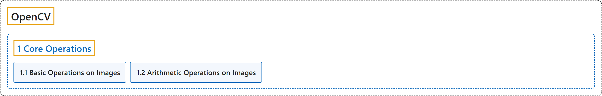

# 1. Core Operations

## Classification

## Glossary

| Term | Definition | 中文翻译 | Source |
|---|---|---|---|
| **1 Core Operations** 核心操作 | "In this section you will learn **basic operations on image like pixel editing, geometric transformations, code optimization, some mathematical tools etc**." | 在本节中，你将学习**图像的基本操作，如像素编辑、几何变换、代码优化、一些数学工具等**。 | [OpenCV team, n.d.-b, "OpenCV-Python Tutorials", item 3](https://docs.opencv.org/4.x/d6/d00/tutorial_py_root.html) |
| **[1.1 Basic Operations on Images](basic-operations-on-images.md)** 图像的基本操作 | (context) "Learn to **read and edit pixel values, working with image ROI and other basic operations**." | （语境）学习**读取和编辑像素值、处理图像 ROI 以及其他基本操作**。 | [OpenCV team, n.d.-a, "Core Operations", item 1](https://docs.opencv.org/4.x/d7/d16/tutorial_py_table_of_contents_core.html) |
| **[1.2 Arithmetic Operations on Images](arithmetic-operations-on-images.md)** 图像的算术运算 | (context) "**Perform arithmetic operations on images**" | （语境）**对图像进行算术运算** | [OpenCV team, n.d.-a, "Core Operations", item 2](https://docs.opencv.org/4.x/d7/d16/tutorial_py_table_of_contents_core.html) |

## References

OpenCV team. (n.d.-a). *Core Operations*. OpenCV-Python Tutorials (Version 4.13.0). Retrieved October 31, 2026, from <https://docs.opencv.org/4.x/d7/d16/tutorial_py_table_of_contents_core.html>

OpenCV team. (n.d.-b). *OpenCV-Python Tutorials*. OpenCV-Python Tutorials (Version 4.13.0). Retrieved October 31, 2026, from <https://docs.opencv.org/4.x/d6/d00/tutorial_py_root.html>
