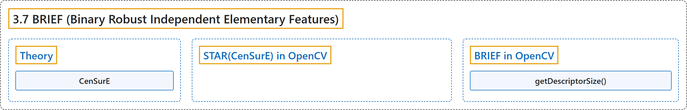

# 3.7 BRIEF (Binary Robust Independent Elementary Features)

## Classification

## Glossary

| Term | Definition | 中文翻译 | Source |
|---|---|---|---|
| **3.7 BRIEF (Binary Robust Independent Elementary Features)** BRIEF（二进制稳健独立基本特征） | (context) "SIFT uses **a feature descriptor with 128 floating point numbers**." | （语境）SIFT 使用**一个由 128 个浮点数组成的特征描述子**。 | [OpenCV team, n.d.-b, "Feature Detection and Description", item 7](https://docs.opencv.org/4.x/db/d27/tutorial_py_table_of_contents_feature2d.html) |
| **Theory** 理论 | "It provides **a shortcut to find the binary strings directly without finding descriptors**." | 它提供了**一条不求描述子而直接求出二进制串的捷径**。 | [OpenCV team, n.d.-a, "Theory", para. 3](https://docs.opencv.org/4.x/dc/d7d/tutorial_py_brief.html#autotoc_md1244) |
| **CenSurE** CenSurE | (context) "The paper recommends to use CenSurE which is **a fast detector**" | （语境）论文推荐使用 CenSurE，它是**一种快速检测器** | [OpenCV team, n.d.-a, "Theory", para. 5](https://docs.opencv.org/4.x/dc/d7d/tutorial_py_brief.html#autotoc_md1244) |
| **STAR(CenSurE) in OpenCV** OpenCV 中的 STAR（CenSurE） | "STAR is **a feature detector derived from CenSurE**." | STAR 是**一种由 CenSurE 派生的特征检测器**。 | [OpenCV team, n.d.-a, "STAR(CenSurE) in OpenCV", para. 1](https://docs.opencv.org/4.x/dc/d7d/tutorial_py_brief.html#autotoc_md1245) |
| **BRIEF in OpenCV** OpenCV 中的 BRIEF | (No definition) | （无定义） | [OpenCV team, n.d.-a, "BRIEF in OpenCV"](https://docs.opencv.org/4.x/dc/d7d/tutorial_py_brief.html#autotoc_md1246) |
| **getDescriptorSize()** getDescriptorSize 方法 | "The function brief.getDescriptorSize() **gives the nd size used in bytes**." | 函数 brief.getDescriptorSize() **给出所用的 nd 大小（以字节计）**。 | [OpenCV team, n.d.-a, "BRIEF in OpenCV", para. 3](https://docs.opencv.org/4.x/dc/d7d/tutorial_py_brief.html#autotoc_md1246) |

## References

OpenCV team. (n.d.-a). *BRIEF (Binary Robust Independent Elementary Features)*. OpenCV-Python Tutorials (Version 4.13.0). Retrieved October 31, 2026, from <https://docs.opencv.org/4.x/dc/d7d/tutorial_py_brief.html>

OpenCV team. (n.d.-b). *Feature Detection and Description*. OpenCV-Python Tutorials (Version 4.13.0). Retrieved October 31, 2026, from <https://docs.opencv.org/4.x/db/d27/tutorial_py_table_of_contents_feature2d.html>
