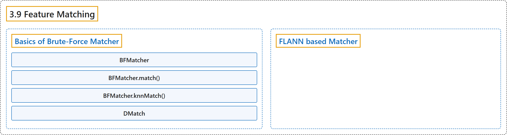

# 3.9 Feature Matching

## Classification

## Glossary

| Term | Definition | 中文翻译 | Source |
|---|---|---|---|
| **3.9 Feature Matching** 特征匹配 | (context) "OpenCV provides **two techniques, Brute-Force matcher and FLANN based matcher**." | （语境）OpenCV 提供**两种技术：暴力匹配器和基于 FLANN 的匹配器**。 | [OpenCV team, n.d.-a, "Feature Detection and Description", item 9](https://docs.opencv.org/4.x/db/d27/tutorial_py_table_of_contents_feature2d.html) |
| **Basics of Brute-Force Matcher** 暴力匹配器基础 | "It takes the descriptor of one feature in first set and **is matched with all other features in second set using some distance calculation**." | 它取第一组中一个特征的描述子，**用某种距离计算与第二组中的所有特征进行匹配**。 | [OpenCV team, n.d.-b, "Basics of Brute-Force Matcher", para. 1](https://docs.opencv.org/4.x/dc/dc3/tutorial_py_matcher.html#autotoc_md1268) |
| **BFMatcher** BFMatcher 类 | (context) "For BF matcher, first we have to **create the BFMatcher object** using cv.BFMatcher()." | （语境）对于 BF 匹配器，首先要用 cv.BFMatcher() **创建 BFMatcher 对象**。 | [OpenCV team, n.d.-b, "Basics of Brute-Force Matcher", para. 2](https://docs.opencv.org/4.x/dc/dc3/tutorial_py_matcher.html#autotoc_md1268) |
| **BFMatcher.match()** match 方法 | "Once it is created, two important methods are BFMatcher.match() and BFMatcher.knnMatch(). First one returns **the best match**." | 创建之后，两个重要的方法是 BFMatcher.match() 和 BFMatcher.knnMatch()。第一个返回**最佳匹配**。 | [OpenCV team, n.d.-b, "Basics of Brute-Force Matcher", para. 4](https://docs.opencv.org/4.x/dc/dc3/tutorial_py_matcher.html#autotoc_md1268) |
| **BFMatcher.knnMatch()** knnMatch 方法 | "Second method returns **k best matches where k is specified by the user**." | 第二个方法返回 **k 个最佳匹配，k 由用户指定**。 | [OpenCV team, n.d.-b, "Basics of Brute-Force Matcher", para. 4](https://docs.opencv.org/4.x/dc/dc3/tutorial_py_matcher.html#autotoc_md1268) |
| **DMatch** DMatch 类 | (context) "The result of matches = bf.match(des1,des2) line is **a list of DMatch objects**." | （语境）matches = bf.match(des1,des2) 这一行的结果是**一个 DMatch 对象的列表**。 | [OpenCV team, n.d.-b, "What is this Matcher Object?", para. 1](https://docs.opencv.org/4.x/dc/dc3/tutorial_py_matcher.html#autotoc_md1270) |
| **FLANN based Matcher** 基于 FLANN 的匹配器 | "FLANN stands for Fast Library for Approximate Nearest Neighbors. It contains **a collection of algorithms optimized for fast nearest neighbor search in large datasets and for high dimensional features**." | FLANN 是 Fast Library for Approximate Nearest Neighbors（快速近似最近邻库）的缩写。它包含**一组为在大型数据集和高维特征中快速搜索最近邻而优化的算法**。 | [OpenCV team, n.d.-b, "FLANN based Matcher", para. 1](https://docs.opencv.org/4.x/dc/dc3/tutorial_py_matcher.html#autotoc_md1272) |

## References

OpenCV team. (n.d.-a). *Feature Detection and Description*. OpenCV-Python Tutorials (Version 4.13.0). Retrieved October 31, 2026, from <https://docs.opencv.org/4.x/db/d27/tutorial_py_table_of_contents_feature2d.html>

OpenCV team. (n.d.-b). *Feature Matching*. OpenCV-Python Tutorials (Version 4.13.0). Retrieved October 31, 2026, from <https://docs.opencv.org/4.x/dc/dc3/tutorial_py_matcher.html>
